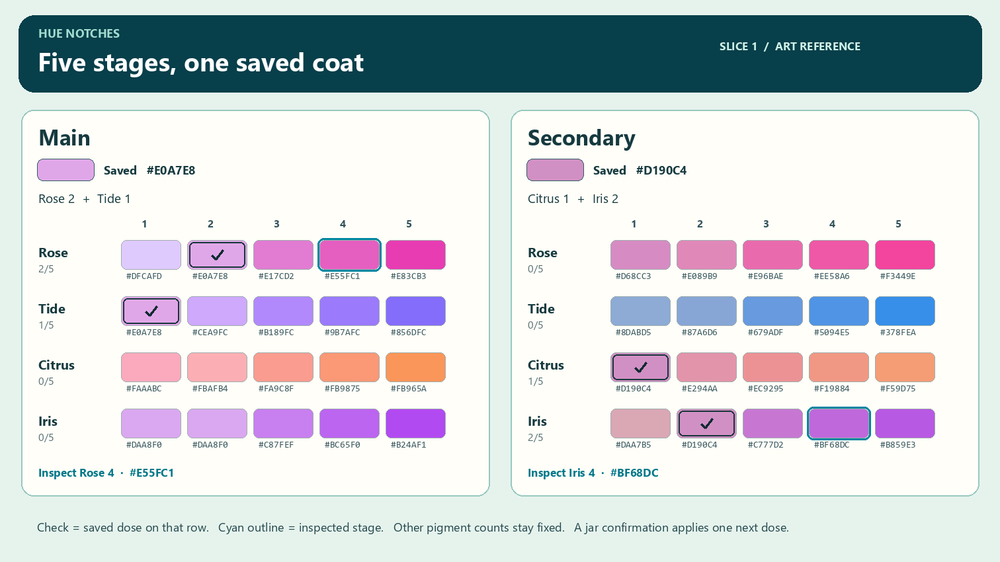

# Care feedback · slice 1 art direction

Private v316 / c549451 is the starting build. This slice covers whole pet loading, the existing four pigments, merge response on the pocket device, and occasional garden coos. The authored sheet and audio files are creative references. A native capture is required to accept how they render and play in Roblox. [Expansion proposal](PET-CARE-EXPANSION.md) · [Released baseline](PLAY-BUILD.md)

## The first frame

Show the baby's complete native recipe on the first frame it is visible. Keep its defining silhouette, eyes, mouth, paws, selected charm and saved colors. Ovelle needs both cuffs, Tikket needs its connected mittens, and Nuum needs its cheek fold. Build the authored replacement out of view. At the handoff, copy the sampled root, size, expression, facing and active appearance into the complete replacement. Swap on one rendered frame. In a stationary matched view, the soles stay planted and the head stays at the same height. Use an instant swap so the two bodies never appear as a translucent double pet. On a denied or late head, the complete native baby can keep playing.

Test owner, nearby visitor, hatch and saved portrait with an initially unavailable head. Capture the first visible frame, successful upgrade and a swap/rejoin that invalidates a late callback. All seven rigs and the selected Dot/Ring/Pebble must keep their identity. Mesh download or render failure cannot change stock, equipment, Stars or receipts.

The first matched Studio strip showed a central forehead seam on Tikket and Kiprik, and a recessed row of teeth on Zivvi. The native-only correction uses one continuous face ellipsoid with two shallower horizontal shoulder fills behind it. Preserve the source piece's existing tilt. Zivvi gets a shallow, curved three-part smile with each original tooth advanced 0.014 definition studs so its tip clears the lip. The authored meshes, eye landmarks, root, charm and feet keep their exact transforms. Verify the correction in a second matched front/three-quarter strip. [Native fallback art overrides](assets/care-feedback-2026-11-09/native-fallback-overrides.json)

## Four hues, five actual result chips

Each chip shows the color obtained by setting only that row to stages 1–5, holding every other count in the same channel fixed. Read the actual v316 resolver. Select Main or Secondary and show the original white or gray base underneath the result. Keep the saved portrait on the left in wide layouts, above a scrollable column in portrait. The labels **Rose 2/5** and **Inspect Rose 4 · #E55FC1** distinguish the applied state from a temporary selection. The saved chip gets a check, each unapplied chip a quiet dark keyline and the inspected chip a cyan double outline. Native focus adds a visible boundary and accessible stage label. When the saved chip is also inspected, preserve the check. Each chip has a 44 px target even when the color strip inside is smaller.

Inventory still initiates a use. A confirmation shows pet, channel, one jar, the next dose and exact result color. Inspecting stage four at saved two cannot spend four doses, undo one, or recolor the portrait. Clear or recompute inspection when the target/channel/authoritative counts change. Reset has its own existing confirmation.

One Reset jar clears the selected channel. Name the pet and Main or Secondary, show the nonzero counts that will be lost, the restored white or gray, and the stock after use. Resetting both channels takes two separate confirmed uses.

The saved portrait is alive even while a different notch is inspected. Reuse the existing production idle sampler at 15 Hz in the visible viewport: a .014-stud breath over 3.2 seconds, a subtle two-degree glance, a 150 ms blink and at most .045 stud of charm lift. Keep the camera framing and feet steady, pause hidden portraits and freeze decorative motion under Reduced Motion. On a stock-only update, keep the portrait and its current pose; a saved color change may tint the visible pet in place. An editor portrait has no incidental voice.

The reference Main has Rose 2 and Tide 1. Both saved-row chips resolve to **#E0A7E8**. The reference Secondary has Citrus 1 and Iris 2. Both resolve to **#D190C4**. These are flat sRGB examples; the lit baby will show shading. [Exact sample values](assets/care-feedback-2026-11-09/hue-notch-examples.json)

## The handheld's recoil

Only the decorative case/rim moves. Keep button hit regions, aim, field, viewport, HUD, backdrop underlay and camera fixed. Use accepted merge events with the current board serial. A result tier and a clear have different emphasis.

| Result | Case amplitude | Duration |
|---|---:|---:|
| II | 1 px | 100 ms |
| III | 2 px | 120 ms |
| IV | 3 px | 140 ms |
| V | 3.5 px | 160 ms |
| Clear | 4 px | 180 ms |

Use a single held curve, sampled from the existing presentation clock. At 16% of the duration the case recoils left and slightly down. At 44% it rebounds half as far right/up, at 75% it has a small settling motion, and at the end it returns exactly to its authored layout position. Normalize the peak vector and cap total displacement at 4 px. A chain may increase amplitude by 10% within that cap. A stronger event can replace the current one; a weaker event cannot sum with it or erase its peak. Clear the effect on blur, serial change, recap, reflow, Reduced Motion or exit.

Keep the local halo and jelly squash at the merge position. Start the six existing pooled fragments on the event, dim them as they widen, and let the device movement communicate the extra weight. Use the current tier color and current merge/chain sounds. Reduced Motion has zero positional recoil or scattered fragments. The restrained local ring is sufficient. Set the decorative backdrop motif to **88% of its otherwise authored opacity** over the opaque theme tint; preserve depth between motif and highlight. Confirm no 3D scene shows through, even under the lightest deck skin.

## Original idle voices and poses

The score and pose table uses seconds, degrees and garden studs. Each family has its own pitch contour and mouth/eyelid timing. Keys offset the current neutral pose and return to zero. Interpolate through the existing 15 Hz expressive sampler; leave the root, planted feet, charm position and authoritative action alone. A visitor sees ordinary garden behavior; this incidental presentation grants nothing. [Authored cue, pose and jolt data](assets/care-feedback-2026-11-09/creative-profiles.json)

| Family | Voice and visible gesture | Local original draft | Available v316 playback fallback |
|---|---|---|---|
| Zivvi · Vezzi | Two rounded rising syllables with a tiny pause. Tilt left, let the eyelids soften, then give a smaller rightward answer. 0.43 s. | [Zivvi coo](assets/care-feedback-2026-11-09/coo-zivvi.wav) | `pet` · 104178433438245 · pitch .85 |
| Ovelle | One smooth rising then falling vowel. Both cuffs lift slightly toward the chin and settle before the eyes reopen. 0.52 s. | [Ovelle coo](assets/care-feedback-2026-11-09/coo-ovelle.wav) | `puddle` · 79464813520035 · pitch .88 |
| Tikket · Kiprik | Two short inquisitive syllables. One mitten opens a fraction on the first, then lifts a little farther on the answer. 0.39 s. | [Tikket coo](assets/care-feedback-2026-11-09/coo-tikket.wav) | `wick` · 73790979677763 · pitch .90 |
| Nuum · Nolli | One low rounded hum dipping and lifting. The lids lower slowly, the head tips a few degrees and the close is gentle. 0.60 s. | [Nuum coo](assets/care-feedback-2026-11-09/coo-nuum.wav) | `orbit` · 105659319683342 · pitch .83 |

Open the alternate little O-mouth only for a vocal pulse and close it with the note. Preserve the real blink, hidden teeth, glint alignment and higher-priority expressions. Keep rolls ≤4°, nods ≤3° and hand travel ≤.05 stud. Reduced Motion retains only a slight mouth/eyelid response, with no head/cuff or limb lift. Never start a second gait, keylight, camera tween or music loop.

Choose a 35–75 second wait between eligible quiet garden beats per listener. Prefer the owner's visible, idle pet; a nearby visible visitor is eligible only within the shared audible range. Play at most one incidental voice at a time. Suppress it during focus/petting, hatch/menu/board, active play, character removal, mute, backdrop handoffs or an existing close cue. Losing eligibility cancels the cue and drops missed opportunities. Do not schedule a burst on return. Use a modest trial playback gain of .18 for the owner, tapering for visitors. A failed voice can skip the beat. Existing petting/hatch cues and music retain their own ownership.

The four draft masters are original 44.1 kHz mono PCM16. Their durations and hashes are in the [audio manifest](assets/care-feedback-2026-11-09/audio-manifest.json). No new Roblox playback ID is established for these files. Until the originals are uploaded and actually heard via a permitted asset in the intended place, use the matching v316 family cue and identify that substitution in the release evidence.

## Acceptance evidence

1. Show all seven complete recipes, a cold or deliberately delayed head and an invalidated load. Compare matched front and three-quarter frames before and after a successful swap.
2. Inspect a mixed Main and an independently mixed Secondary using normal input, then confirm a single use and cancel another. Check actual hexes against the reference, nearest accessible controls, Large/Largest desktop and short landscape.
3. Record an accepted small merge, a late large merge/clear and overlapping chain. Compare case movement at native resolution, return-to-rest, stationary field/input, reduced response and opaque backdrop.
4. Record the eligible coo pose in normal roam, a forced QA timing sample for each family, and interruptions during contact/menu. Label synthetic timing separately from ordinary idle. Report the audio ID actually played and listen for clipping, over-loud cues or a voice persisting after focus/exit.
