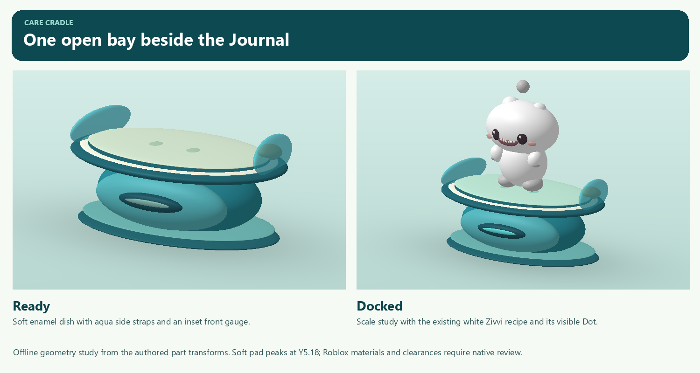

# Carrying a baby and the Journal care cradle

**Creative build contract.** Private v326 / 3c6b61b is the fallback. This proposal adds one bay at the existing Journal service location. The ordinary Menu and Journal customize shortcuts remain available. Geometry coordinates below come from the native part definitions and the v326 station. Studio screenshots, motion, actual input and collision acceptance are separate evidence. [Implementation brief](CARE-CARRY-MACHINE.md) · [Pet care proposal](PET-CARE-EXPANSION.md) · [Existing complete-model behavior](CARE-FEEDBACK-ART.md)

## One machine at the Journal

*Offline geometry study.* Both views use the authored part transforms. Zivvi in the right image is a scale reference assembled from its existing recipe. The study does not establish Roblox glass appearance, avatar clearance or live placement.

The existing JournalTop at **(11, 6.51, −6.30)** already owns the seven-stud E/X prompt. Its size is 5.15 × .24 × 2.25 studs. The tabletop's front edge is Z −5.175. Keep the guidebook, sign and that single prompt recognizable. Place a low enamel cradle just in front of the table and slightly to its right.

**Dock datum (11.75, 5.18, −4.20)** means the top of the cushion and the pet's sole anchor. All geometry coordinates in the JSON are relative to that datum, with +Y up. **+Z is the open front.** Players approach from approximately (11.75, 4.025, −1.60), looking toward −Z. A docked pet looks back toward the player, facing +Z. The front gauge also faces +Z. Parent's native baseline rays hit Floor at Y4.0 at the pad, front approach and both candidate approach shoulders.

The 15 parts include 14 visible pieces and one collidable, queryable central support. The conservative world bounds span X 10.237–13.263, Y 4.026–5.456 and Z −5.135–−3.265. The rear clears the Journal tabletop front by .040 stud. Do not add another prompt, broad collision plate or PointLight. The existing table and bridge routes retain their original geometry. Validate the solid support, avatar shoulders and pet-width paths at runtime, especially the diagonal approaching the bridge from the southwest. A center-point floor ray alone does not prove passage for an avatar.

The dark teal foot supports a rounded turquoise pedestal. A thin cream enamel rim surrounds the sage cushion. Two short lagoon-glass straps flank the baby below its face. The amber thumb dial is an art detail. The central gauge and cushion shift only on an authoritative change of occupancy. When free, the cushion is **#DDF1D9**, paw contacts **#B7D7BC** and the gauge bar **#80B6AE**. When occupied they become **#C6F2DF**, **#95E0CE** and **#62DEDC**. Use SmoothPlastic for enamel and gauge, mildly tinted Glass at .24 transparency for the straps. All status surfaces are nonemissive. The prompt also states availability, and the bay remains readable with color perception differences. [Exact materials, dimensions and hull](assets/carry-machine-2026-11-09/cradle-geometry.json)

All 14 visible components use nonuniform SpecialMesh spheres on their authored XYZ dimensions. Native cylinder trials narrowed the rim and cushion to small disks. A softly rounded pad keeps its peak at Y5.18, preserves the full 2.52-stud authored width, and drops less than .01 stud beneath the central paws. The single invisible box remains the physical support.

## Carry and dock poses

Use the existing pet identity, saved palette, selected charm and complete native/authored rendering path throughout. The host owns carry and bay state. Presentation follows it. Never attach a separately simulated physics pet to the character.

- **Carry.** Resolve UpperTorso or Torso, with forward measured along its LookVector. Place the baby .12 stud to one side, forward by torso half-depth + the baby's rear half-depth + .10 stud. Begin with soles .75 stud below torso center. Lower the cradle if necessary so the visible charm's highest point, including the .06-stud motion reserve, stays at least .15 stud below the chin. Use actual bounds at the real world scale; enlarge the forward gap for very small torsos if needed. Keep the baby at its normal size. Face outward, about 8° off the torso heading, and give the upper body a gentle 4–6° backward lean. Do not bounce the whole pet with every footstep.
- **R15.** Aim both actual hands beneath the lower sides of the belly. Target X is ±.33 of the baby's body width, Y is .20 of its body height, with the left support .08 stud higher. Reach from the actual shoulders and keep elbows outboard. Release the carry pose immediately on an invalid identity or exit. Let the running arm animation resume with its correct prior controller.
- **R6.** Orient each rigid arm from its own shoulder toward the corresponding support point. A practical trial limit is 64° forward and 28° inward. Never stretch or bend the rigid arm. Front and side views must show a credible cradle with the face clear even when avatar dimensions or clothing differ.
- **Dock.** Center the same pet at the sole datum, facing the open approach. Feet rest on the pad, upper body relaxes by .018–.025 stud according to family, and the head keeps a small family-specific tilt. Normal blink and charm motion continue without incidental garden voices. Keep both feet stationary through editor tabs, notch inspection and charm hide/show. New equipment after a committed switch uses its own bounds.
- **Transition.** Apply the confirmed state immediately and allow a local visual blend of at most .18 s. Pickup closes pet focus through the existing camera owner once. A set-down uses the server-selected dry support and safe reach. Use an immediate pose under Reduced Motion. Clear walk planting anchors when carried; rebuild them on supported set-down so the next stride starts from the confirmed ground.

The widest authored body estimate is Nuum at 1.545 studs. Zivvi's Dot reaches 1.862 studs above its soles. The other five retained forms have their own dimensions and poses. Use the measured rendered model for arm/charm clearance, including hidden charms, Ring/Pebble and the later full-rig handoff. Keep the gaze and blink visible rather than filling the owner's face with the Dot. [All seven profiles and arm targets](assets/carry-machine-2026-11-09/carry-and-dock-poses.json)

## Controls and feedback

| Context | Composition and copy |
|---|---|
| Petting | **Back** at safe upper left; separate **Pick up** at upper right. Keep both at least 44 px in each axis. Reserve the larger button width plus a gutter when laying out the top hint on short phones. If the hint needs a second line, measure its actual native text size and keep it above the pet. A pending request may read **Picking up…**. Rejection leaves Back, camera and normal input available. |
| Carrying | **Set down** in the bottom-center safe lane. Leave the movement thumbstick, jump and upper Menu/Deck shortcuts accessible. Near the Journal, its existing prompt becomes **Place [name]**. If another player occupies the bay, show **Bay in use** and keep the baby held. On a rejected ground position, give a short reason such as **Find clear, dry ground**. |
| Docked editor | Header has pet name, **Change pet**, Stars and the bare close ×. Keep the two released **Hue** and **Charm** tabs and their live saved portrait. Anchor **Pick up** and **Set down** in one lower action row; scroll the controls above it. On short landscape use the existing compact portrait/controls columns. The first chip row, Close and both exit actions must remain usable at Largest preference. The same dock actions do not appear in ordinary fast menu customization. |
| Switch | Show only owned pets. **Make [name] active?** names the change and requires one explicit Confirm. Cancel returns to the same tab and bay. A committed equip survives bay expiry and follows the owner; it cannot reclaim another player's new occupancy. |
| Close, walk away or interrupted | Release the exact bay to ordinary follow at validated dry support, preserving the durable companion and its saved appearance. No stranded cradle pose or second visible baby. A busy or unsafe state never traps an owner in the editor. |

## Native review

1. Walk up from the lawn on both approach shoulders. Prove one Journal prompt, one bay claim and correct behavior for two competing owners. Record the table's book, machine, feet/face/charm and existing bridge path at avatar height, in noon and at night.
2. Record ordinary Pick up from petting, a walking carry, Place, Hue/Charm, a committed switch, Pick up and safe Set down. Check observer appearance and wallet/stock invariance. Record refused wet/obstructed placement, interruption and a late equip from an expired bay separately.
3. Capture front, side and rear three-quarter of default R6 and R15 carrying a low broad baby and a tall baby with Dot/Ring/Pebble. Check all seven bodies against the cradle, charm/chin separation, actual wrist support, untouched face, dock soles, ordinary camera and transfer through an asynchronous native-to-authored upgrade. The rear view may naturally show the owner's back. Never replace the player's walking camera solely to expose the pet.
4. At short landscape/Largest, verify petting hint/Back/Pick up, bottom-center Set down against touch controls, compact dock editor and switch/exit confirmations. Test controller selection and Reduced Motion. Keep ordinary screenshots, setup fixtures, source geometry and local-only observations labeled separately.

## Static Studio art review

**GO for the cradle geometry and materials at noon and midnight.** The soft oval pad spans the teal dish between its two low straps. Zivvi's feet meet the cushion, its face is clear, and the unlit gauge stays secondary to the pet at night. The Dot overlaps the guidebook in this three-quarter view. Check its separation from the ordinary open-front approach when testing Place. [Noon fixture](artifacts/carry-machine-2026-11-09/cradle-final-oval-noon-FIXTURE.png) · [Midnight fixture](artifacts/carry-machine-2026-11-09/cradle-final-oval-midnight-FIXTURE.png)

These isolated renders place a static pet at the dock datum. Actual occupancy transitions, pickup/carry motion, avatar hand support, visitor behavior, live editor controls and short-phone input remain separate acceptance gates.

## Earned carry and editor review

**GO for the owner’s R15 carry.** In the 18.33-second recording, both hands stay under the lower sides of the earned Zivvi as the owner walks, turns and stops. The legs retain their running motion. The face and floating charm stay clear of the forearms. The inspection camera tracks from a lower three-quarter angle and briefly passes scenery. In ordinary play the owner approaches the open cushion and receives one **Place Zivvi** prompt beside the existing Journal and bridge. [Walking film](artifacts/carry-machine-2026-11-09/actual-fixed-walk-turn-stop-CAMERA-FIXTURE.mp4) · [Ordinary approach](artifacts/carry-machine-2026-11-09/actual-machine-approach-final.png)

**GO for the machine editor at Largest text in the 733 × 307 safe area.** Charm shows Zivvi from feet to charm, **Change pet**, all three shape choices, and **Pick up** and **Set down** together on entry. Selecting Ring leaves the whole pet visible. Hue shows the saved pet, active channel in the header and all five Rose swatches above the footer. Scroll to reach the full Main/Secondary selector and further fruit rows. The earned owner used Place, edited the charm and returned the pet to dry ground with 6 Stars. These captures use Studio phone emulation. [Charm](artifacts/carry-machine-2026-11-09/actual-machine-largest-phone-charm-final.png) · [Selected Ring](artifacts/carry-machine-2026-11-09/actual-machine-largest-phone-ring-saved.png) · [Hue](artifacts/carry-machine-2026-11-09/actual-machine-largest-phone-hue-final.png)

Isolated pose checks cover the seven pet profiles and both avatar rig types. The Studio launcher stopped the two-client run before either player joined. Actual R6 owner input, a live visitor's view and physical-device ergonomics remain unverified in this review. [Launcher evidence](artifacts/carry-machine-2026-11-09/local-two-client-studio-version-blocker.png) · [Visual gallery](artifacts/carry-machine-2026-11-09/GALLERY.html)
