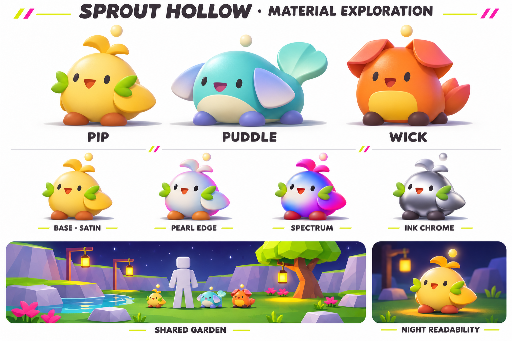

# Sprout Hollow baby garden

**Proposal for approval · 8 November 2026**

This is a design proposal. The garden redesign, new rigs, currency, items and shop are awaiting your feedback. The first two illustrations explore shapes and customization. The material direction incorporates the painting and both video references supplied on 8 November.

Make the garden a place where players can watch their baby pets do things together. Start with one expressive Pip, a neighborhood-sized clearing, and two players seeing the same greeting. Keep the handheld field game as the way to earn nectar. Introduce training and item eggs only after watching and interacting with a pet is enjoyable on its own.

**Use V2’s stronger body colors and satin base.** Keep the small beak from the first Pip sheet so the quail reads even with its mouth closed. Try Pearl Edge as an earned finish, Spectrum as the more animated earned option, and Ink Chrome as a previewable fixed-price cosmetic candidate. All four are art targets for a native render test. The baby shapes and finishes can be approved separately.

## The first minute

Pip comes up to the player’s shin. It looks up, takes two short hops toward a fallen seed, misses it, then nudges it with its beak. When another player's Puddle arrives, Pip pauses. Puddle flicks its tail and both turn toward the creek. Either player can walk around and see the exchange from a different angle. A player can tap their own Pip for the existing close portrait, rub to get an immediate response, or simply sit and watch.

Build this moment within view of the existing arrival point. Keep the current routes for the first pet prototype. In the art pass, shape an open lawn into a shallow creek cove, with rounded, staggered rock ledges enclosing its far edge. Put a flowering tree beside a shallow crossing, a workbench lantern at one approach and the field journal at the other. The creek bends back into the clearing so returning pets repeatedly pass each other. Most of the middle stays open enough to read a shin-high animal from across the path. At dusk, amber lamps illuminate the path and the pet’s face stays readable against the grass. The existing day/night cycle continues through the same garden.

The reference garden puts recognizable destinations around water, makes a first visit immediately rewarding and gives each later area a different atmosphere. The viewer and gallery show how face, silhouette, colors and accessories can create variety within a small cast. Those are the design ideas behind this proposal. Its creatures, landmarks, voices and music would be original. [Garden reference](https://chao-island.com/info-center/basics/gardens-sa2.html) · [3D viewer](https://chao-island.com/viewer/) · [Gallery](https://chao-island.com/gallery/)

## Three baby designs

[First silhouette exploration and action poses](assets/concepts/garden-direction/garden-babies-v1.png)

Use the existing family names and ownership IDs. Each proposal has a recognizable side profile, a face readable from standing height, and an action that gives the silhouette a purpose. Paint a front three-quarter view, a side view and one action pose against the same avatar ruler. Target a body height around a quarter to a third of a reference avatar, roughly 1.35–1.65 studs for the first scale test. Measure the floating ornament separately. The close portrait and hatch camera still frame the actual mesh tightly.

| Family | Silhouette and finish | Behavior to prototype |
|---|---|---|
| **Pip, seedling quail** | Buttercream pear body, large rounded head, little cinnamon beak, two asymmetrical leaves sweeping sideways, folded winglets and terracotta seed feet. A blush patch carries the face in silhouette. | Pecks once, tips a little too far, balances with a wing, then trots to its owner. Start the playable prototype here. |
| **Puddle, tide calf** | Low blue-green pebble body, sideways fan ears, milky belly, short flippers and a broad paddle tail. A violet cheek spot anchors the eye line. | Crouches at the water, belly-flops into the shallows and sneezes two bubbles. On land it scoots and looks back for company. |
| **Wick, lantern cub** | Warm apricot body, paired folded petal ears, honey-colored belly window, charcoal bean paws and a small cupped tail. A glossy ear edge catches the evening light. | Sits, rubs one eye with a paw, leans toward the nearest warm lamp, then perks up at a visitor. |

These are art directions for existing pets. Orbit remains available to owners throughout the transition. Its eventual baby rig and the three rare coats deserve the same side-profile, small-screen and night tests. Preserve Bloom Pip, Foxfire Wick and Eclipse Orbit as the catalog’s named variants. A rare’s special color or flower should remain legible with any equipped ornament.

## What players can customize

[See Pip’s four halo shapes, finishes and day/night concepts](assets/concepts/garden-direction/pet-customization-v1.png)

Give every baby one pearl-like dot floating a short distance above the head. The dot briefly bobs when the pet starts an action. Keep its silhouette steady in reduced motion. Let players preview shapes and finishes on their current pet in daylight and at night before spending anything. Use a separate side pin or focus-only badge for family mastery so players can recognize what was earned even after changing the halo.

| Slot | Starting and earned examples | Optional fixed-price examples |
|---|---|---|
| Halo shape | Default pearl dot. Earn a four-point spike through a first field goal, a ring through garden training and a puffy heart through several care activities. Keep an earnable route for each requested shape. | Later, offer a clearly pictured alternative silhouette such as a ribbon knot. |
| Color and finish | Milk, sea glass and apricot tints. Unlock a two-tone edge by spending earned Garden Buttons. Shape and tint are independent. | Display the exact mother-of-pearl or opal finish being sold on the player's own pet. |
| One accessory | A seed pouch or patterned neck bib with clearance around the face, halo and family crest. | A coordinated, identifiable cosmetic set sold directly. Include the individual pieces and preview the whole set. |

The customization sheet shows the same Pip pose four times. Interpret its **Heart · Shop** label as a known-price base heart available for earned Buttons. A separately previewed finish can be an optional Robux purchase. The reference games also use a floating symbol to communicate emotions. In Sprout Hollow, the equipped shape stays recognizable when the pet changes mood. Happiness comes through a crinkled eye, a wingbeat or a brief pair of petals beside the cheek. [Reference expressions](https://chao-island.com/info-center/advanced/expressions.html)

Test cosmetic prices privately. Robux buys a displayed cosmetic. Nectar, Garden Buttons, eggs, food, training power, pity and probability boosts stay outside the paid shop. Roblox treats indirect paid-currency purchases of random items as paid random items. [Roblox paid random items](https://create.roblox.com/docs/production/monetization/paid-random-items)

## A reason to return with a small cast

The first visit should give the player a companion and something to do together. A repeat visit should offer a familiar pet with a new interaction, a visible training goal and a known cosmetic to work toward. Free petting, wandering, greetings, and field play remain available throughout the day. A daily gift is an optional bonus. There is no proposed attendance penalty, care decay while offline, daily play ceiling, paid recovery or stat loss for skipping a day.

Keep **nectar** as the currency that buys current companion eggs. Introduce **Garden Buttons** as a visibly different, earned-only currency in a later progression slice. For a private test, a successful field run grants two Buttons, a completed garden relay grants one, and three Buttons buy a training snack the player chooses. A runner can reach one snack with a win plus a relay. A garden-only player can reach the same snack with three relays. Show the payout and exact use before the activity. These amounts are test values. Tie each award to one completed server-validated activity ID.

Try two trainable values, **Agility** and **Focus**. A chosen snack adds a known amount to one stat on the equipped, owned pet. Show the effect now, such as steadier stepping across lily pads or a better response to a rhythm cue. Keep current family mastery and its badges separate. Store training per owned catalog pet, so a duplicate still advances its family under current rules and never creates an invisible second baby. Later, try a race or cooperative obstacle course before turn-based exhibition battles. Battle balance, matchmaking, moves, breeding, trading, other-player feeding and PvP are separate approval decisions.

## Can eggs contain items?

**Yes. Add a clearly named Supply Egg alongside existing Companion Eggs.** A Supply Egg from a relay contains one training snack. Let the player choose which snack before opening and show the exact quantity. Its reveal can be delightful even when the owner knows what is inside. It spends or grants no rare-pet pity. This gives players a useful egg to open after they own the cast.

Mixed Meadow currently costs 18 nectar and offers seven catalog outcomes. Sprout Focused costs 24 and offers Pip or Bloom Pip. Seven consecutive non-rare companion hatches make the next companion egg rare. Keep those price cards, the actual odds applicable to that player, the guaranteed first Pip, and existing duplicate mastery rewards. A single mixed pet/item recipe is a possible later experiment. It would need its own outcome pool and explicit pity rules. Show complete per-outcome probabilities before spending, including guaranteed states. An item must never silently displace a promised rare pet. [Current hatch loop](HATCH-LOOP.md) · [Current catalog odds](src/shared/EggCatalog.lua)

## Art and audio production

**Material reference pass.** The 32-second `Download 2.MP4` turntable shows a small toy holding its silhouette through a full rotation. The head, headphones, paws and harder side details separate through bright gray and near-black planes. Test that contrast on an optional graphite accessory and under the chin. Keep each original baby recognizable from the back and side.

The 15-second `Download.MP4` shows white, cobalt and hot-magenta regions shifting across a rounded pet while its black eyes stay easy to read. Try this as an unlockable **color-wave finish**. Paint a broad, soft gradient around a cheek, flank or halo using a shared UV texture. In the more vivid preview, extend the bands over the entire body while protecting the eyes and each family's identifying feature. Prototype a slow transition between authored color states on a few visible mesh regions. Reduced motion holds one chosen state. The clips show the desired appearance and movement. They contain no shader source. Validate this native Roblox approximation against a still and a short turntable before offering the finish. [Turntable frames](artifacts/garden-direction-2026-11-08/references/clip-1-contact-sheet.jpg) · [Color-wave frames](artifacts/garden-direction-2026-11-08/references/clip-2-contact-sheet.jpg)

The supplied JPEG identifies the painting as Robert Nava’s *Fire Talk* (2019). Its chalk-white ground, pale blue sky, green grass, golden yellow, coral, magenta and charcoal give us a more vivid starting point than the initial pastel sheets. Translate that playful color contrast into the original quail, tide calf and lantern cub. The painting’s figure and drawn marks stay in the reference.

| Proposed color family | Use in the garden and pets |
|---|---|
| Chalk `#F4F2E8` and pale sky `#A8D6ED` | Air, creek reflections, bellies, soft edges. Keep enough light open space around a pet to read its profile. |
| Grass `#20853F` and acid lemon `#DFEB35` | A broad lawn and small charged accents. Use lemon at Pip’s sprout or on an earned halo. |
| Golden yellow `#F2B82F` and flame coral `#FA714C` | Pip’s main hue and Wick’s hot ear/belly accents. Give each family one dominant hue. |
| Magenta `#B73779` and charcoal `#2E292D` | Small cheek or accessory details and deliberate dark eyes, paws or face edges. Puddle pairs sky-cyan and chalk with one magenta fin detail. |

These production swatches are a color interpretation of the JPEG. Give the garden an open grass-green base, pale sky/cyan creek and one blossom landmark. Night shifts the background toward deep blue-violet, with concentrated amber pools along the path. Keep the strongest pearl reflection on the halo. Reduce the broad white forehead glints in the first sheets by about half for the initial rig test. The sheets have yet to be rendered in Roblox.

Start with a milk-glass body in SmoothPlastic and a pale painted rim. For an authored mesh, use a UV-mapped `MeshPart` with a shared `SurfaceAppearance`, low metalness and a satin roughness map. At night, try a very faint emissive base across the cheeks, torso and feet, with stronger emission reserved for the halo and Wick’s belly. Preserve visible lamplight, socket shadows and a darker underside so the round body keeps its volume. Try a violet-to-mint edge tint under that base. Roblox exposes `EmissiveMaskContent`, `EmissiveTint` and `EmissiveStrength`. The art test should match a low-graphics SmoothPlastic fallback and a higher-quality mesh, with colors and contrast checked in both the actual garden and the hatch `ViewportFrame`. Put local lights at the tree, workbench and crossing. A lit sign or pale rim lets a visitor enter the scene without requiring another moving point light. [Roblox material reference](https://create.roblox.com/docs/art/modeling/material-reference) · [Emissive masks](https://create.roblox.com/docs/art/modeling/surface-appearance) · [ViewportFrame](https://create.roblox.com/docs/reference/engine/classes/ViewportFrame)

Keep the current music available. For comparison, commission one original alternate 64–90 second garden loop around 88–96 BPM. Start with a rounded electric-piano chord, a soft plucked answer, springy bass and a lightly swung brush rhythm. Leave four bars of breathing room for pets and water. For night, use the same original pulse at lower intensity with a bell answering a descending three-note phrase. Record a tiny original voice for each family and limit visitor chirps by proximity. Existing music, SFX, mute and reduced-effects preferences keep their roles. Compare quiet daytime, lamplit night, hatch ducking and eight visitors on phone speakers before choosing a default. Use licensed or original recordings throughout. [Roblox sound groups and spatial playback](https://create.roblox.com/docs/sound/objects)

## Shared pets and ownership

Sprout Hollow already renders a local pet and up to six nearby visitors’ companions within 72 studs. Each client reads confirmed equipment and mastery, then positions each visitor’s pet beside its owner. Extend this renderer so both people can watch the same autonomous action. Publish owner ID, catalog ID, confirmed cosmetic IDs, behavior, target landmark or peer, start time and generation. A joining observer receives the current snapshot. The server chooses short routes on a small walkable waypoint graph, handles arrival and peer greetings, and despawns on player exit or mode change. Clients interpolate poses from the same event and apply their own visual/audio quality settings. Give the local owner priority when entering focus, returning to roam or switching pets. Equip/rejoin changes the generation and retires old presentations. [Visitor companions](src/client/RoomCompanions.lua) · [Existing follow behavior](src/client/PetFollow.lua)

Try four autonomous states first. Pets follow, investigate, play or rest. Make a greeting a coordinated pair action with one shared start time and an interrupt when a participant leaves. Begin with a 2–4 Hz server decision budget and client interpolation. Keep a cheap location anchor for distant pets, promote nearby pets to full expressions, and prioritize the owner's companion during focus. Stage eight players while retaining the six-visitor render budget, then profile a crowded server. Count active rigs, mesh parts, voice instances, state updates and warmed frame times separately. Confirm a newly streamed visitor appears at its current garden location. [Roblox multiplayer runtime](https://create.roblox.com/docs/projects/client-server)

The owner alone equips, feeds and spends. Other players can wave and both clients can see the greeting. The server checks ownership, range, sequence, activity completion and wallet before any progression write. Use the existing revision/transaction/receipt pattern, including ambiguous retries. The current persisted hatching subrecord is v4. Migrate new fields additively and preserve sparse inventory bits, family mastery, pet award state and pending hatch IDs. A previously saved pet result must still reopen as a pet. Approve, version and test the separate Supply Egg result kind before shipping it. [Hatch persistence](src/server/HatchProgress.lua) · [Pet catalog](src/shared/PetCatalog.lua) · [Roblox client-server boundary](https://create.roblox.com/docs/scripting/security/client-server-boundary)

## Build gates after approval

1. **Playable art proof.** Build one Pip, one halo and three behaviors. Capture beside an avatar at noon/dusk/night and in the existing close portrait. Compare with the concept sheet at phone size. Approve the silhouette before producing Puddle and Wick.
2. **Two-player garden.** Ship one clearing to private test. Two clients see the same owner, pet, halo, destination and paired greeting. Test join mid-action, owner leaves, pet swap and remote input against another player's pet. Profile eight pets and 20 focus/return cycles. Keep the existing field, hatch and music preferences usable.
3. **Earned progression.** Add Buttons, one repeatable relay, two previewable halo unlocks and one chosen snack. Test redelivery, stale revision, reconnect mid-save and migration of a sparse roster with a pending rare. Playtest whether a player can name their next reward after one visit and voluntarily return to visit or train a particular pet.
4. **Extend only after playtest.** Complete the other family rigs and rare coats, refine the two music stems, test a cosmetic shop with guaranteed items, and evaluate races. Author battle mechanics as a separate proposal after players care which pet they train.

**Please approve or revise three choices** before implementation.

1. Begin with a two-player, one-garden Pip prototype and the existing day/night cycle.
2. Choose which of the three baby silhouettes to prototype and whether V2’s stronger satin palette is right. The independently customizable floating halo works with each finish.
3. Preserve Companion Eggs, add explicitly labeled earned Supply Eggs later, and limit any future paid shop to guaranteed cosmetics.

The proposed numbers, stat names and art palette can change during private testing. The supplied JPEG and sampled frames from both MP4s were reviewed on 8 November.
