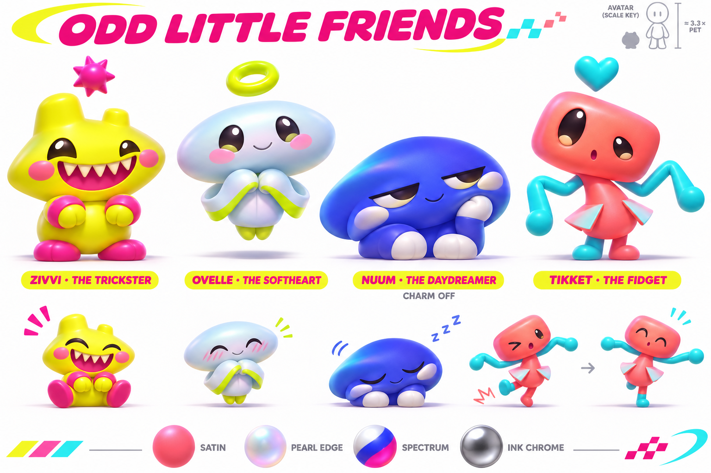
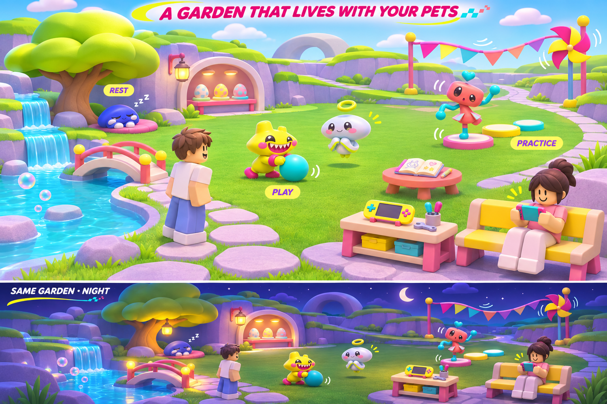

# Sprout Hollow · a garden for strange little babies

**Revised design proposal for approval.** Build a small social garden around four original fantasy babies. A visitor should recognize their pet from across the lawn, see what it is trying to do, and have a reason to stay for its next interaction. Stars are the single earned currency. The roster, materials, progression and migration below are proposed. They have not been implemented or published.

Use the four profiles and expressive faces shown here. For the Roblox rig test, soften the strong forehead reflections and reduce each overhead charm to roughly one-quarter of its baby’s head width. Keep the more reflective looks for the finish preview. Nuum’s charm-free pose should be just as recognizable in a crowd.

## The first minute

A player arrives beside a low creek crossing. Zivvi has just shoved a wobble toy farther than it meant to. It watches the toy roll, bares a huge toothy grin, then hops back when the toy tips toward it. Another player’s Ovelle drifts over and catches the toy between its curved cuffs. Both players see the same exchange. A third baby sleeps in the raised nook across the water. The player can join the game, rub their own pet, or open the handheld for a field run.

Offer the first-time player a guaranteed choice among the four babies after the welcome board. Let them see each baby idle and greet before choosing. The welcome credit becomes six Stars. Keep the first visit free of separate wallets, timers or obligatory chores.

## Four new babies

Use four working names until the silhouettes pass a tiny-screen test. Aim for 1.35–1.65 studs of visible body on a reference Roblox avatar, around a quarter to a third of its height. The floating charm has its own clearance above the head. Judge scale from the roaming view and frame the actual model more closely in petting and hatch portraits.

| Baby | Shape and palette | An expression that carries at garden distance |
|---|---|---|
| **Zivvi** | Low, rounded diamond head occupying about two-thirds of the silhouette. Two uneven stepped corners, a squishy barrel tummy and small planted feet. Acid lemon body, hot-magenta secondary surfaces, dark oval eyes. The grin spans the cheeks with six small, pointed ivory teeth. | Squats and side-eyes a toy, widens the grin, then bounces away from its own prank. A startled little **o** mouth replaces the teeth. |
| **Ovelle** | Broad horizontal lozenge head, tiny suspended torso and two curved ribbon cuffs floating beside its arms. Pale sky-blue body with acid-lime cuffs. The gap under its feet and the sheltering arc of the cuffs give it a gentle, celestial presence. | Hovers, inclines its head, folds both cuffs around a toy and slowly offers it to another baby. It widens its eyes before a catch and closes them when petted. |
| **Nuum** | Low, broad indigo cushion with a single offset cheek fold. Two tiny slippers and one hand tucked against its face. Cobalt body and chalk-colored fold. An eyelid halfway down each broad eye gives it a sleepy, slightly spooky look. | Settles into a dent, opens one eye at a sound, yawns so widely its whole body lifts, then gives the visitor one sleepy nod. |
| **Tikket** | Tall, narrow spindle torso with a tilted, softly squared head. Long hinged elbows, two folded sail shapes at the hips and little mismatched feet. Flame coral body and cyan secondary panels. Its thin side profile contrasts with Nuum’s broad one. | Overshoots a turn, opens its sails to catch its balance, pauses in visible embarrassment, then tries again with a determined brow. |

Use one animation contract for gaze, eyelids, mouth, head tilt, torso squash, two hand anchors and foot contact. Each rig keeps its proportions and signature motion. Ovelle’s cuffs follow hand targets, Nuum can hide a hand in its fold, and Tikket’s sails have one additional flap channel. Give each baby a neutral, curious, startled, pleased, sleepy and affectionate expression. Change posture and timing as well as the face. All six must read with charms hidden and audio muted. Prototype Zivvi’s grin and Ovelle’s catch first to test a visually different pair.

## What to take from the references

Chao Island’s gallery separates child and mature forms, Neutral/Hero/Dark directions, movement or ability profiles, two-tone and monotone colors, and shiny or jewel finishes. Its expression reference combines changes in face, posture and overhead symbols. The garden makes water and cliffs landmarks a player can navigate by. The transferable idea is how several independent choices create recognizable individuals. For Sprout Hollow, body shape expresses personality, training changes a garden activity, finish changes surface appearance, and a charm expresses the owner’s taste. A mischievous or spooky pet has the same opportunities as a gentle one. Players will never need to mistreat a baby to unlock a design. Mature forms and alternate temperaments are later possibilities. [Gallery](https://chao-island.com/gallery/) · [Type combinations](https://chao-island.com/gallery/advanced-evolution/types.html) · [Two-tone examples](https://chao-island.com/gallery/coloured-chao/twotone.html) · [Jewel examples](https://chao-island.com/gallery/coloured-chao/jewel.html) · [3D viewer](https://chao-island.com/viewer/) · [Expressions](https://chao-island.com/info-center/advanced/expressions.html) · [Gardens](https://chao-island.com/info-center/basics/gardens-sa2.html)

**Keep V2’s materials and vivid palette.** The prior sheet provides surface direction. The four babies above define the new creative roster. The supplied JPEG identifies Robert Nava’s *Fire Talk* (2019). Draw on the contrast of chalk `#F4F2E8`, pale sky `#A8D6ED`, grass `#20853F`, acid lemon `#DFEB35`, gold `#F2B82F`, flame coral `#FA714C`, magenta `#B73779` and charcoal `#2E292D`. These are proposed production swatches. Keep one dominant body color, one secondary color and a dark face color per baby. [V2 material study](assets/concepts/garden-direction/garden-material-directions-v2.png)

The supplied 32-second turntable separates a small figure and its sharper accessories with gray and near-black planes. The 15-second clip shifts white, cobalt and hot-magenta bands across rounded limbs while the eyes stay dark. Test a graphite finish against the first reference and a full-body color-wave finish against the second. The clips show the intended appearance. The technique used to produce them is unknown. [Turntable frames](artifacts/garden-direction-2026-11-08/references/clip-1-contact-sheet.jpg) · [Color-wave frames](artifacts/garden-direction-2026-11-08/references/clip-2-contact-sheet.jpg)

## Optional charms and finishes

> **Superseded for pets and charms (2026-11-12):** see [PET-STYLE-GUIDE.md](PET-STYLE-GUIDE.md). The plush Bear is the reference pet. Pets start with no charm; charms (shape and position) come from an expensive Charm Egg, and wings come from the Feature Egg.

The starter charm is a small dot tinted from the baby’s **secondary** swatch. Owners can turn it off. Each owned pet saves its own visibility, chosen shape, palette and finish. Switching it off retains the selected shape for the next time it is enabled. Equipping another pet restores that pet’s settings. Preview Dot, Spike, Ring and Heart at the same position above the head, with a clear gap for head movement. When hidden, the charm contributes zero camera headroom and no input target. Put mastery in a separate small badge. Show mood through the face, hands and body even when a permanent heart happens to be equipped.

| Finish | What changes | Proposed access |
|---|---|---|
| Base Satin | Broad curved color fields, one soft highlight, readable dark face. Charm matches the secondary swatch. | Included with every pet. |
| Pearl Edge | A milk-glass rim picks up the secondary tint. Charm keeps that tint with a small pearl glint. | Earn through a visible garden milestone or buy directly for Stars. |
| Spectrum | White/cobalt/magenta bands cross selected regions. Charm uses the finish’s mapped secondary color. Preview a slow transition and a static reduced-motion version. | Earnable cosmetic egg or a known-price Stars catalog item. |
| Ink Chrome | Ink-gray and silver planes, one colored accent preserving the pet’s identity. Charm matches that accent. | Possible fixed-price, previewable cosmetic. |

Make the base Spike, Ring and Heart earnable. A separate paid shape or finish can be sold directly with a day/night preview and no training or battle benefit. Stars stay earned-only. All four egg types stay outside the Robux shop. Roblox’s paid-random-item policy also covers indirect paid-currency purchases. [Roblox paid random items](https://create.roblox.com/docs/production/monetization/paid-random-items)

## One wallet and four egg types

A player can earn Stars on the existing 24-drop field board, return to the garden and decide what the next egg is for. Preserve the current starting value, successful field payouts of six plus two for a clean win, earned contract amounts, optional six-Star daily gift and existing server-confirmed pet reward. The current five-award daily limit applies only to incidental petting payouts. Players can keep rubbing their pet, playing the field, greeting visitors and using toys throughout the day. A later garden relay can grant one Star per verified completion as an initial tuning trial.

| Egg | Example price for testing | The choice and its guarantee |
|---|---:|---|
| **Companion** | 18 Stars for the mixed recipe, 24 for a focused recipe | Hatches a baby or a defined rare companion edition. Show each result, its actual chance, what a duplicate grants, and the player’s rare protection before spending. Retain the existing seven non-rare miss threshold for companion hatches. Only a companion hatch can advance or reset it. |
| **Cosmetic** | 8 Stars | Contains only listed shapes, palettes or finishes. For the first test, show three equally likely unowned items. On subsequent openings recalculate and display the actual remaining chances. Disable the recipe once the pool is exhausted. A direct Stars price remains available for a player who wants one particular item. |
| **Training** | 6 Stars | Choose one Agility or Focus treat and see its exact stat increase before opening. The receipt names the treat, the assigned pet and the resulting stat when it is used. |
| **Supply** | 4 Stars | Lists its guaranteed contents, such as a ball and a short-lived practice toy. Supplies start garden interactions and have no hidden permanent stat value. |

A type’s icon, name, price, pool and guarantee appear together on its shop card. The commit stores an explicit reward kind and operation ID. Item and cosmetic openings use their own result art and action, such as **Equip charm**, **Use treat** or **Place toy**. **Meet** is for a companion. Reopening the same result shows the same item and quantity. Charging, selection and receipt creation remain one server transaction. Item eggs neither contribute to companion pity nor consume a promised rare. A cosmetic finish does not count as a rare companion.

For the cosmetic pool, remove items already owned before an opening and disclose the updated chances. If a saved candidate has become owned through another entitlement before reconciliation, return the full cosmetic egg price in Stars exactly once on that operation. The receipt says **Already owned · 8 Stars returned** at the proposed price. Retrying or reopening that receipt cannot refund twice.

Keep four base rigs. For migration and rare-roll variety, use up to three rare editions with an enduring identifying sculpt detail on the same rigs. Confirm names, eligibility and all numeric weights in a separate catalog review before enabling the new pool. Publish 100% of the current possible outcomes per recipe, including guaranteed states. Rarity and cosmetic finish confer no stat advantage.

## Training that players can see

Start with one persistent baby per owned catalog identity. Each player's pet has a stable saved ID tied to its roster slot. Training, per-pet appearance and equip all point to that same ID. A repeat companion draw grants one family mastery mark and preserves the existing pet’s care stats. An owned rare edition has its own playable ID. The first catalog therefore needs at most four base pets plus three rare editions per player. Existing mastery ranks, marks, challenges and badges stay separate. Additional individual instances or breeding would require a later roster proposal.

**Agility** changes how quickly the pet recovers on a short garden stepping course. **Focus** widens the input window on a paired chime exercise. For the first prototype, test three levels. A stepping recovery might take 1.20, 1.08 or 0.96 seconds, and a chime might accept input within ±0.15, ±0.18 or ±0.21 seconds of the beat. Each chosen treat advances one level in its stat. Show the before/after timing and let the player try the activity immediately. Show a clear maximum before using an item and prevent wasted consumption. Validate completion and item use on the server. The garden has no attendance penalty or offline stat decay.

A returning player can greet their pet, earn Stars on a board run or relay, choose between a pet, appearance, training or toy reward, then watch what their choice changes. A daily card can suggest a fresh toy pairing or activity. Players can continue the same activities after claiming the daily bonus. A cooperative course is the next progression test. Exhibition battles, moves, trading, breeding and ranked play need separate approval after people enjoy training these babies.

## An open garden with places to go

The image sets the relationship between places. Preserve the open cyan/green lawn and the visible bench player. The pink furniture, illustration labels and exact apparent creature scale are concept choices. Measure the pets against a standing avatar in Studio before setting their rig sizes.

Keep the handheld, hatch station, journal and workbench recognizable. Compose arrival toward a gently enclosed grass clearing, with a staggered lavender cliff and a low cascade on the far edge. A bright shallow pool bends back into the center. Across the crossing, a dry sunny ledge and shaded alcove give sleepers somewhere worth visiting. Place the wobble toy beside the shared lawn and a short stepping course near the chimes. Make the toys reachable from the center so independent pets regularly cross paths. Keep the foreground open for shin-high figures.

Animate the wheel or stream glints near the hub, a lantern pennant above the workbench and an occasional falling blossom at the single flowering landmark. Keep the existing day/night cycle. At dusk, use blue-violet ambient color and separate warm pools at the crossing, bench and nap nook. A faint emissive body floor can keep cheeks, feet and facial features legible. Reserve stronger emission for selected trim or charms. Preserve a shaded underside and a ground-contact shadow.

In Roblox, start with SmoothPlastic and painted color regions. Test a UV-mapped `MeshPart` with shared `SurfaceAppearance`, low metalness, satin roughness and subtle `EmissiveMaskContent`, `EmissiveTint` and `EmissiveStrength`. Approximate the broader bands with authored UV color gradients and slow bounded color changes on visible regions. Test the simple low-graphics version, the full garden mesh and the hatch `ViewportFrame` separately. Ship a finish only after an actual device render demonstrates its face contrast and motion. [Roblox material reference](https://create.roblox.com/docs/art/modeling/material-reference) · [Emissive masks](https://create.roblox.com/docs/art/modeling/surface-appearance) · [ViewportFrame](https://create.roblox.com/docs/reference/engine/classes/ViewportFrame)

Keep the current original music. Prototype an alternate 64–90 second garden loop at about 88–96 BPM, with rounded electric piano, plucked answer, springy bass and light swung percussion. Leave space for the water and pet voices. Night can answer the same original tune with a softer bell phrase. Compare with the current track on phone speakers before choosing a default. Preserve mute, music and SFX controls and duck the garden mix for a reveal. [Roblox sound and spatial playback](https://create.roblox.com/docs/sound/objects)

## A shared action both players can see

The current renderer already shows the local pet and the nearest six visitors’ equipped pets within 72 studs. It reads server-confirmed equipment and mastery and locally follows the visitor’s avatar. Extend that owner so a garden action has a shared destination and time. The authoritative state describes owner, pet identity, confirmed appearance, behavior, target landmark or peer, start time and generation. A joining observer gets the current snapshot. Clients interpolate pose and apply their local quality settings. Remote players can wave or join a toy activity. Only the owner can equip, feed, spend or claim a reward. [Existing visitor renderer](src/client/RoomCompanions.lua) · [Existing follow behavior](src/client/PetFollow.lua) · [Roblox client-server boundary](https://create.roblox.com/docs/scripting/security/client-server-boundary)

Use four persistent behavior states. Pets follow, investigate, play or rest. A brief greeting reserves two participants for one shared start time, then returns each to its prior activity. **A solo garden still plays.** The wobble ball rocks back toward a pet after a shove. Zivvi can pounce on it twice, glance at the owner and curl up in the nook. This works in an empty server using only the player's own pet and the toy. A visitor can join the next action when one arrives.

| Owner’s state | Owner’s view | What a nearby visitor sees |
|---|---|---|
| Garden roam | Player controls the camera and can approach toys, a pet or another player. | Avatar and equipped baby move independently around the same landmarks. |
| Pet focus | The chosen close portrait owns input. A rub gives visible immediate feedback. Back restores the player’s prior roaming view. | Avatar remains in the clearing. The baby pauses its roam action and shows the agreed receive-care pose. The visitor keeps their own camera. |
| Handheld board | The 2D field owns controls, sound and board camera. Suspend the local garden FX and care input. | Avatar remains visible holding the deck at the bench. Its baby can rest or play near that bench. AI or an AFK owner earns no care reward. Returning from the board resumes roaming without a camera takeover. |
| Leave or swap | Unbind the old pet/action generation. | Remove or replace that representation once. A late greeting or old camera callback cannot revive it. |

Start with a small walkable waypoint graph and a 2–4 Hz decision budget. Extend the current Room-only visitor filter to include the confirmed handheld-at-bench state. Keep the nearest-six render budget and profile eight nearby players. Count rigs, active voices, network updates and warmed frame times. Verify that a newly streamed pet appears at its current location. [Roblox multiplayer runtime](https://create.roblox.com/docs/projects/client-server)

## Existing players and save migration

Retire the previous roster from the creative direction. Preserve what each player earned. When implementation is approved, treat the stored balance as Stars at **one Star per existing nectar**. The internal field can retain its old storage name until a later schema version requires a rename. It represents one wallet. Historical Saved receipts keep their original amounts and operation IDs. Replace the currency name in every player-facing balance, cost, reward, odds card and receipt together.

Prepare an explicit mapping for all four legacy base IDs and all three rare IDs. One owned base maps to one new base, one owned rare to one separately identifiable rare edition, and the equipped pet maps to its corresponding new identity. Carry over exact sparse ownership, its family’s marks, rank, challenges, unlocked crest or sparkle rights, existing misses, daily day, welcome credit and pending result ID. A player who owned only two pets still owns two. An already-paid pending result resolves through the ID mapping with the original rarity, debit, operation ID and duplicate reward. It never rolls again. Preserve a previously unlocked ownership-gated Wick sticker or grant a reviewed replacement. If a retired cosmetic has no acceptable equivalent, show the proposed replacement or one-time Stars compensation before rollout. Do not apply a silent roster wipe or an unapproved data migration.

Test migration twice, an interrupted write, a reconnect with a pending rare, a noncontiguous inventory, a max-rank owner and an account without legacy data. Preview the mapping and distribution of balances on anonymized fixtures before enabling it. The current hatching subrecord is v4 and already fences retries by operation identity. Preserve that behavior for each new reward kind. [Current hatch persistence](src/server/HatchProgress.lua) · [Current catalog and pity](src/shared/EggCatalog.lua)

## Approval and build sequence

1. **Two-player vertical slice.** One clearing, Zivvi and Ovelle, one wobble toy, one greeting, six expressions, optional secondary-colored charms and one guaranteed starter. Capture at noon, dusk and night beside an avatar and in close portrait. Verify both clients see the same action and that replay, blur and owner exit clean up correctly.
2. **First complete progression loop.** Bring in Nuum and Tikket, the single Stars wallet, distinct egg cards, one stepping course and one chime exercise. Gate on duplicate-safe transactions, correct pity, replica agreement, earned cosmetics and a migration rehearsal. Ask a player to identify the next reward and demonstrate what training changed.
3. **Later tests.** Alternate original music, additional cosmetic finishes, cooperative races, a guaranteed-cosmetic shop and eventually exhibition battles. No paid random power, paid luck, hard daily play limits or attendance penalties.

For approval, choose whether the **four silhouettes and temperaments** are the right creative reset, whether the **satin palette and secondary-colored optional charms** are the right visual system, and whether **Stars with four clearly labeled egg purposes** is the right progression model. The quoted item prices and stat increments are private-test starting points.
