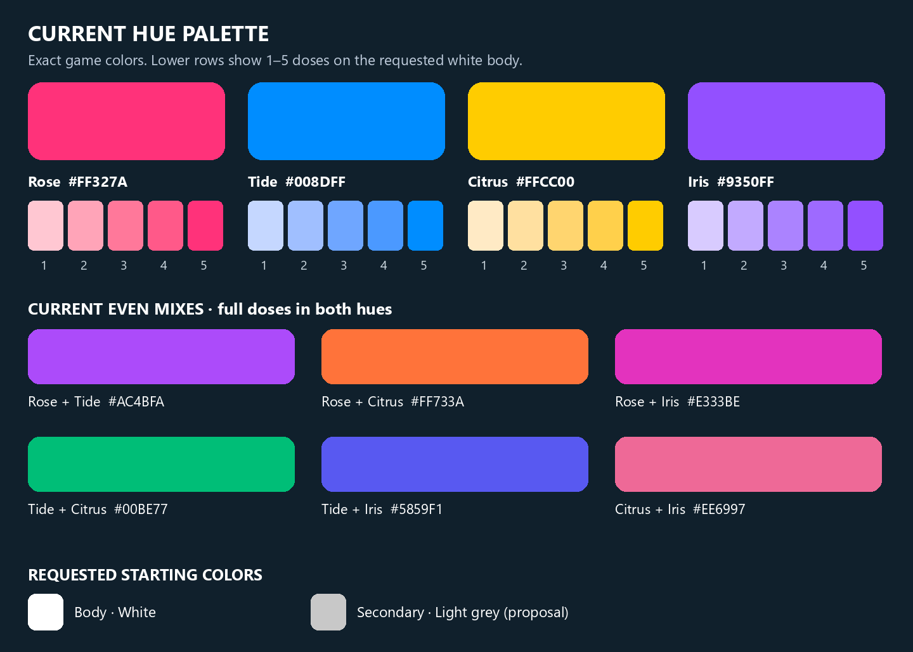

# Neutral companions and temporary four-pet hatch pool

User direction, November 9, 2026: every companion starts with a white body and light-grey secondary areas, including paws and matching floating charm. Players use the existing separate Main/Secondary hue items to supply color. The current exact Rose/Tide/Citrus/Iris anchors and 0–5 dose math remain pending user critique.

**Released privately as v316 / runtime c549451**, committed and pushed. Refreshed native Version History confirms **Neutral companions and four-pet pool - c549451 / Published**. [Proof](artifacts/pet-materials-2026-11-09/private-published-v316-c549451.png). No public/access settings changed.

## Reviewed plan

Astra creative direction and independent Sol architecture review approved a neutral baseline. Honor the user's white body (`#FFFFFF`); use achromatic light grey (`#C8C8C8`) for Secondary. Protect dark eyes, mouth, blush, ivory and pale catchlights. Do not regenerate geometry or overwrite saved hue counts.

Temporarily remove Vezzi, Kiprik and Nolli from new companion hatches. Preserve all seven stable IDs, bit indices, saved ownership, equipped visitors, hue inventory and committed historical results. Keep the existing four surviving weights 35:25:20:10, displayed after normalization as 38.9%, 27.8%, 22.2%, 11.1%. An active collection target is four; already-owned retired pets remain accessible and explicitly labeled.

Architecture review caught an empty rare-only pool at seven misses. Suspend rare-only filtering and its UI promise while the active recipe has no rare outcomes; freeze, rather than erase, stored misses. Historical result receipts still reconcile exactly once. No new pet designs are approved by this change.

## Verification

Sol 6.1 High implements and independent Sol reviews source. Verify neutral defaults/reset, protected face roles, separate Main/Secondary hue counts and old colors; active pool and probability total; all roll samples/misses including seven; retained owned/equipped retired IDs and old pending results; journal attainable targets and no unavailable hatch promises. Run native client/server suites, compile and Rojo. Record actual results before calling the change tested or published.

The material/gloss pass is a separate unfinished candidate, safely parked as recorded in PET-MATERIAL-PASS.md. Its four newly uploaded images return failed callbacks through raw-URI preload, but an ordinary LocalScript successfully loads all four through ImageLabel-instance preload. The candidate raw-URI loader still fails; fix and render verification remain pending. Image loading does not prove processed shader rendering. An unverified texture candidate cannot be published. Private v316 is the released neutral-only baseline; none of the gloss experiment is included.

## Palette for critique

This is a flat sRGB color chart generated from HueCatalog, not a lit in-game render or an approved new pet design.

## November 9 local verification

Independent Sol architecture/source review: GO. Astra reviewed the actual controlled-noon four-pet fixture: neutral palette GO; this is not gloss/emissive acceptance. Existing applied Main/Secondary dose vectors stay saved. Hands/cuffs now intentionally follow Secondary, so an already dyed pet can change paw color to its saved Secondary tint.

Native isolated fixtures passed **148 cases in 15 suites**: 82 server/shared (NeutralPetRoster7, HatchProgress22, HueProgress18, GardenState12, PetAppearance19, HueHost4); 66 client/shared (HuePalette6, JournalPurpose4, CompactEggShop4, ControllerSheets9, GardenPetVisual11, NewBabyRigs10, HueAppearance7, ItemPetVisuals7, HueIntent8). These include 8,000 sampled active rolls, all 1,296 legal dose combinations, old committed retired results, sparse retained ownership, independent inventory uses and controller/compact sheet layouts. Three initial test invocations used wrong arguments (HueIntent, HueHost, PetAppearance); correcting the invocation signatures passed without production fixes. No persistent/live profiles were written by the suites.

The integrated candidate initially had127 native source matches. The release was then isolated from the unfinished material changes using an index snapshot: **125 exact native source matches and zero compile errors**, separate Rojo build, and all148 cases in15 suites passed again against that neutral-only runtime. The repeated148 are the same cases, not296 independent cases. No physical phone, live service rejoin or human fun evidence was produced.

The actual rendered palette fixture is [neutral four at noon](artifacts/pet-materials-2026-11-09/neutral-four-noon-candidate.png). The full Studio screenshot intentionally retains its fixture banner. It uses the material candidate's fallback (the new PBR finish was not bound); it proves palette/role presentation only.

On the isolated neutral-only runtime, eight ordinary Space inputs completed the welcome hatch; the reveal displayed the white Zivvi with grey paws/charm and the confirmed inventory mask became1. [Actual earned reveal](artifacts/pet-materials-2026-11-09/neutral-earned-zivvi.png). Meet returned to roam with “Let your pet come closer”; a subsequent pointer/E attempt did not establish focus with the controller emulator visible. Do not count this as successful actual focus entry or a demonstrated new palette regression. Source-level visitor/focus-state tests passed; physical input focus needs a clean follow-up.

[Server/shared results](artifacts/pet-materials-2026-11-09/neutral-server-results.json) · [Client/shared results](artifacts/pet-materials-2026-11-09/neutral-client-results.json) · [Exact125-source equality](artifacts/pet-materials-2026-11-09/neutral-release-source-equality.json) · [Compile](artifacts/pet-materials-2026-11-09/neutral-release-compile.json).
