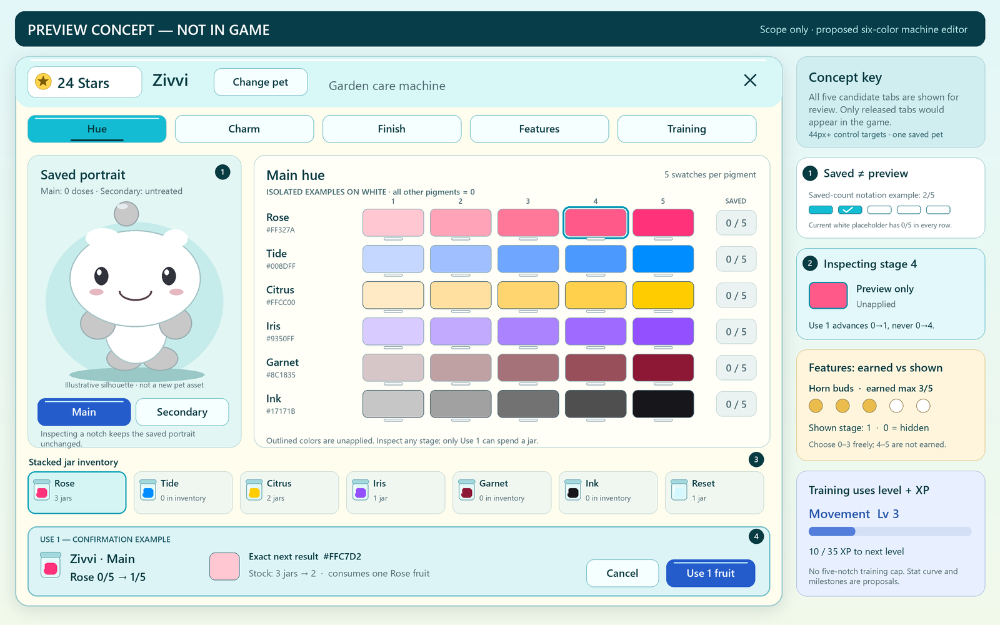

# Pet care, growth and the garden machine

**Design proposal for feedback.** The published baseline is private **v316 / c549451**. Zivvi, Ovelle, Tikket and Nuum hatch with white bodies and light-gray paws, charms and species accents. Existing owners keep Vezzi, Kiprik and Nolli. Hue doses, archived purchases and the single earned Stars wallet survive. The glossy night-material experiment is parked separately and has no verified release. Prices, chances, new swatches, dimensions and level thresholds below are trial values. [Published baseline](PLAY-BUILD.md) · [Roster and palette](NEUTRAL-ROSTER.md) · [Existing item rules](ITEM-EGGS-AND-AERO.md) · [Garden brief](CHAO-GARDEN-DIRECTION.md) · [Open verification](TODO.md)

## Start with a complete pet

After the welcome hatch, show a complete white Zivvi. A whole, lightweight version can smile and blink while the authored meshes load. In petting, **Pick up** closes the portrait, returns the normal walking camera and places Zivvi in the player's arms. The player walks to the glass garden machine and chooses **Place Zivvi**. Its paw rest lights up. The machine shows Zivvi's saved appearance and the player's jars. A visitor sees the same pet leave the player's arms and sit on the machine.

For the first build, ship the complete-model load gate, exact five-notch hue previews, limited coos/item feedback and a bounded Deck feedback pass. Preserve the current Journal and Store/Use now paths in this build. Next, prototype pickup, set-down and the physical machine using the existing Hue and Charm controls. Wait until that works with two players and short-landscape touch before adding another random egg.

## Physical controls and the machine

| State | Visible action and result |
|---|---|
| Petting | **Pick up** and **Back** have separate ≥44 px targets. Pick up requires the player's own equipped, reachable pet. A successful server response releases focus once, restores movement and starts the cradle pose. |
| Carrying | One **Set down** button. The avatar supports the baby with two forearms, the baby looks toward the player, and its charm clears the avatar's chin. Visitors see the owner carry the same pet. Suppress casual toy/rest/greeting decisions for that pet while held. |
| At the machine | A single context-sensitive prompt changes to **Place [pet]**. One physical bay in the prototype. Reserve it for this owner, character generation and pet before changing either pose. An occupied bay shows who is using it and leaves another owner's controls available. |
| Docked | **Pet name · Change pet** at the top. One saved portrait, balance, close button and current tab. Choose another owned pet, confirm **Make [name] active**, then update the saved equipment and bay together. The previous pet returns to its collection. An unsuccessful save preserves the original pet and dock session. |
| Leaving | **Pick up** returns the pet to its owner. **Set down** uses a nearby supported dry point with headroom, a clear pet-sized footprint and a valid safe path. If there is none, keep holding and explain where the player can place it. Closing the sheet or walking away releases the bay to ordinary follow on a validated point. |

Keep carry/dock transient. On disconnect, death, character replacement, failed station load or expired bay claim, release exactly the owned reservation. Rejoin with the durably equipped pet following at a valid spawn anchor. Do not strand a pet, duplicate its visible model, or let an old release evict a new occupant. For an interrupting handheld launch, safely return the baby to follow before entering board mode. Carrying and water transitions require explicit support checks. A request to switch pet or apply an item carries the exact target ID and expected revision.

The v316 pet is a locally rendered cosmetic following a server-owned garden actor. Use that same identity for following, carrying and docking. Animate and validate holds for both R6 and R15 arms; the server publishes holder, mode, generation and attachment side. A machine swap replaces the single existing actor. Test late equip commit after bay release without reverting durable equipment.

If a durable equip succeeds after the bay expires, the newly equipped pet follows its owner. The old bay stays available to its current occupant. Only a failed or uncommitted equip leaves the old pet active.

Use a low enamel pedestal with one open side, a clear aqua rim and a matte paw rest. Keep the face above the rim, controls in the safe area and visitors' ordinary cameras intact. Study adapting the Journal location rather than adding another overlapping E prompt. Measure the existing station, spawn, toy and bridge reach disks with actual avatars before picking coordinates.

After the physical prototype passes, keep the Journal as the readable roster and stats reference. Its customize icon locates the machine. At the machine, show only released tabs, starting with **Hue** and **Charm**, then **Finish**, **Features** and **Training** as each actually ships. In the full station-based design, a saved hatch result offers **Use now** when docked and **Store** or **Find machine** elsewhere. Confirm the change from today's anywhere-use flow before making the machine exclusive.

### One editor at desktop and phone size

*Design concept only.* The untreated white pet previews Rose stage 4 while a separate confirmation offers its actual next dose, stage 1. All 30 chip colors match the proposed linear-light resolver for this dose state.

At desktop width, use one compact light-enamel panel with a dark-ink header, pet name and **Change pet** at left, Stars and a bare **×** at right. Place one large saved-pet portrait in the left third, on an aqua stage with a soft floor shadow. On the right, show a row of the released tabs, a jewel-colored selection with a clear text/underline state, then the current controls. In **Hue**, put Main/Secondary first, six labeled rows of five actual result chips below it, then the stacked inventory at the bottom of the same scroller. **Features** shows the earned maximum separately from the free **Visible size 0–max** selector and the inventory item that earns the next stage. **Training** gives Movement and Swim one card each with level, XP-to-next, next behavior and the matching practice/snack. Fixed-function text sits on opaque light surfaces; glass belongs on the rim, portrait frame and selected controls.

At the observed short landscape safe area of roughly **733 × 307**, reserve a separately measured header and a 44-pixel tab row. Fit five short tab names across the available width when text permits. At Largest text, use a horizontal focus-scrolling tab strip that keeps the selected tab and close action reachable. Keep a 96–120 px portrait at left and a vertically scrolling controls column at right. Five independently inspectable notch targets need at least 220 px plus a label column. Inventory flows after the six rows, with its own 44 px jar targets, rather than covering the last row. At narrow portrait widths use a single vertical stack. A confirmation replaces the tabs/portrait with a content-fit surface for the specific item, pet, channel, before/after and two 44 px actions. Check native text bounds, keyboard/gamepad focus, touch scroll, safe insets and focus restoration on Cancel.

## Hue items and exact notch colors

Keep the four confirmed full-dose colors. Propose two additional fruit jars, **Garnet** for dark red and **Ink** for black. Show the new candidates beside the accepted colors on the same calibrated sRGB sheet before deciding their final values. Ink needs a deep black coat whose eyelids, feet, specular edge and charm still read in midnight lighting. [Current exact chart](artifacts/pet-materials-2026-11-09/current-hue-palette.png)

| Full-strength pigment | sRGB | Status |
|---|---|---|
| Rose | `#FF327A` | Existing |
| Tide | `#008DFF` | Existing |
| Citrus | `#FFCC00` | Existing |
| Iris | `#9350FF` | Existing |
| Garnet · dark red | `#8C1835` | Proposed |
| Ink · black | `#17171B` | Proposed near-black |

For **Main** or **Secondary**, each of the six rows has five visible swatches. Swatch n shows the actual coat result if that pigment had n doses on this channel, holding all other pigment counts fixed. Compute all swatches with the same resolver that paints the saved pet. Use a border/check and a text count such as **Rose 2/5** to mark the saved amount. Future stages have outlines and an **Unapplied** label on focus. An inspection swatch explicitly says **Preview · stage 4**; a missing fruit shows **0 in inventory**. A dark row needs a light keyline. Touching any notch only inspects. Spending follows the separate inventory button and explicit confirmation; earlier swatches cannot undo a dose. The single portrait stays on the saved appearance. A confirmation shows the selected pet, channel, current → next dose, exact result chip and remaining stock. Suppress use at five. Put stacked inventory below the bars with scroll memory and a full-size focus target on controller/touch.

At five Ink doses, a dark eye or closed mouth can disappear even if a specular glint is visible. Prototype a fine warm-ivory eyelid/mouth edge that engages only against a very dark coat, preserving pupils, teeth, blush and blink semantics. Inspect all seven neutral faces, open/closed eyes, mixed coats and tiny portraits at noon, midnight and low graphics. Use the local face treatment only if needed. A brighter world or a uniformly glowing coat cannot substitute for recognizable expressions.

Keep five counts per pigment independently per channel, the existing strongest-dose weights 0, .44, .65, .84, .93, 1, and all old mix anchors. Extend the resolver per dose layer. For layers containing new colors, start with the already-defined mix for the old colors present, weighted by their count, and combine the new anchors at equal weight in linear light. Show actual black/red mixed results for approval. A single pigment at five reaches its specified target. Reset still consumes exactly one item and clears only the chosen channel. It never resets a finish, feature or stat.

**Draft Hue Egg** costs 8 Stars. Use fifteen equal tickets, two for each of six fruits and three for Reset. Show 2/15 (13⅓%) per fruit and 3/15 (20%) Reset before purchase. This drops a particular fruit's chance from 20% to 13⅓%. Five doses of one desired color now take 37.5 eggs or 300 Stars on average, versus 25 eggs or 200 Stars today. Review the new odds, swatches and migration together.

Recommend optional **Target fruit** protection alongside that table. After three consecutive misses for the selected fruit, show the fourth egg as 100% that fruit. On ordinary rolls the base chances above apply. With one target continuously selected, five target jars average about **131 Stars**, maximum **160 Stars**. Those guaranteed rolls yield no Reset; selecting a persistent fruit reduces the long-run Reset chance to about 16%, compared with 20% on unrestricted rolls. Show the current table and progress before spending, preserve misses across rejoin, advance once per saved purchase and explicitly confirm any target change that discards progress. The three namespaces are frozen Companion `state.misses`, new `HueTargetMisses` and new `FeatureTargetMisses`. Reserve the target, counter, pool version and whether this roll is forced in the same durable purchase. Advance only that purchase's counter once at commit, independently of reveal or rejoin. This is a proposed trade-off for review; expanding to six colors without compensation slows a specific coat.

## Skin FX, feature items and Stat Eggs

**Finish** is independent of the two pigments. One gradient choice per pet, initially **None**, **Fade to white**, or **Fade to black**. Use a common anatomical top-to-bottom gradient that preserves the selected Main hue near the face and fades toward the belly. One surface choice per pet, initially **Standard**, **Glossy**, **Matte** or **Metal**. Keep the bright charm, eyes, mouth and protected facial marks on their own materials. Recommend one-time direct purchases with earned Stars, then free reversible selections across the owner's pets. Draft unlocks are 12 Stars per gradient, 16 for Matte or Glossy, 24 for Metal. Standard and None remain free. A player can change finish without consuming fruit or erasing dyes. Verify an actual saved-hue→white and saved-hue→black ramp. Multiplying a white-to-black map by Rose cannot produce its white endpoint. The first two original rigs lack UV coordinates in their GLBs; test an authored UV refresh or an honestly labeled stepped per-piece fallback. Reuse original material assets across rigs and confirm all seven, noon, midnight and low graphics. A failed material load falls back to the saved pigment with its complete face. The parked PBR experiment must independently load and render through a normal client before it becomes a dependency. [Roblox material support](https://create.roblox.com/docs/art/modeling/surface-appearance)

UVs supply coordinates only. Before selling a smooth gradient, prove that an authored template and color-compositing method actually reach both endpoints for a dyed pet in Studio. If the renderer cannot reproduce that result, review a visibly stepped per-piece finish or defer the unlock.

**Draft Feature Egg** costs 32 Stars for one fixed, server-rolled item. Example pool **Horn buds 50%**, **Tail tuft 35%**, **Folded wings 15%**. Distinct silhouettes carry the rarity, with an ordinary baby-sized shape at every stage. One horn item advances horns on one pet from 0→1, then up to 5. Wings use a separate counter and can coexist with horns. A capped pet cannot consume another item of that kind. Duplicates remain stacked for another pet. Each feature saves an earned maximum and a displayed stage. Freely select stage 0 (hidden) through the earned maximum. Stages 1–5 use roughly 20/40/60/80/100% of a deliberately small authored maximum. Wings change appearance only. Test folded wings in a cradle, a horn beneath each charm, the Journal portrait and the hatch camera. Test every retained species before enabling a consume operation on it.

At that example price/chance, unrestricted random rolls make five wing items cost about 1,067 Stars on average, with no guaranteed maximum. Recommend an explicit **target feature**. After two consecutive misses for that selected target, the third purchase gives it with 100% probability. Show the actual chance and remaining misses before each debit. Switching targets requires confirmation and starts its own stated run at zero; replaying a saved result cannot advance progress. With the target fixed on Wings, five items then average roughly 412 Stars and cost at most 480. Review that cost against actual Stars earned per real round before approving the pool. Show each outcome and rarity, and a neutral mini silhouette at stages one and five.

**Draft Stat Egg** costs 12 Stars, with 50% **Stride snack** and 50% **Swim snack**. Start with two independent stats, **Movement** and **Swim**. Save canonical integer total XP and a curve version for each stable pet/stat; derive the level from that total. The five notches belong to pigments/features. Training shows a level number, XP-to-next bar and the next visible behavior. Example curve from level L uses 20 + 5L XP to advance and 25 XP per matching snack. Three matching snacks take a new stat from L0 to L3, about 72 Stars on average at these odds. Show the exact before/after level and carried-over XP on confirmation. Cap the first authored curve at L20 and refuse to consume maxed items. Further levels or activities can extend the curve while retaining total XP. No prestige reset or second wallet.

| Stat | First visible milestones | Subsequent use |
|---|---|---|
| Movement | L0–2 belly-low crawl with alternating forepaws, rising into a brief wobbly stand. L3–7 planted first steps. L8–14 confident walking and turning. | L15–20 brisk practiced strides and expressive cornering. Show progress in the stride course. Preserve ordinary follow/catch-up comfort even when an owner runs. Sample position, feet and velocity during slow and fast follow so the body actually propels itself. |
| Swim | L0–2 supervised shallow shelf and awkward tread with the face above water. L3–7 short dog-paddle. L8–14 steady surface stroke and competent turns. | L15–20 longer coordinated strokes and a stronger final turn on the buoy course. Keep a dry route to every essential station. Every skill threshold needs a playable trial before being advertised. |

Recommend **L0 Movement and L0 Swim for every pet**, including existing owners. v316 records no earned training XP. The new baby crawl will change the gait existing players see, while follow and catch-up stay comfortable. Confirm that change before release. Keep archived mastery/trial data for its original purpose. Pair each stat with an actual short practice before selling snacks. Guide the pet through three dry stride stones, or paddle from a shallow shelf around one nearby buoy and back to shore. Draft **8 matching XP per completed practice**, with no Stars or item attached. Start via deliberate owner input, validate order, reachable pet path and completion on the server, grant each action ID once. Ordinary follow, petting, idle time and unattended simulation earn no XP. A beginner can practice and improve entirely in the garden.

## A compact, textured garden

The user-supplied garden ZIP contains a nested OBJ/MTL and eleven 64–256 px images. Its mesh has 1,454 vertices, 1,377 triangular faces and 1,542 UV coordinates. The twelve material slots include one referenced texture absent from the supplied PNGs. The roughly 1,255 × 760 × 1,255 overall bounds include the sky/ocean shell. The grass spans about 377 × 328 **unscaled OBJ units**, and its vertical extent includes a raised ledge. The water material spans about 199 × 142 units with vertical geometry. The waterfall material rises about 121 units. There is no avatar or unit calibration in the archive. A local-only contact sheet distinguishes grass blades and capped rock faces, horizontal water ripples, directional falling-water streaks and painted distant sky. The OBJ is static and does not establish the original animation speed. Ship original scenery and maps. [Reference geometry](artifacts/pet-care-scope-2026-11-09/reference-geometry.json) · [Material bounds](artifacts/pet-care-scope-2026-11-09/reference-material-bounds.json)

Keep Egg Drop's useful current distances. Spawn, petting, toy, hatch, Journal/machine and the creek crossing should fit the first five minutes. Preserve access to the 160 × 176 Spring Meadow loop. Concentrate the next art pass around a compact social clearing where two avatars can pass, both babies remain visible, and three destinations read from a standing player's camera: the machine, the water and the cave entrance. Use the supplied archive as a scale and composition study. Author original scenery, textures, animation and audio for Egg Drop.

Prototype a **90 × 78-stud basin inside the existing 160 × 176 floor**, with a dry open foreground, a **32 × 24-stud pond** along its outer edge, and an **8-stud-wide** main promenade. A shallow crescent shelf leads to a clearly separated training pool. Offset the waterfall from the bridge axis so a visitor can see both the cave mouth and another pet's face. Try **18, 24 and 30-stud** rock shoulders around two sides, with an **8–10-stud-high walkable terrace** below them, and an approximately **18–22-stud** cascade. This echoes the reference's large vertical-to-horizontal proportion without assigning an absolute scale to its OBJ. Original grass-to-lavender-rock transition textures distinguish walkable terraces from vertical walls. Validate the terrace ramp, full pet path, avatar shoulder clearance and alternate dry return before opening it. Give the cave **8 × 9 studs** of visible mouth clearance and at least **5 studs** of dry standing depth. Try an **8 × 7-stud** machine apron, 1.2-stud pet platform and ≥5 studs for an avatar at its open front. These are original trial dimensions. At a nominal 16 studs/s, **48–80 studs** of path between major destinations takes about **3–5 seconds** of uninterrupted walking. A meandering **190–300-stud** circuit takes about **12–19 seconds**. Measure at actual spawn, with an ordinary avatar/camera and following baby. Keep the original close welcome, existing station activation disks, pet face sightlines and bridge accessible. Compare real travel times and apparent size before proposing another floor expansion.

Paint a seamless original water set with cyan shallows, deeper blue bands, a restrained foam edge and a distinct falling-water sheet. Scroll two small textures at different speeds on registered water surfaces. Freeze or greatly soften motion under Reduced Motion and retain a readable still image on low graphics. Use one shared visible-water update budget. Separate the decorative sheet, wet bounds, shallows, swim surface, dry entry shelves and cave threshold. Author original grass, grass-to-rock margins and small sky/distant foliage planes with soft Aero gloss on water and machine trim. Keep the landscape's surface detail quiet enough to distinguish shin-high babies. Inspect at avatar and pet height under the existing day/night cycle. [Roblox texture controls](https://create.roblox.com/docs/reference/engine/classes/Texture)

The waterfall should veil part of a dark opening with a dry, lit ledge visibly leading through it. A cave activity entry is a later slice. Only enable an entrance when it reaches a real destination with an obvious return path, mode ownership and safe pet restoration. First prove one shallow-water stroke and shore recovery for all seven rigs. Keep the existing bridge's registered support and safe dry following independent of swim level. An inexperienced pet never sinks, loses progress or waits indefinitely far from its owner. A carried or docked pet cannot simultaneously swim, rest or join the toy.

## Readability, sound and handheld response

**Whole-model reveal.** Inventory each rig's required head, face, torso, limbs and selected attachments. Prepare a complete semantic fallback first, then stage the authored parts offscreen. Check each real mesh request, ownership and current equipment epoch. Swap the complete rig at a frame boundary, preserving root, expression, focus bounds and visitor identity. A timeout or missing head keeps the complete fallback, with a bounded retry for that generation. Never expose the new legs before its head resolves. Prioritize the local pet and hatch before nearby visitors. Test fresh cache, one denied head, delayed faces, a rapid swap, reconnect, hatch, Journal and care. Mesh download and permission success are separate from successful PBR map processing. [Roblox ContentProvider](https://create.roblox.com/docs/reference/engine/classes/ContentProvider)

**Coos.** Record or synthesize short original voices for each family. A soft greeting, contented coo and small surprise are enough to start. Trial a random 35–75 second idle window with a global nearby voice budget, skip a coo during focus transitions, receipt effects, menus or another pet's close cue, and respect SFX mute. Use an owner's or nearby visitor's actual pet pose. A repeatable button cannot farm Stars by triggering a voice.

**Using an item.** After the saved operation succeeds, one baby-specific response lasts roughly 0.6–0.9 seconds. A fruit gets a sniff/bite, a feature gets a look toward its new attachment, and training gets a stretch or paddle. Use one soft four-note-or-shorter sound and a small visible response. Reduce Motion uses a still pose/result chip. Skip and reopening a receipt never rerun a debit or replay an impactful cue. Two rapid successes keep input responsive and cannot stack unbounded animations or voices.

**Pocket Deck.** Make accepted merges physically legible. Scale a short bounded handheld-shell nudge by merged tier. Trial 1, 2 and 4 pixels for small, medium and large merges, 0.10–0.18 seconds, with a bounded combined peak during chains. Anchor the field simulation, pointers, aim and HUD. Reduced Motion uses a brief local rim flash and existing merge audio. Composite the trippy motif at a trial **85–90% opacity** (10–15% transparent) over the fully opaque deck-theme tint. Adjust only the decorative layer. The 3D garden cannot shine through the board. Check every skin for ball, aim guide, text and warning contrast during large merges and chains.

## Save boundaries and delivery order

All random eggs roll once on the server. Persist the exact item, price, catalog version and receipt before showing a result. Full stacks or pending-result capacity reject before debit. Applying a consumable atomically spends one item and updates only the confirmed pet, feature/stat/channel. Exact retries replay the original result. An operation ID reused with another target, channel, item, pending-result ID or version conflicts. The monotonic replay fence survives compaction. Wallet, inventory and XP remain owner-private. Visitors need only confirmed dyes, feature stages/visibility, public pose and the locomotion tier relevant to rendering.

The present v6 hue validator expects exactly four keys. Freeze v6 validators, table definitions and quote semantics before changing the active catalog. Expand through a versioned, lease-fenced migration, adding the two new counts as zero for both channels on each live owned row. Preserve old v5/v6 proof validators, original paid presets, carried-token tombstones, stock and pending receipts. Reconcile old committed rewards against their saved table, including retired pets. Pin outstanding proofs when the generic 64-receipt history compacts. Audit acquire, renew, rebase, release and rejoin. Roll out compatible readers and establish that older writers have retired before enabling new writes. A migration cannot charge Stars, invent a completed practice or re-roll an unacknowledged item.

| Review slice | Deliverable and evidence before proceeding |
|---|---|
| 1 · Reliability, hue UI, feedback | Complete-model gate on owner and visitor, exact four-color notches for both channels, bounded Deck response and first coos. Verify all seven rigs, existing 1,296 combinations and old receipts, cold-load/denied assets, Reduced Motion and short landscape at Largest text. Show dark-red/black proposals on the chart separately. |
| 2 · Carry and machine | One bay, carry/place/safe release, switch pet, same Hue/Charm panels and persistent read-only Journal. Two clients contend for one bay, disconnect, refocus, switch and rejoin. Actual avatar-held pose clears face/charm. Keep a normal way home with no unsupported drop. |
| 3 · Hue expansion and finishes | Six-color schema, swatches, revised odds, real measured FX on all seven rigs. Check 6⁶ = 46,656 dose vectors per channel, common old numerical outputs, saved row migration and exact replay. Review authored color/skin renders before release. |
| 4 · Feature Egg | Three original bounded attachments × five stages; previews, odds, saved use, caps and toggles. Verify simultaneous features, sparse old owners, animation clearance and remote descriptor privacy. |
| 5 · Stats, water and cave | Ship the two-stat egg only when each stat produces a real tested behavior. Prototype water surface, entry, exit and beginner safety first. Walk/crawl and swim are separate state owners with interruptions and tests. Build and review a single playable cave destination separately after the gateway works. |

Sol owns runtime, schema, UI and asset tooling. Astra reviews the original art, motion, sound and actual controls. Root runs native Studio and compares ordinary play, native fixtures, real phone and live save evidence separately. Keep one private publication checkpoint per accepted slice. [Architecture and migration appendix](PET-CARE-ARCHITECTURE.md)

The original garden art blockout and decorative texture/waterfall study can start around the carry-machine prototype; they do not need to wait for training purchases. Keep water decorative with safe dry routes until the separately reviewed swim behavior is ready. Review the basin at avatar height before committing its final dimensions or detailed assets.

**Decisions for Spencer** include the first slice, the two new color swatches and revised odds, whether the machine eventually becomes the exclusive editor, the illustrative Feature/Stat pools and pacing, the two-stat level curve and existing-pet migration, then which activity belongs beyond the waterfall. Prices and stat thresholds can be revised independently of the permanent pet IDs.
