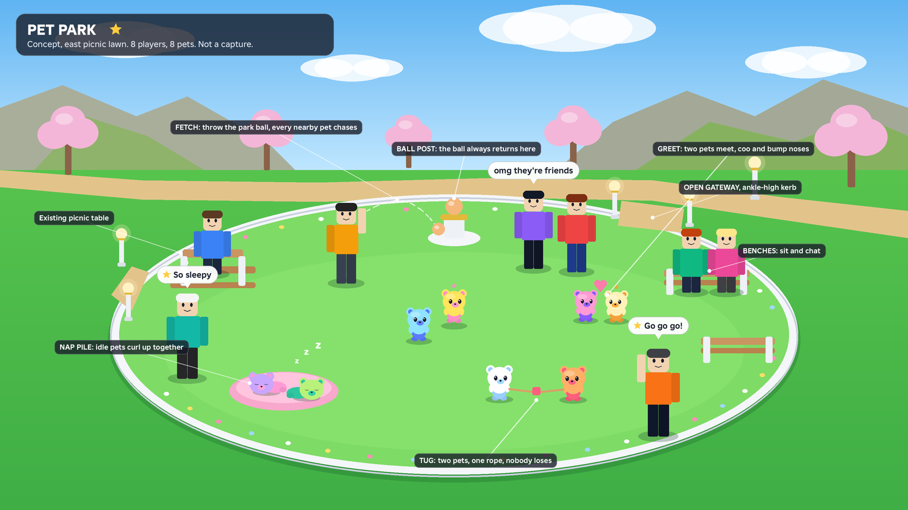
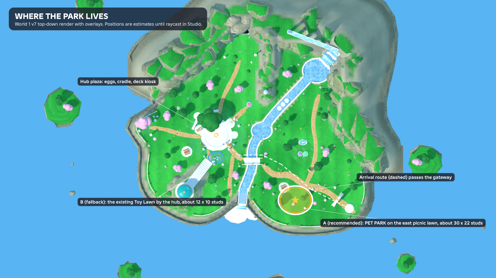
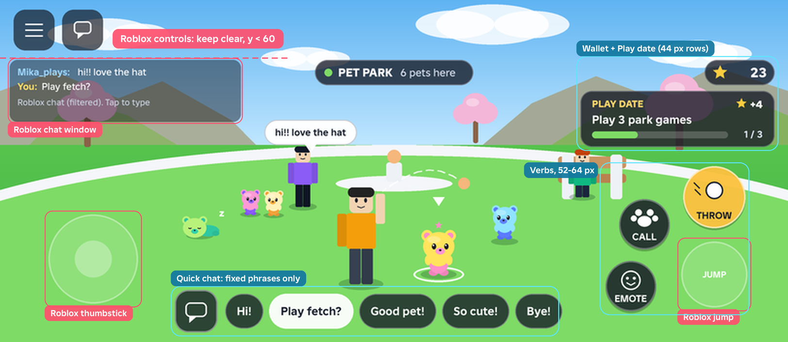

# Pet Park for v1: scope

**Status: scope and concept mockups only, 2026-11-13. Nothing here is built.** No runtime code, save format, Studio place or published build was changed. It answers Spencer's ask: "a playground where pets can play together, like a dog park lol, and users can see their pets playing together, and chat. Is that possible?"

**Short answer: yes, and about half of it already runs.** Every player's pet is already a server-owned actor that every other player sees, pets already greet each other in pairs, and Roblox chat is already on. What is missing is a place that gathers pets, one shared game (fetch), a nap pile, a small phone HUD and a reason to come back.

Sources read: `CHAO-GARDEN-DIRECTION.md`, `GARDEN-VERTICAL-SLICE.md`, `PET-CARE-ARCHITECTURE.md`, `ONBOARDING-V1-SCOPE-2026-11-13.md`, `DEVICE-HATCH-AND-PLAY.md` (toy retirement), `PLAY-BUILD.md`, `TODO.md`, `artifacts/world1-mockup/v7/stations.json`, and the code named in section 1.

Mockups (concept paintings from `scripts/deck_art/build_pet_park_mockups.py`, not captures):

| File | Shows |
|---|---|
| `artifacts/pet-park-2026-11-13/01-park-overview.png` | Three-quarter view of the park: 8 players, 8 pets, fetch, greet, nap pile, tug, benches, ball post |
| `artifacts/pet-park-2026-11-13/02-park-hud-phone.png` (812x354) and `02-park-hud-phone@2x.png` | In-park phone HUD |
| `artifacts/pet-park-2026-11-13/02-park-hud-phone-zones@2x.png` | Same HUD with Roblox-owned zones (red) and our zones (cyan) marked |
| `artifacts/pet-park-2026-11-13/03-park-location.png` | World 1 v7 top-down render with the proposed park (A) and the fallback (B) |

---

## 1. Is it possible, and what already exists

Checked against the working tree on 2026-11-13.

### Already working

| Capability | How it works today | Where |
|---|---|---|
| **Everyone sees everyone's pet** | The server keeps one actor per owner and plans each move as a timed curve. It publishes one JSON snapshot on the `GardenState` folder. Each client replays the curves against server time, so all viewers see the same pet in the same place without per-frame replication. | `src/server/GardenState.lua`, `src/shared/GardenActivity.lua`, `src/client/GardenClient.lua`, `src/client/GardenPetVisual.lua` |
| **Pets greet each other** | Every 12 s the server picks one free pair of pets within 9 studs, walks them to 1.8 studs apart for 2.6 s and links them (`peerId`, shared `actionId`). The client only plays the greeting when both sides of the pair check out. | `Garden:greeting` in `GardenState.lua`; `Garden:get` in `GardenClient.lua`; `Visual:greet` in `GardenPetVisual.lua` |
| **Pets coo** | One quiet coo every 35 to 75 s from your pet or the nearest visible pet within 28 studs, with a small head and hand pose. It is chosen per listener, so two players do not hear the same coo at the same moment. | `src/client/PetCooScheduler.lua`, `src/client/PetCooPose.lua` |
| **Follow, wander, nap** | Pets follow their owner (walk 4, catch-up 9, leash 18 studs/s), wander when the owner stands still for 3.5 s, and nap on three daises. Two daises are exclusive slots, so two pets never stack on one. | `Garden:wander`, `Garden:decide`; `src/shared/GardenLayout.lua` (`RestAnchors`) |
| **Personal toys other players can see** | A pet with Ball, Bone or Sparkler selected plays with it during idle, and visitors see it. | `src/shared/ToyCatalog.lua`, `src/client/PetToyPose.lua`, `src/client/PetToyGeometry.lua`, `Garden:appearance` |
| **Petting** | Hold-to-pet on your own pet with a server lease; +1 Star, five times a day. | `src/server/PetContact.lua`, `src/client/PetContactIntent.lua`, `src/client/PetAffection.lua` |
| **Daily quests and Stars** | Three daily quests at 4 Stars, weekly set, one wallet. | `src/shared/QuestCatalog.lua`, `QuestRotation.lua`, `QuestRules.lua`, `src/server/QuestState.lua` |
| **Chat** | No file in `src/` or `default.project.json` touches `TextChatService`, so the place runs Roblox's default text chat with bubbles. | Verify in Studio: `TextChatService.ChatVersion` and `BubbleChatConfiguration.Enabled` |
| **Park furniture** | Two hub benches, two picnic tables and the toy-lawn props are already on the island as meshes. I found no `Seat` instances in `src/`, so nobody can sit yet. | `artifacts/world1-mockup/v7/stations.json` |

### Present in the repo but switched off

**The shared garden ball.** A full "return the ball" game exists: start, a 3 s join window for a second pet, solo fallback, reservations and cleanup when a player leaves (`src/server/GardenToyReturn.lua`, `src/client/GardenToyPrompt.lua`, `GardenToyIntent.lua`, `GardenToyVisual.lua`). It was retired on purpose in `DEVICE-HATCH-AND-PLAY.md` ("Clear the old toy landmark"). Today `init.server.lua` builds the garden with `sharedToyEnabled=false` and answers `toyStart`, `toyJoin` and `toyCancel` with `Rejected / ActivityRetired`.

The park should not switch that back on as it was. It was a two-step ceremony at the hub. The park needs a one-tap throw. The parts worth reusing are the ball visual (anchored, non-colliding, driven by the shared sample), the intent packet with bounded retry, and the release-on-leave pattern.

### Not there yet

- No place that pulls pets together. Greetings only happen when two owners happen to stand within 9 studs.
- No shared game. Pets never chase the same object.
- No player verbs beyond walking and petting. No throw, call, sit or quick chat.
- No crowd handling. `GardenLayout.ObserverDistance = 72` and `ObserverCap = 6` are defined, but I found nothing in `src/` that reads them. Every pet is rendered at full detail at any distance.
- **No current two-player proof.** An earlier build has filmed two-client evidence for the old toy return (`PLAY-BUILD.md`). On the current build the two-player check is listed as still open, Studio's two-player launcher refused to start, and there is no second tester or alt account. This is the main schedule risk (section 4).

---

## 2. The design

**One line:** a low-kerbed play lawn on the arrival path where pets drift together on their own, any player can throw the park ball for every nearby pet, idle pets curl up in a nap pile, and people sit on benches and chat.

### 2.1 Where it lives

**Recommended (A): the east picnic lawn**, centred near Roblox (45, 59), about 30 by 22 studs, beside the existing `Station_PicnicEast` at (34, 46).

- It sits on `Routes.ArrivalToHub`. A new player walking from the arrival dais (96, 66) passes the gateway within about 20 seconds and sees pets playing before reaching any menu. That is the "first minute" described in `CHAO-GARDEN-DIRECTION.md`.
- It is open, flat lawn. Pets stay ground-level only, as approved.
- The hub is already crowded (Spencer's v515 QA: "area by the deck machine too crowded").

**Fallback (B): the existing Toy Lawn** at (-30, 18.5) by the hub. It needs no new art, but it is about 12 by 10 studs and inside the busiest spot on the island.

The position and size are read off the top-down render. They must be raycast in Studio before any anchor is authored. `[ESTIMATE]`

**Boundary: an ankle-high marble kerb with two open gateways, not a fence.** Pets do not collide with anything, so a fence would only trap players and block camera sight lines on phones. The kerb marks the place and carries a flower border. Star-orb posts mark the gateways.

**Inside:** a ball post in the middle (the ball's home), a round nap cushion, two benches and the existing picnic table.

### 2.2 What pets do together

A pet is "in the park" when its owner stands inside the kerb or sits on a park seat. Pets in the park behave as follows.

| Behaviour | v1? | What the player sees | Built on |
|---|---|---|---|
| **Mingle** | Yes | Idle pets wander toward the park centre and each other instead of orbiting their owner. | Existing `wander`, with park anchors |
| **Greet and coo** | Yes | Two pets meet, face each other, bump noses, and one coos. In the park a greeting can start every 6 s (12 s elsewhere), and the same pair waits 45 s before repeating. | Existing `greeting`; make the coo a shared event for a greeting |
| **Fetch** | Yes | A player throws the park ball. Up to 3 idle pets within 14 studs run for it. The first to arrive picks it up, trots back to the thrower and drops it. The others hop alongside. The ball then rolls home to the post. | New. Reuses ball visual, intent packet and release pattern |
| **Nap pile** | Yes | A pet idle for 20 s walks to the cushion and curls up. Four slots, touching. A sleeping pet wakes when its owner moves or calls. | Existing exclusive rest anchors, more slots |
| **Show-off** | Yes | A pet with a personal toy plays with it in the park, as today. | Exists |
| **Tug** | Later | Two pets pull a rope. Nobody wins. Ends in a tumble. | New paired pose and rope |
| **Follow-the-leader** | Later | Three or more pets walk a loop in a line. | New path logic |

Fetch is the only new shared game in v1. It is the one behaviour a player can cause on purpose, and it is the one that makes several pets do the same thing at once. Tug and follow-the-leader are charming, but each needs new paired animation, and neither changes whether the park works.

**Fetch rules**

- One ball per park. It lives on the post. Throw is available when the ball is home and you are inside the kerb.
- The server chooses the landing point: 10 to 14 studs along the direction the thrower's character faces, clamped inside the kerb and onto walkable ground. The client sends no position.
- The server picks the chasers (nearest idle park pets, the thrower's pet first, at most 3) and decides the winner from path length, so every viewer sees the same pet get there first.
- One fetch takes about 8 s. If the thrower leaves or the round stalls, the ball returns to the post within 20 s.
- After your throw you wait 6 s before throwing again while another player is in the park. Alone, there is no wait.

### 2.3 Player verbs

| Verb | Input | What happens |
|---|---|---|
| **Throw** | Touch: THROW button. Keyboard: F. Gamepad: R2. | Starts a fetch (above). |
| **Call** | Touch: CALL. Keyboard: C. Gamepad: Y. | A short whistle. Your pet leaves any park activity and runs to you. Walking away already does this today; Call makes it deliberate. |
| **Emote** | Touch: EMOTE opens a row of four. | Plays a default Roblox emote (wave, cheer, point, dance) through `Humanoid:PlayEmote`. Pets within 9 studs of a cheering player do a small hop. |
| **Sit** | Native prompt on benches and the picnic table. | Roblox `Seat`. Your pet stays in the park and keeps playing while you sit. This is the "watch your pet and chat" posture. |
| **Pet** | As today, your own pet only. | Unchanged. Other players' pets cannot be petted in v1. It would open a Stars farm and a consent question. |

### 2.4 Chat

- **Typed chat is Roblox's default `TextChatService` with bubbles.** No custom text box anywhere. Roblox applies its own filtering, parental controls and age rules.
- **Quick chat for players without text chat.** A bubble button opens a row of six fixed phrases: "Hi!", "Play fetch?", "Good pet!", "So cute!", "Thanks!", "Bye!". The client sends a phrase **id**; the server checks it and other clients show the phrase as a bubble with `TextChatService:DisplayBubble`. No free text travels through our remotes. The phrases live in one table so they can be localised.
- Before launch, confirm that fixed-phrase bubbles shown to accounts with chat turned off meet current Roblox policy. `[CHECK]`

### 2.5 Staying readable with a full server

| Limit | Value | Why |
|---|---|---|
| Players per server | **12** `[PROPOSED]` | A Creator Hub setting, not in the repo. Roblox fills servers before opening new ones, so a quiet launch still puts players together. |
| Pets per player | **1** | v1 has one pet. The rule stays "one pet out at a time" when more pets ship. |
| Pets in one fetch | 3 | More reads as a blur on a phone. |
| Nap pile | 4 slots | Extra sleepy pets rest beside their owner. |
| Balls | 1 | One shared focus. A second ball splits the crowd. |

**Telling pets apart:** your own pet gets a soft white ground ring and a small chevron, drawn only on your screen. Other pets get no label. Their two body colours and their owner standing nearby are enough, and labels over 12 pets would bury the lawn.

**Phone HUD (812x354):** everything sits at y >= 60, below Roblox's top-left buttons. The top-left quarter is left empty for Roblox's chat window. Park chip top centre, wallet and Play date card top right, three round verbs in an arc above the Roblox jump button, quick chat in the bottom centre between the thumbstick and the verbs. Touch targets are 44 px or larger. The HUD shows only inside the kerb and fades out on leaving.

**Performance budget `[TARGETS, to be measured on Spencer's iPhone and Android]`:**

- 30 fps or better with 12 players and 12 pets in view.
- Pet detail tiers by distance from the camera: the nearest 6 pets within 72 studs get full pose updates every frame (this finally uses `ObserverCap` and `ObserverDistance`); the rest update position and facing at 10 Hz with charms and face animation frozen.
- No new per-frame remotes. Park state rides the existing snapshot model.
- Bear is about 1.5k triangles before wearables. Twelve pets is not a triangle problem; the cost is per-frame part movement, which the tiers cap.

### 2.6 A reason to visit

- **Daily "Play date": play 3 park games, +4 Stars, once a day.** A park game is a fetch you threw, a fetch your pet joined, a greeting your pet took part in, or a nap beside another pet. It can be finished alone with three fetches, so an empty server never blocks it. It matches the existing 4-Star daily quests and lifts a casual day from about 40 Stars to about 44.
- **No Stars trickle for standing in the park.** A trickle pays for idling and invites AFK farming. The park's pull is the pets.
- **Park-only toy (later):** a flying disc earned after 5 Play dates, kept outside the Toy Egg pool so the disclosed "1 in 3" odds do not change.
- **Passive pull:** the park sits on the arrival path, and the onboarding coach can point at it once after the first pet is won ("See who's at the park").

---

## 3. Server authority and networking

### 3.1 Who owns what

| Thing | Owner | Notes |
|---|---|---|
| Pet positions and actions | **Server** (`GardenState`) | Unchanged. Clients never send a pet position. They replay server-planned curves. |
| Park membership | Server | Derived from the owner's position at the existing 2 Hz input sample. |
| Ball position | Server | A timed arc, then "carried by pet X", then a timed roll home. Clients draw it from the shared sample, as `GardenToyVisual` does. |
| Who chases, who wins | Server | Decided when the throw is accepted, from planned path lengths. |
| Player avatars, emotes, sitting | Roblox | Default character replication, `Seat`, `PlayEmote`. No custom code. |
| Own-pet ring, HUD, coo timing outside greetings | Client | Cosmetic and per viewer. |
| Stars and Play date progress | Server | Awarded inside the existing transaction and save path. |

### 3.2 What replicates

- **One new block in the garden snapshot:** `park = { ball = {state, from, to, startTime, endTime, carrierId}, fetch = {id, throwerId, chasers, winnerId}, nap = {slot -> ownerId} }`. Pets get new `action` values (`fetchChase`, `fetchCarry`, `fetchCheer`, `napPile`) on the actor records that already replicate.
- **Remotes:** reuse `GardenIntent` (client to server) with three new kinds, `parkThrow`, `parkCall`, `parkQuick`, and one new `ParkResult` event for accept or reject, following `GardenToyResult`.
- **Payload watch:** today any change republishes the whole snapshot as one JSON string. With 12 actors and a busy park that could be several kilobytes a few times a second. Measure it first. If it is heavy, put the park block on its own attribute so a throw does not resend every pet's path. `[MEASURE]`

### 3.3 Validation and rate limits

Every park packet is checked on the server for: live character, `Room` mode, inside the kerb (plus 4 studs of slack), and the same `characterId` and `petGeneration` tokens that the focus packets use today.

| Packet | Limit | Extra checks |
|---|---|---|
| `parkThrow` | 1 per 3 s per player; 6 s after your own throw when others are present | Ball is home; direction comes from the server's view of the character |
| `parkCall` | 1 per 2 s | Pet is yours and in the park |
| `parkQuick` | 1 per 2 s and 6 per 20 s | Phrase id is in the table |
| All kinds | The existing 0.1 s per-kind floor | Unknown kinds are dropped silently |

### 3.4 Anti-grief

- **Pets cannot be pushed.** They are client-side visuals with no physics, placed by the server's curves. Nothing a player does moves another player's pet off the lawn.
- **The ball cannot be stolen or lost.** It is anchored, non-colliding and server-timed. It always returns to the post, at most 20 s after a throw.
- **No ball hogging.** The 6 s personal cooldown lets someone else throw.
- **Your pet, your call.** Another player's throw can invite your idle pet to chase (that is the point of a dog park), but **Call** or walking away pulls it out at once, and a pet being petted, carried, docked or already busy is never picked.
- **Leaving cleans up.** A thrower or winner who leaves releases the fetch, the same way `Garden:release` clears toy reservations today.
- **Seats:** about 8 seats for 12 players. Nobody can be removed from a seat by another player.

### 3.5 Privacy and safety

- All typed text goes through Roblox chat. We add no text field, no pet names shown to other players and no signs.
- Quick chat sends ids, never strings.
- No trading, gifting, friend-follow or teleport. Matches "all ages, default chat, no trading".
- No Stars move between players. The only park reward is the once-a-day Play date, paid by the server.
- Reporting chat abuse uses Roblox's own report flow. Our bug form (`ONBOARDING-V1-SCOPE-2026-11-13.md` section 4) stays for bugs.

---

## 4. What exists, what to build, in what order

Sizes: **S** is half a build session or less, **M** is about one session, **L** is two to three. A session is one focused agent pass including specs and review.

### 4.1 Reuse as is

| Need | Existing file |
|---|---|
| Pet actors, curves, snapshot | `src/server/GardenState.lua`, `src/shared/GardenActivity.lua`, `src/client/GardenClient.lua` |
| Path planning and walkable ground | `src/shared/GardenPathPlanner.lua`, `src/shared/GardenWalkability.lua` |
| Greeting pair logic and pose | `Garden:greeting`, `GardenPetVisual:greet` |
| Coo voice and pose | `src/client/PetCooScheduler.lua`, `src/client/PetCooPose.lua` |
| Ball visual | `src/client/GardenToyVisual.lua` |
| Intent packet with retry | `src/client/GardenToyIntent.lua` (pattern) |
| Rest slots | `GardenLayout.RestAnchors` (exclusive anchors) |
| Wallet and daily clock | `src/server/HatchProgress.lua`, `src/shared/DailyContracts.lua` (05:00 UTC day) |

### 4.2 Build

| # | Work | Files | Size |
|---|---|---|---|
| 1 | Park layout data: kerb ellipse, gateways, ball post, nap slots, seats. Adds `Stations.PetPark` to the v7 table. | new `src/shared/ParkLayout.lua`; edit `src/shared/HollowWorldLayout.lua` | S |
| 2 | Mingle and greeting tuning inside the park; shared coo on a greeting. | edit `src/server/GardenState.lua`, `src/client/PetCooScheduler.lua` | S |
| 3 | Fetch and nap pile state machine, plugged into `GardenState` the way `self.care` is. Specs. | new `src/server/ParkState.lua`, `src/server/ZZSpecs/ParkState.lua` | **L** |
| 4 | Remote validation, rate limits, wiring. | new `src/server/ParkHost.lua`; small edit to `src/server/init.server.lua` | M |
| 5 | Client park reader, ball, own-pet ring. | new `src/client/ParkClient.lua` | M |
| 6 | Pet poses: chase, pick up, carry, drop, cheer, pile curl. Astra directs, reviewed on the real Bear. | new `src/client/ParkPetPose.lua`, `src/shared/ParkPoseData.lua` | M |
| 7 | Phone-first HUD: chip, verbs, Play date card. | new `src/client/ParkHUD.lua` | M |
| 8 | Quick chat. | new `src/shared/ParkPhrases.lua`, `src/client/ParkQuickChat.lua` | S |
| 9 | Play date: counter, once-a-day award, save fields, come-back strip entry. | new `src/shared/ParkQuest.lua`; edit `src/server/HatchProgress.lua` (versioned save change) | M |
| 10 | Seats on park benches and the picnic table. | Studio place; new `src/server/ParkSeats.lua` if scripted | S |
| 11 | Park art: kerb, gateway posts, ball post, nap cushion, flower border. | new `assets/art-source/stations/v2/PetPark*.blend`; Studio import | M |
| 12 | Distance tiers for pet rendering. | edit `src/client/GardenPetVisual.lua` (and its caller in `RoomView.lua`) | M |
| 13 | Two-client and two-phone verification, payload measurement, private publish. | `artifacts/pet-park-*/` evidence | M |

**v1 total: 1 L, 8 M, 4 S. Roughly 10 to 12 build sessions, about two weeks at the current pace.** `[ESTIMATE]` A smaller first cut is possible: items 1, 2, 10 and a greybox kerb give "pets mingle and greet in a park while people sit and chat" in about three sessions, with fetch following.

**Later, not v1:** tug (M), follow-the-leader (M), park-only disc toy (M), a resident park pet for empty servers (M).

### 4.3 Build order

1. **Decisions and test path.** Answer section 5. Arrange a second account or tester and get the Studio two-player launcher working. Everything after this needs it.
2. **Place.** Raycast the lawn in Studio, write `ParkLayout`, greybox the kerb and post. (1)
3. **Mingle.** Park wander anchors, faster greetings, shared coo, seats. First private look: pets gather and greet while players sit and chat. (2, 10)
4. **Fetch on the server** with specs, behind `FeatureFlags.Park = false`. (3, 4)
5. **Fetch on the client** with poses. Astra reviews film of the real Bear. (5, 6)
6. **HUD and verbs** on phone fixtures, then a real phone. (7)
7. **Nap pile.** (rest of 3, 6)
8. **Quick chat.** (8)
9. **Play date** with its save change, reviewed on its own. (9)
10. **Art pass.** (11)
11. **Crowd pass.** Tiers, payload measurement, 12-actor soak with fixtures, two phones. (12, 13)
12. **Private publish** and Spencer's playtest.

### 4.4 Risks

| Risk | Effect | Mitigation |
|---|---|---|
| **No second tester, and the Studio two-player launcher is broken** | A multiplayer feature ships unverified | Step 1 blocks the rest. Isolated two-owner specs cover logic, but one filmed two-client session is the gate for publishing. |
| **Empty servers at a quiet launch** | The park looks dead and the promise fails | Play date works solo; fetch is fun with one pet; a 12-player cap concentrates players. If soft-launch data shows a median below 3 players per server, add the resident park pet. |
| **Snapshot payload grows with 12 actors and a busy park** | Phone bandwidth and hitches | Measure in step 4. Split the park block onto its own attribute if needed. |
| **Bringing back a shared ball that was retired on purpose** | Old problems return | Different rules: one tap, no join ceremony, new location, new module. The old `GardenToyReturn` stays retired and can be deleted after the park ships. |
| **Save format change for Play date** | Load failures on rollback (see the v10 warning in `TODO.md`) | Additive fields with defaults, versioned, reviewed alone in step 9. |
| **Phone HUD collides with Roblox chat, thumbstick or jump** | Mis-taps | Zones in the mockup; measured insets, as `WardrobeShop` does; check on both test phones. |
| **Three build agents are editing `src/` now, including `init.server.lua`** | Merge conflicts | Park code lives in new files; the only shared edits are a few wiring lines, landed last. |
| **Onboarding scope competes for the same weeks** | Both slip | Onboarding first. It decides whether players stay long enough to reach a park. The three-session "mingle" cut can ship with it. |
| **Park position is read off a render** | Anchors land on a slope, tree or the path | Raycast in Studio before authoring. Fallback B exists. |
| **Chat rules differ by age and region** | Some players cannot type | Quick chat. Confirm policy for fixed-phrase bubbles before launch. |

---

## 5. Open questions for Spencer

1. **Where does the park go?** East picnic lawn on the arrival path (A), or the existing Toy Lawn by the hub (B)?
   **Recommendation: A.** New players walk past it in their first 20 seconds, it has room for 12 pets, and it keeps the hub from getting more crowded.

2. **Is "mingle, greet, fetch, nap pile" enough for v1, with tug and follow-the-leader after launch?**
   **Recommendation: yes.** Fetch is the one game players can start themselves. Tug and follow-the-leader each cost a session of paired animation and do not change whether the park works.

3. **May another player's throw send your pet chasing?**
   **Recommendation: yes, when your pet is idle in the park.** That is what makes it a dog park. Call or walking away pulls it out at once. Add a "my pet plays with others" setting later only if players ask.

4. **Reward: one daily "Play date" for +4 Stars, finishable alone, and no Stars for idling?**
   **Recommendation: yes.** It matches the existing dailies, adds about 10% to a casual day, and cannot be farmed by standing still.

5. **Server size 12, and who is the second tester?**
   **Recommendation: 12 players per server**, and a second Roblox account on your Android phone (or your friend from `ONBOARDING.md`) before fetch is built. Without a second client the park cannot be verified.
