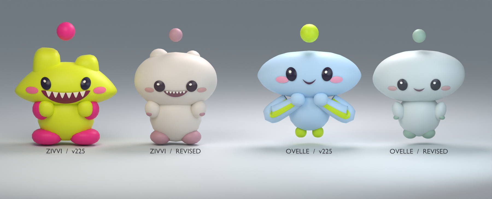

# Softer babies and Hue Eggs

Zivvi and Ovelle should look young before either one moves. Give their faces room for a blink, let their weight settle, and keep the brightest colors for small details that players can eventually choose. This pass replaces the two v225 model designs. The next progression slice introduces Hue Eggs and the single Stars wallet.

## Two silhouettes

| | Form and face | Base and accents |
|---|---|---|
| Zivvi | A rounded dumpling with a broad forehead, two low uneven crown bumps and a planted stance. The small mouth retains six ivory milk teeth. Its curious pose tilts the head. Its affectionate pose folds the hands under the cheeks. | Warm porcelain `#E5DBD0`, dusty rose `#C595A0`, cocoa-plum eyes `#443641`, muted peach cheeks `#D9A6A2`. |
| Ovelle | A gently asymmetric river-pebble head on a short hovering body. Each shoulder ends in one short attached mitten with a small colored tip. The fine crescent mouth and suspended feet distinguish Ovelle from Zivvi at garden distance. | Pale cool stone `#D3DBD9`, soft sage `#A2BCAA`, charcoal eyes `#404149`, powder-rose cheeks `#D6AFB0`. |

Both use a small floating dot in their secondary color. Keep the dark eyes and their catchlights readable at night. Concentrate highlight on cheeks, crown and mittens while preserving a rounded transition into shadow. Recheck in the actual garden after imported mesh repair and under the hatch viewport’s separate light. The matched Blender views establish form and palette. The Roblox engine determines the final material rendering.

## Life and movement

- Blink once over 120–170 ms every 3.2–5.4 s, with a stable phase per owner. Lower the lids quickly, pause briefly, then reopen. A sleeping or affectionate eye keeps its pose. During contact the hands fold, eyes close and existing accepted-contact feedback takes priority. At release the curious eyes reopen.
- Give the chest a slow 2.5–3.4 s breath with at most 0.018 stud of head travel, grounded feet and occasional 2–3° gaze shifts with long holds. Animate the dot in its own local offset, lagging the head by about a quarter-second. Bound its vertical travel to ±0.06 stud, lateral travel to ±0.018, and squash to 4%. Reserve its swept volume only while visible. Reduced motion shows the settled expression and keeps the charm still.
- Select paths on the existing server decision clock. Derive each moving leg’s duration from its length and an explicit baby walking speed. Ease into and out of short actions. Join subsequent legs to the previous sampled position and heading, turn toward a greeting partner before arrival, and hold on the spot between decisions. Reserve teleportation for explicit respawn or discontinuities already handled by the host. Keep the authoritative 7-stud care check and the independent camera lens. The owner and both observers sample the same server start time.
- Verify a 45-second two-client trace across solo toy play, approach, paired greeting, rest, focus, Back and Deck. Record the largest ordinary one-frame displacement and heading change. Capture the same walk at 30 and 60 FPS, both faces before/during/after contact, the dot on/off, Reduced and a ranked crest. Check 749×381 and portrait with 55–65% reachable body coverage and full visible dot clearance. Compare whole-frame timing and node counts with the v225 scene.

## PocketDeck

Use stronger directional bands, halftone or broken arcs and sharper light/dark color transitions in exterior gutters. Size them to read at phone scale while keeping the existing pattern allocation and one sampled motion owner. Reduced motion keeps a composed still. The LCD remains clear enough to judge a drop. Remove DROP, FALLING and other state captions adjacent to the physical A control from every layout; keep the A face, its action description, the 44 px target and gesture instructions. Keep the highlight requested behind the balls distinct from ball materials and from reward or charge states. Inspect it with each rendering backend and at the first bright field row.

## Next progression slice • Hue Eggs

**Accepted implementation contract after private v232. One purchase buys one named direction on one chosen, owned baby for 8 Stars.** Show the actual pet, current body colors, resulting colors, direction, rank increase, secondary unlock and resulting wallet before the player spends. A fresh account with the six-Star welcome grant can afford one after a daily gift or a successful field run. Measure time to the first reachable egg with real play.

| Egg | Direction and preview swatch | First use |
|---|---|---|
| Rose Hue Egg | Rose `#D988A1` | Adds Rose 1 and makes Rose available as a secondary on this pet. |
| Tide Hue Egg | Blue `#77AAD3` | Adds Tide 1 and unlocks its blue secondary. |
| Citrus Hue Egg | Yellow `#E7C764` | Adds Citrus 1 and unlocks its yellow secondary. |
| Iris Hue Egg | Violet `#A994D4` | Adds Iris 1 and unlocks its violet secondary. |

Each pet has four small integer ranks, initially zero, each capped at three. Eating a Rose egg advances only that pet’s Rose rank by one and selects Rose as its active body direction. The other three ranks keep their exact values. Rank 1, 2 and 3 use increasingly strong body tints, with initial weights **12%, 23%, 35%** between the authored base and the direction swatch in the same linear-light color space used by the preview. Verify their actual visible separation in noon, dusk and hatch lighting. Facial ink, blush, mouth and ivory remain authored colors. A free body selector offers Original plus every learned direction. Selecting Original restores the original body immediately while retaining every rank.

Secondary choice is independent. An owned swatch recolors only the feet, mitten details and optional dot. Default uses that species’ original secondary. All learned secondary choices remain selectable without spending, including while the dot is off. Preserve the prior selected secondary when an egg unlocks another; offer **Equip Rose accents** as a separate explicit action. If a direction is already rank 3, show **Max rank** and prevent spending. A table of four named ranks is easier to read than a composite of several tint directions.

**Example.** Zivvi has Tide 2, Rose 0 and default dusty-rose accents. A Rose Hue Egg changes the saved Tide 2 / Rose 0 to Tide 2 / Rose 1, spends exactly 8 Stars, selects Rose body and unlocks its secondary. The player may return to the Tide body and equip Rose accents. The dot adopts Rose whenever visible. A third Rose purchase from rank 2 reaches rank 3; a fourth attempt costs zero.

### Storage, replay and unlocks

1. Present the current nectar balance as Stars at one-for-one value throughout the game. Keep the same existing authoritative balance field and all historical amounts and IDs. Run, daily, petting and hatch transactions still share one wallet. Keep each existing hatch result, companion inventory, cost, miss count, mastery, appearance unlock and daily day.
2. Key ranks by the existing persistent pet ID (`pip` displays Zivvi, `puddle` displays Ovelle). Begin sales for the two revised species. Existing owners start with their original colors and four zero ranks. Keep records sparse. Store debit, rank increment, unlocked direction, active body and receipt ID in the **same committed record and update** as the wallet. Do not grant colors in a separate profile write after spending. The existing per-pet Dot boolean remains independently confirmed.
3. A Hue request includes a unique operation ID, exact pet, hue, quoted rank and expected wallet revision. The server validates ownership, current rank, cap, price and balance against canonical state. A stale preview refreshes without charging. Duplicate/retried operations return the original receipt exactly once. Serialize with concurrent run/claim/pet payouts and companion purchases. A pending saved reveal remains recoverable. If the current host requires it to be resolved before spending, honor that fence and show the pending action.
4. Confirm colors only after a saved result. Publish a compact selected-body/grade/secondary token to nursery UI, equipped model, hatch, journal portrait and visitor snapshot. Validate every free equip against saved per-pet unlocks. Reject unknown or cross-pet secondary IDs. A player can switch pets and return without losing either selection. Render pending or rejected operations with the last confirmed palette on observers.
5. Keep Hue Eggs visibly separate from Companion, Training and Supply offers. Hue purchases never add pet inventory bits, roll rarity, change pity, modify battle power, reduce another stat, or seize a hatch acknowledgment. Keep Hue Eggs earned with Stars, with no purchase odds, extra currency or daily use limit beyond the visible per-pet rank cap.

### Acceptance for progression

- Migrate sparse legacy snapshots and replay pending run/hatch/daily receipts. Compare the old balance to the new Stars readout, every owned bit, pity and result ID before/after, including prices, contracts, receipts, prompts, gift text, hatch UI and accessibility labels.
- Exercise one successful use, repeat use, duplicate click, reconnect after save, timeout then confirmed retry, stale wallet/rank, cap, insufficient Stars, unsupported pet, switched pet, simultaneous wallet award and client-provided arbitrary color. Inspect both the balance and saved color; no half-applied grant.
- Verify free independent body/secondary equip, Original, hatch/journal preview, hidden then restored dot, and second-client observer colors, including Medium/Largest layouts and native phone. Keep all RGB/tint math in one tested palette resolver across those views.

### Shop, Journal and art contract

The egg shop opens in Companion or Hue mode. A saved companion result owns its existing reveal, X, Meet and replay behavior. The player completes that result before spending on a Hue Egg. Hue uses the existing safe-area card, close control, one scrolling body and a pinned purchase action. When both babies are owned, start with the equipped eligible baby. Let the player change the target without equipping it in the garden. With no eligible baby, show the existing companion route.

The four Hue shells share one silhouette. Give Rose two petal strokes, Tide two waves, Citrus a small fan of rays and Iris angled facets. Each offer shows its name and three rank positions. A color-only distinction is insufficient. The detail shows the chosen baby twice under one controlled, neutral preview light, labeled **Current** and **After**. Reuse at most two stationary rigs. Face, pose, camera and Dot visibility match so the only intended difference is color. Place both samples beside each other when labels fit, and reflow into the scroll body when they need more space. Include named body and accent swatches. Preserve normal controller selection, existing 44 px targets, readable Largest copy and Reduced motion.

For a Zivvi with 16 Stars and no Rose rank, show **Rose 0 → 1**, **16 → 8 Stars**, the Rose secondary unlock and **Feed Rose egg · 8 Stars**. Show the actual shortfall or Max rank when the action is unavailable. A Saved purchase updates an inline result with the target pet and exact rank. Offer **Equip Rose accents** explicitly. The free color editor is reachable from Hue and Journal. Journal's existing Equip and Track actions keep their meanings. Body choices include Original and learned directions. Accent choices include Default and learned swatches. Keep one selection when the other changes, including when the Dot is hidden.

One shared palette resolver reads the two meshes' authored body and accent colors. Decode each sRGB channel to linear light, interpolate the body with weight 0.12, 0.23 or 0.35, then encode to sRGB. For example, Zivvi's Rose grades are approximately `#E4D3CB`, `#E2CCC6` and `#E1C3C1`. Ovelle's Tide grades are approximately `#CBD6D8`, `#C3D1D8` and `#B9CCD7`. Allow one rounding unit in test comparisons. Use the same result for the comparison swatches, preview rigs, room pet, hatch, journal sprite and visiting pet. Retain the face, mouth, eyes, blush, teeth and iris highlights. Verify the three grades are distinguishable under preview lighting. Natural garden night shifts the neutral base toward sage, as recorded in the softened-model pass.

Use a five-point gold Star with an ivory glint for the wallet, compact reward chips and the petting +1. Keep numeric text legible on each theme. Player-facing labels, shop prices, contracts, prompts, recap receipts and accessibility text use **1 Star** or **n Stars**; internal compatibility fields such as `nectar` retain their existing storage meaning.

### Save compatibility and authority

Keep `hatching.version = 4`. Hue is an optional sparse namespace. Its absence means zero progress, Original body and Default accents. Validate every present entry with bounded supported IDs, integer ranks 0–3 and learned selections before accepting it. The v4 lease acquisition and transaction clone the full existing record. The profile writer merges named non-hatching siblings and preserves the hatching value. Keep those behaviors and verify an old-style award/claim/profile flush preserves the Hue namespace. Historical wallet, hatch identity, hatch acknowledgement, pity, sparse inventory, mastery and appearance records pass through unchanged.

Paid grants have a lifetime bound of 24 per account for this roster (2 babies × 4 directions × 3 ranks). A typed paid receipt can be retained for every successful rank. Compare the exact pet, direction, prior rank and quoted revision before returning an old grant. Keep a distinct server operation GUID and sequence for the lease-fenced write. A matching client token alone cannot establish a saved grant. A successful old replay returns its original facts, even after another wallet transaction or body selection. Free equips use revision comparison, validated learned choices and an idempotent acknowledgment for the latest matching equip. An old equip cannot override a newer selection. Expose only saved Hue state and the latest typed result in shop snapshots. Visitors receive the equipped pet's selected body direction, active grade, secondary and existing independent Dot preference. A color change reuses the same rig and current activity generation.

#### Request and receipt protocol

| Path | Fields and behavior |
|---|---|
| Purchase | `HatchRequest("hue", {id, petId, hue, rank}, revision)`. Here `hue` is the named direction ID and `rank` is the prior visible rank. The server supplies the canonical 8-Star cost and chooses the next rank. |
| Free equip | `HatchRequest("hueEquip", {id, petId, body?, secondary?}, revision)`. The editor sends the one field being edited. A supplied body is `original` or a learned direction. A supplied secondary is `default` or a learned direction. Every supplied choice must validate together. An omitted slot keeps its saved value. |
| Correlation | The client creates `<quotedRevision>:<GUID>` once per deliberate action, with at most 100 characters. Retry sends the same action, ID, pet, values and outer revision. A different payload with an existing saved or pending ID is a rejection. A stale original revision cannot be relabeled as a new purchase with the old ID. |
| Result | Owner receives keyed `HueResult` with `id`, `action`, `petId`, `status`, `revision`, and optional `reason` or public `receipt`. Status is `Saved`, `Rejected` or `Retrying`. A public receipt carries the committed revision, historical before/after balances, cost, resulting body and secondary IDs. A purchase also identifies hue, old/new rank and whether a secondary was unlocked. |
| Ambiguous save | Reuse the existing fenced retry with the same immutable pending candidate. Internal proof requires the typed quote, server-generated operation GUID and operation sequence. A generic `lastOperation.id` match, elapsed animation, changed wallet or pet pose cannot establish success. |
| Snapshot order | The result event and `HatchState` may arrive in either order. A matching saved latest receipt can settle its intent directly. An older paid replay may already have a newer latest receipt. In that case settle the quoted intent using its matching typed saved result and a confirmed revision at or beyond the receipt. Show the original receipt as history and show the latest balance and selected colors from the current snapshot. Closing the panel never acknowledges or clears a companion hatch. |

Persist only the sparse per-pet rows, bounded paid `hueReceipts` and `lastHueResult` in hatching state. Public shop state includes `hues` and the latest public receipt. Keep the server operation GUID, sequence proof and historical ledger out of the displayed receipt. Give observers the compact body, bodyRank and secondary selections for their renderable pet appearance; keep the existing actor motion generation separate from palette refresh.

## Accepted implementation checkpoint

Astra accepted final desktop and Medium/Largest phone-emulator comparisons; Sol6.1 High implemented the runtime and an independent Sol review returned final GO. Root verified102matching/compiling sources,145unique Largest client and59isolated server cases,60repeated Medium cases, earned purchases and actual two-client same-rig palette updates. Publication is recorded in PLAY-BUILD.md; physical phone/private-client rejoin remain pending. [Exact evidence](artifacts/hue-eggs-2026-11-08/BUILD-EVIDENCE.md).
