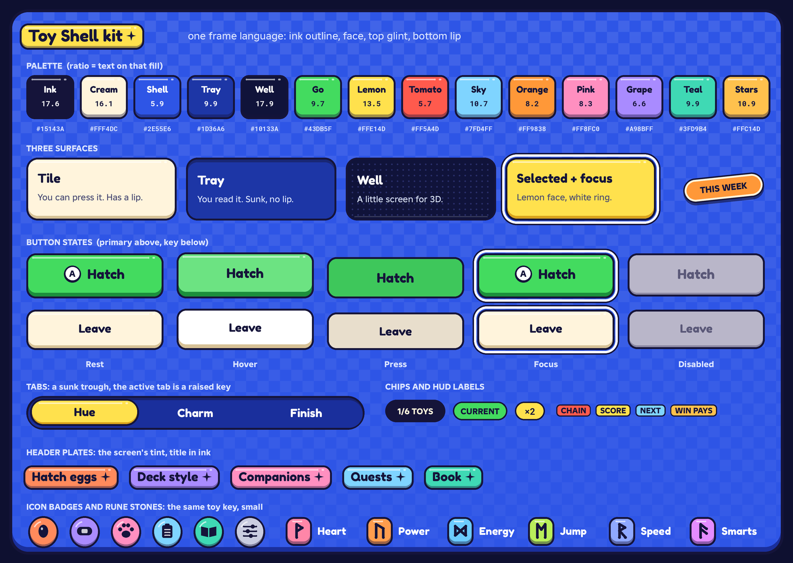
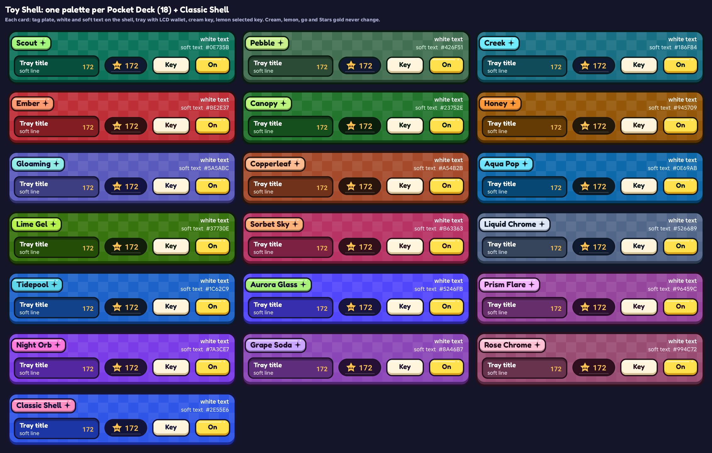
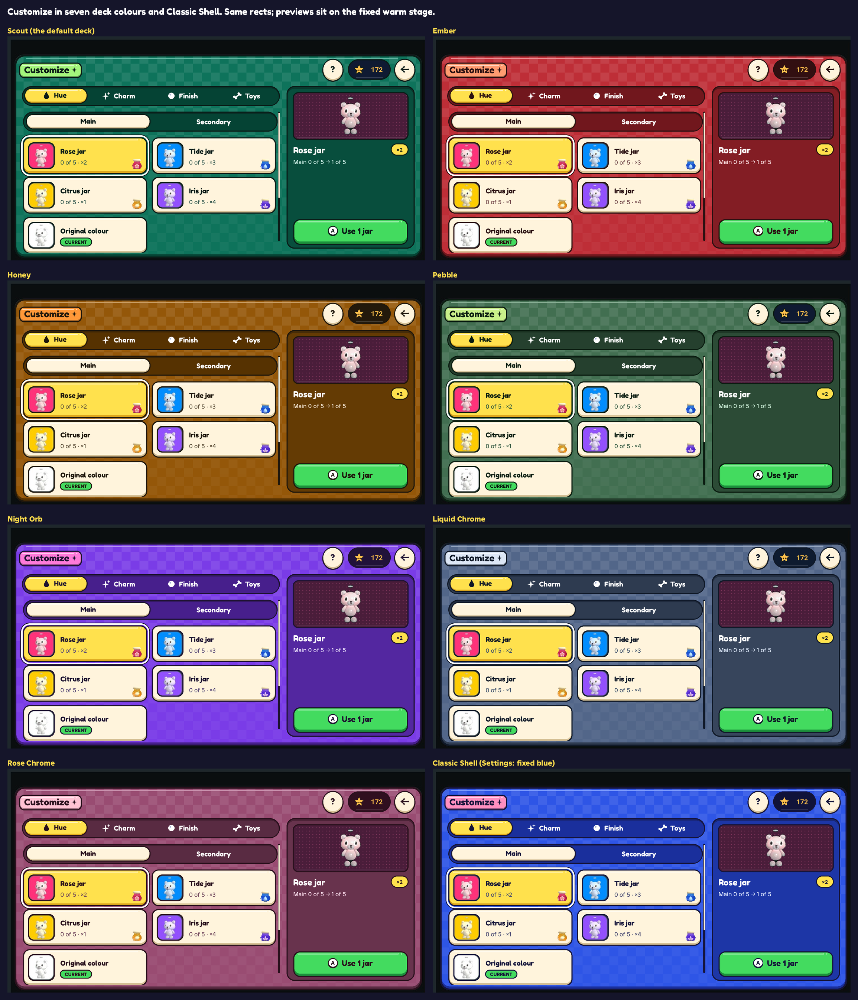
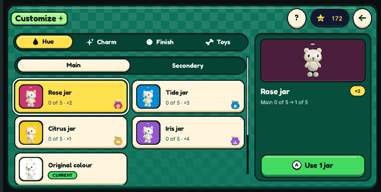

# Pocket Pals v2: retro UI restyle ("Toy Shell")

**Status: direction, style system and mockups for approval, 2026-11-19 (Fable as Astra). Nothing here is built.** No `src/` code, other doc, Studio place or published build was changed.

Spencer (2026-11-19): *"in v2 we need to drastically upgrade the game screen/ui. it looks not retro enough, too vibe codey... the ux is good now, the position of things etc. but the basic styling, colors, etc of the menu uis etc looks too vibe codey/personalityless... I like the font now though. and the usability of the UI. just need a more fun style that's still coherent and usable. lets look to chao garden for inspo?"*

**Kept:** every layout, rect, hit area and focus order; the type (Fredoka One for titles, names and buttons, Builder Sans for body, Roboto Mono for numbers); Stars gold; the board during a round.
**Changed:** the surface of everything else: colour, frames, material, pattern, tabs, chips, headers, icons, motion and sound.

Mockups and generator: `artifacts/v2-ui-restyle-2026-11-19/` (`python artifacts/v2-ui-restyle-2026-11-19/build_mockups.py`). They are PIL drawings over real Studio phone captures. Pets, eggs, jars, jellies and the Star are cut from the capture and put back in the same place. No generated art.


## 1. Diagnosis: why it reads "vibe-coded"

Captures: [deck HUD](artifacts/qa-2026-11-16c-v775/ui-batch/after-14-deck-board-bottom-844x390.png), [Customize](artifacts/qa-2026-11-16c-v775/customization-egg/08-customize-hue-jars-750x402.png), [Pocket menu](artifacts/qa-2026-11-16c-v775/ui-batch/after-09-pocket-menu-animated-tiles-750x402.png), [results](artifacts/qa-2026-11-15-v735/verify-D/D6-results-844x390.png), [Wardrobe](artifacts/store-listing/raw/wardrobe-bell-collar.jpg).

1. **It is the default dark dashboard.** Panel `#152525`, raised `#213335`, well `#0D1818`: three grey-teals a few percent apart, with a 1 px white stroke at 14%. This is the look every generated app has. On the Pocket menu, six tiles and the sheet are one colour; on the deck HUD, eight cards are one colour.
2. **Mint on charcoal is the giveaway.** A single pastel accent (`#76F6B0`) on a dark neutral is the stock palette of 2020s tool UIs. It does every job (tabs, primary button, focus fill, "CURRENT"), so nothing ranks.
3. **No material.** Fills are flat and glassy. The deck beside them is glossy moulded plastic with a real A button; the menus are made of nothing. The personality pass added lips, but a 3 px lip in a slightly darker teal is invisible on a phone (see the Customize cards).
4. **No frame language.** Hairline strokes cannot say "press me" or "read me". The only strong edge in the UI is the focus ring.
5. **No saturated colour except content.** The brightest things on every screen are the pets, the hue thumbnails and the Star. The chrome around them is grey, so the game's own colour never reaches the UI.
6. **The round HUD is a spreadsheet.** CHAIN, SCORE, EGGS LEFT, WIN PAYS: identical boxes with identical grey caps labels, on the most-seen screen in the game.
7. **Details that confirm it:** thin line icons (back arrow, chevrons, clipboard), grey capsule chips, a title squiggle as the only ornament, uniform Quad tweens.

The earlier pass (`UI-PERSONALITY-SCOPE-2026-11-13.md`) fixed type, voice and a few details, and those still hold. What it deliberately kept, "today's default dark teal glass as its permanent palette", is the part Spencer is now reacting to. This page replaces that palette decision (T5) and deepens T2; that doc is not edited.

## 2. Three directions (drawn for this page)


| | Idea | For | Against |
|---|---|---|---|
| **A Toy Shell** | Menus are moulded from the same plastic as the deck: blue shell, cream keys, thick ink outline, a lip you press, little LCD wells | Retro in the Dreamcast-toy sense, bright, obvious affordances, highest contrast, builds straight on "pocket console" | Biggest visual change; the outline needs a Studio spike first (section 6, step 0) |
| **B Pixel LCD** | Every menu is the deck's screen: phosphor green, stepped corners, dither | Most literally retro, cheap | Dark and one-colour again; fights Fredoka's round shapes; pets look wrong on green |
| **C Sticker Book** | Paper, gingham, pastel stickers, stitching | Cutest; closest to the garden | Cosy-2020s, not retro; pastel on cream leaves little contrast; nothing to do with the deck |

**Recommendation: A, Toy Shell**, with B kept where it belongs: inside wells and on the deck's LCD. The rule that falls out: **plastic is bright and outlined, screens are dark and dotted.**

Chao Garden is the reference for feel only: chunky frames, saturated primaries, a patterned backdrop, toy-console charm. Nothing of Sega's is used: no assets, emote ball, logos, fonts or layouts. The checker is a plain two-tone grid at 9%, not a copy of any screen.

## 3. The style system



### 3.1 Palette (`Kit.Toy`, fixed, never tinted by the faceplate)

Ratios are computed by the generator (WCAG relative luminance).

| Token | Hex | Job | Text on it | Ratio |
|---|---|---|---|---:|
| `ink` | `#15143A` | Every outline; text on light fills | cream | 16.1 |
| `inkSoft` | `#4A4972` | Body text on cream / on lemon | | 7.7 / 6.5 |
| `cream` / `creamLip` | `#FFF4DC` / `#D6C196` | Tiles and keys (anything you press) | ink | 16.1 |
| `shell` / `shellHi` / `shellLip` | `#2E55E6` / `#7C9BFF` / `#1A2F9C` | Sheets (the menu body); tab troughs use `shellLip` | white | 5.9 |
| `onShellSoft` | `#DCE5FF` | Secondary text on shell / on tray | | 4.7 / 7.8 |
| `tray` | `#1D36A6` | Info panes; `#1B2670` on the deck LCD | white | 9.9 |
| `well` / `wellDot` | `#10133A` / `#2A2F6B` | Little screens for 3D previews; the LCD glass | white | 17.9 |
| `go` / `goLip` | `#43DB5F` / `#1C8F3C` | The one primary action per screen; "done" | ink | 9.7 |
| `lemon` / `lemonLip` | `#FFE14D` / `#D9A31C` | Selected: active tab, selected tile | ink | 13.5 |
| `tomato` / `tomatoText` | `#FF5A4D` / `#B3261E` | Danger, promos; red text on cream | ink / on cream | 5.7 / 6.0 |
| `sky` `orange` `pink` `grape` `teal` | `#7FD4FF` `#FF9838` `#FF8FC0` `#A98BFF` `#3FD9B4` | Screen tints, HUD label tabs, icon badges | ink | 6.6 to 10.7 |
| `stars` | `#FFC14D` (unchanged) | Stars only: a star shape, or digits beside one | ink / on well | 10.9 / 11.0 |

Mint `#76F6B0` is retired from chrome. Lemon is an area fill for "selected"; Stars gold only ever appears as a star or its number, so the two do not collide. Screen tints replace the `Kit.Tint` values: Hatch `#FF8A5C`, Deck style grape, Companions pink, Quests sky, Book teal, Garden go.

### 3.2 Frame language: outline, face, glint, lip

Every piece is the same four-part moulding:

1. **Ink outline**, drawn *inside* the rect: 3 px on sheets, 2 px on everything else.
2. **Face**, flat colour.
3. **Glint**: one 1.5 px line of the face colour mixed 60% to white along the top, with a break and a dot at the right end. Pieces under 20 px tall skip it.
4. **Lip**: a darker band of the face colour below the rect. Sheet 4 to 5, primary 4, tile and key 3, tab and chip key 2. These are today's `Kit.Lip` depths, so they fit the existing gaps.

Three surfaces, three meanings (this is T2, made visible):

| Surface | Look | Means | Kit |
|---|---|---|---|
| **Tile / key** | Cream face, lip, glint | You can press it | `Kit.tile`, `Kit.button` |
| **Tray** | Dark blue, no lip, a 3 px shadow under its top edge (sunk) | You read it | `Kit.card`, `Kit.frame` |
| **Well** | Navy screen, 6 px dot grid, one light line at the bottom | A window onto 3D | `Kit.well`, `Kit.previewWell` |

Radii stay as `Kit.Radius`. Round keys (back, help, chevrons) are circles with the same outline and lip.

### 3.3 Patterns

- **Shell checker:** 12 px squares, shell mixed 9% to white, fading from full strength at the top of a sheet to 35% at the bottom. One small tile image plus a transparency gradient. Tiles and trays cover it; it never sits under a sentence.
- **Well dots:** already in Kit (`Kit.dotGrid`); raised from 6% white to the visible `wellDot`.
- **Sunburst:** a two-blue 12-ray burst behind a hero (results Star, hatch reveal). One image, slow 20 s rotation; still under Reduced Motion.
- No pattern on the board, in trays, or behind body text.

### 3.4 Buttons

| State | Primary (go) and key (cream) |
|---|---|
| Rest | Outline, face, glint, lip |
| Hover (mouse) | Face 22% lighter (a key goes white), piece rises 1 px, lip grows 1 px |
| Press | Face drops onto the lip (lip height 0), face 10% darker, no glint. 60 ms down, 100 ms up, as today |
| Focus (gamepad, keys) | 2.5 px white ring 3.5 px outside the piece, with a 1.5 px ink hairline outside that. The ring wraps the lip |
| Disabled | Face `#B9B6C9`, 2 px lip `#8C89A3`, text `#5A5878`, no glint; the reason line beside it stays, as now |
| Selected (tiles) | Lemon face and lemon lip; ink text stays |

One primary per screen. Everything else pressable is a cream key. Danger is a tomato key with ink text. The A / B hint caps sit on buttons as white discs with an ink ring.

### 3.5 Tabs and chips

- **Tabs:** the bar is a sunk trough (`shellLip`, ink outline, top shadow). The active tab is a raised key: lemon on the main bar, cream on a second-level bar (Main / Secondary). Inactive labels are white on the trough. Same segments, same heights.
- **Count chips** ("1/6 TOYS"): solid ink pill, cream caps. **State chips** ("CURRENT", "WEARING"): go fill, ink outline, ink caps. **Quantity** ("×2"): lemon pill, mono.
- **Stickers** (T6, kept): cream edge inside an ink outline, tilted, for the one thing per card that deserves a shout ("THIS WEEK", "NEW", "New best").
- **HUD label tabs:** on the deck LCD each card's caps label sits on a small coloured plate with an ink edge: CHAIN tomato, SCORE lemon, GOALS go, NEXT sky, EGGS LEFT orange, WIN PAYS Stars gold. Same text, same place; the HUD stops being eight grey boxes.

### 3.6 Header plates

The title keeps its position and size. Behind it goes a plate in the screen's tint (9 px side padding, 26 px tall, 2 px lip) with the title in ink and a four-point sparkle after it. It replaces the eyebrow dot and the squiggle. The wallet becomes a well-coloured capsule (an LCD counter) with the faced Star and gold mono digits. Back and help are cream round keys.

### 3.7 Icons

- Filled ink silhouettes, round ends, one cut-out or glint each, drawn for 16, 20 and 24 px. No hairline icons: the back arrow and chevrons become 2.4 px ink strokes with round caps.
- Navigation icons sit on a **badge**: a round key in the screen's tint with outline and lip. Round things may have two dot eyes (T10, kept).
- One atlas upload replaces the `Vector` table in `DeckKit`. Drawn by hand or in code, as here; no AI art.

### 3.8 Rune stat stones

The stones in `V2-FEEDING-RUNES-ONBOARDING-2026-11-19.md` 1.3 are already this language: a rounded square in the stat's colour with an ink rune and a darker lip. Two changes make them fit; they are proposed here and that doc is not edited:

1. **Edge:** on cream tiles and on the shell, the stone takes the 2 px ink outline (instead of "flat chip, no outline" on dark glass and the white sticker edge on light UI). In the 3D world it keeps the white sticker edge.
2. **Stat tiles** become cream tiles with the stone at the left, the name in ink Fredoka and the value in mono; the stats panel body is a tray.

Ink on the six stat colours measures 7.7 to 12.9. Heart pink `#FF86A8` and Power orange `#FF9D4D` sit near our pink and orange tints, so stat colours only ever appear as a stone or directly beside one. The 16 px floor and the "never without colour, name where there is room" rules are unchanged. The stones on the style sheet are my redraw for this page, not the approved art.

### 3.9 Motion

| Name | Where | What | Reduced Motion |
|---|---|---|---|
| **Press-in** | Every key and tile | Face drops onto the lip in 60 ms; back in 100 ms with 1 px overshoot | Kept (it is feedback) |
| **Boing** | Selection, stickers, chips landing | 0.96, 1.04, 1 in 160 ms, Back out (`Kit.boing`, exists) | Cut |
| **Squash** | Tab key travelling | Stretches 6% along its travel, lands with a 2 px settle | Slide only |
| **Plate drop** | Screen open | Header plate drops 10 px and rocks 2 degrees once, 220 ms | Cut |
| **Shell rise** | Sheet open | The existing slide, with the lip appearing last (40 ms) | Existing fade |
| **Tick** | Counters | Digits hop 1 px per change | Cut |

Never animate text the player is reading. Nothing loops except the sunburst and the existing pet idles.

### 3.10 Sound (spec only; nothing was synthesised for this page)

Same house method as the feeding sounds (numpy, fixed seeds, no samples, no AI audio), on the existing `ClickSound` attribute:

| Cue | Sound | Length |
|---|---|---:|
| `press` | Soft plastic "tok": a 180 Hz thump with a 2 kHz click | 50 ms |
| `release` (primary only) | A lighter "tik", a fifth up | 40 ms |
| `tab` | Wooden "thock" with a short downward bend | 70 ms |
| `select` | Two-note blip, rising a fourth | 80 ms |
| `open` / `back` | Cartridge "ka-chunk" / the same two parts in reverse order, softer | 140 ms |
| `deny` | Existing | |

All follow the SFX volume and none is the only signal. Spencer must listen before any upload.

## 4. Readability and touch rules

1. **Body text is ink on cream, or white on tray, shell or well. Nothing else.** Every pair in 3.1 passes WCAG AA for body text (4.5:1). The lowest is soft text on the bare shell at 4.7, so that pair is for hint bars only.
2. **Saturated colours never carry sentences.** On go, lemon, tomato and the tints, text is ink, 12 px or larger, labels only.
3. **Coloured text on cream is limited to `tomatoText`** (promos, 6.0). Gold text is allowed on tray or well (8.3, 11.0) and never on cream, where it fails.
4. **Colour is never the only signal:** selected is lemon *and* a ring or a raised key; done is go *and* a tick; a stat is colour *and* rune *and* name.
5. **Outlines go inside the rect**, so 44 px targets stay 44 px and no gap shrinks. Lips use the gaps `Kit.Lip` already uses. Phone minimums stand: 44 px targets, 12 px text floor, `TextScaled` off.
6. **Disabled text is 3.4:1** by design (WCAG exempts disabled controls); the reason line beside it is at full contrast.
7. **The board is untouched:** no pattern, tint or outline inside it. The HUD around it uses the dark tray so the board stays the brightest thing on the LCD.
8. The focus ring is white with an ink hairline, so it reads on blue (5.9), on cream and over the garden.

## 5. The four screens

Each file shows the Studio capture on the left and the drawing on the right, at 2x. The `-after@2x.png` files are the proposal alone.

| # | Screen | File | What changed |
|---|---|---|---|
| 1 | Pocket Deck round HUD, 844x390 | [01](artifacts/v2-ui-restyle-2026-11-19/01-pocket-deck-hud-844x390-before-after.png) | Navy LCD glass, trays with coloured label tabs, Quests as the one cream key, round back key. Board, shell and hardware untouched |
| 2 | Customize, Hue, 750x402 | [02](artifacts/v2-ui-restyle-2026-11-19/02-customize-hue-750x402-before-after.png) | Blue checker sheet, pink header plate, tab troughs with raised keys, cream jar tiles, a tray and well for the pet, go button |
| 3 | Pocket menu (the hub), 750x402 | [03](artifacts/v2-ui-restyle-2026-11-19/03-pocket-menu-750x402-before-after.png) | Cream tiles, icon badges, ink count chips, wells for the live previews, tilted stickers |
| 4 | Round results, 844x390 | [04](artifacts/v2-ui-restyle-2026-11-19/04-results-844x390-before-after.png) | Sunburst behind the Star, payout and goals trays, Total as a gold plate, one go button and three keys |

Honest limits:

- These are drawings, not Studio captures. Rects were measured from the captures by eye against a 10 px grid, so they are within about 2 px, not pixel-exact.
- Customize and the Pocket menu only exist as 750x402 phone captures, so those two are at that size, not 844x390. The results capture is 860x406 as saved.
- Cut-outs are soft because the captures are 1x. The hardware MENU pill, A, B and d-pad are left as captured.
- Desktop is not drawn; the same tokens apply, with a 5 px sheet lip.

## 6. Migration: restyle without moving anything

The work is almost all in `src/client/DeckKit.lua`. Screens call Kit, so most of them change without being opened. **No `Position`, `Size`, `AnchorPoint`, padding or focus order changes in any step.** Each step is checked by overlaying a new Studio capture on the old one at 844x390 and 750x402 (rects must match) and by the existing layout specs.

| Step | Kit change | Reaches | Risk |
|---|---|---|---|
| 0 | **Spike in Studio: the inner 2 px outline.** Try `UIStroke` with an inner border position if the engine offers it (I have not verified this in Studio); otherwise one white 9-slice "toy frame" image tinted by `ImageColor3`. Decide once | Nothing shipped | This decides the cost of everything below |
| 1 | `Kit.Color` and the `fallback` table take the `Kit.Toy` palette; `Kit.Stroke` becomes ink, opaque; text roles split into "on cream" and "on shell" | Every screen recolours | Labels that set their own colour by hand: sweep `TextColor3` |
| 2 | `Kit.tile`, `Kit.button`, `Kit.paintButton`: cream and go faces, outline, glint, lip colours, the five states | All tiles and buttons | Hand-built tiles in `CustomizeCards`, `HueEggView`, `CompanionsHub`, `EggHatchView`, the shops |
| 3 | `Kit.card` / `Kit.frame` become trays; `Kit.well` / `Kit.previewWell` / `Kit.dotGrid` become wells; `Kit.seam` retired | Detail panes, previews | A screen that uses `card` for something pressable must switch to `tile` |
| 4 | `Kit.sheet`: shell, checker, sheet lip. `Kit.header`: plate instead of eyebrow and squiggle. `Kit.wallet`, `Kit.backArrow`, `Kit.helpButton` as LCD capsule and round keys. New `Kit.Tint` values | Every menu | Long translated titles: the plate follows the text and truncates where the title does now |
| 5 | `Kit.tabs`: trough and raised key, squash. `Kit.chip`: ink, state, quantity and sticker kinds. `Kit.glyph` caps | Tabs and chips everywhere | Low |
| 6 | Deck LCD: `DeckScreen` HUD cards use the tray plus a new `Kit.hudLabel`; `DeckResults` trays, sunburst, Total plate | The round and results | The most-seen screen: check on the smallest phone (568x320) |
| 7 | Icon atlas replaces `Vector`; badges in `PocketMenu`; rune stones | Icons | One upload batch |
| 8 | Motion (`Kit.Motion`, `Kit.boing`, plate drop) and the five sounds | Feel | Reduced Motion paths |
| 9 | Sweep the outliers: `NoticeCards`, `CoachCards`, `NotificationRail`, `QuestLog`, `BookView`, `PetFocusUI`, `PetInspect`, `HowItWorks`, toasts | Leftovers | Anything still teal after step 5 is a hand-built frame |

Steps 1 to 4 change most of what Spencer sees. Ship 0 to 5 as one private build for his eyes before touching the deck LCD (step 6). The faceplate keeps tinting only the deck and its backdrop, as already decided.

## 7. Open questions for Spencer

1. **One blue shell for every menu, or a shell colour per screen family?** Recommended: one blue, with the header plate carrying the tint. That is the coherence he asked for.
2. **Green stays the action colour, as saturated go instead of pastel mint?** Recommended: yes. It keeps "green means go" and matches the A button on the default plate.
3. **Does the deck LCD go navy too?** Recommended: yes for the HUD and results around the board; no change to the board itself.
4. **Checker, or plainer?** If the checker feels busy on a phone, keep it in the header band only. Nothing else depends on it.

## Revision 1 (2026-11-19): deck-matched colour, 18 palettes, the moving grid

Spencer: *"i think toy shell. can we make the color change depending on the color of pocket deck we have selected? or should it be a separate ui theming option? and can we make the grid background pattern like seamlessly uv translating diagonally."* Direction A is chosen. This section replaces "fixed, never tinted by the faceplate" in 3.1, the last sentence of section 6, and open questions 1 and 4. Nothing is built; `src/` is untouched. Generator: `python artifacts/v2-ui-restyle-2026-11-19/build_revision1.py` (it reuses `build_mockups.py` unedited).

### R1.1 Recommendation: match the deck by default, Classic Shell as a Settings choice

**Settings > Menu colours: "Match my deck" (default) / "Classic Shell".** Not a separate theme picker.

- Today's menus already follow the deck (`Plates[id].ui`). A fixed blue would take away something players have now, and would make an 18-plate shop feel smaller.
- It gives every faceplate a second payoff: buy Night Orb and the whole game turns violet. A separate theme list would be a second thing to unlock, explain and store.
- Classic Shell is the blue from sections 3 to 5, unchanged, for players who want one fixed look. One saved key (proposed `menuColours = "deck" | "classic"`), default `deck`. The Deck style shop should preview a plate's shell on focus, so the colour is seen before buying.
- Book-only plates (Bookworm, Stargazer) are not in `Themes.Order` and are not drawn here; until they get a row they fall back to Classic.

### R1.2 How each palette is made



1. **Hue and saturation by hand, per plate**, from its `deep`, face and `accent` (notes are in the Lua comments).
2. **Brightness is solved, not picked.** Each role is set to one fixed WCAG luminance on every deck: shell 0.131, tray 0.058, trough 0.042, LCD well 0.0105, ink 0.009, soft ink 0.080, soft text 0.80. Contrast is therefore the same on all 18 decks by construction, and a new plate needs only a hue, a saturation and a tag.
3. **Fixed on every deck:** cream tiles `#FFF4DC`, white text, selected lemon `#FFE14D`, go `#43DB5F`, tomato, and Stars gold `#FFC14D`. Selected stays lemon everywhere: it is the one constant "you are here", and it clears every shell by more than 4:1.
4. **Mint stays retired.** Scout and Aurora Glass have mint accents, so their tags move to spring green and aurora green.
5. **No teal behind previews, on any deck.** Every 3D preview and reveal sits on a fixed warm **stage**: berry `#4A1D3A`, dots `#7A3458`, apricot `#FFB26B` for the reveal sunburst and light pool. This replaces the navy preview well in 3.2 and is never deck-tinted. The dark `well` is now only LCD glass for counters (the wallet); on green and cyan decks (hue 140 to 200) it is navy, so no grey-teal glass remains.

Plates that needed special handling:
| Plate | Problem | Handling |
|---|---|---|
| Honey | Yellow cannot hold white text at 4.5:1 | Shell is caramel `#945709`; tag is orange, not gold, so nothing imitates Stars |
| Pebble (`stone`) | Grey-green, reads dull | Sage, saturation raised from .31 to .40; brighter lime tag |
| Liquid Chrome | Grey plate, no hue | Steel blue shell at saturation .40; the tag stays silver on purpose |
| Rose Chrome | Pale pink accent | Dusty rose shell at full depth; the pale pink is the tag |
| Night Orb | `deep` is near black | Lifted to violet `#7A3CE7`; hot pink tag |
| Aurora Glass | Navy `deep`, mint accent | Lifted to indigo, kept off Classic blue; tag is aurora green |
| Scout (`sherbet`) | Accent is the retired mint | Jade shell, spring green tag |
| Ember, Copperleaf, Sorbet Sky | Three reds | Hue 356 red, 16 copper, 338 raspberry. Tomato danger keys keep their ink outline |

### R1.3 Contrast (computed by `build_revision1.py`: WCAG relative luminance, 18 pairs x 19 palettes = 342 checks, 0 failures)

| Pair | Job | Floor | 18 decks, min to max | Lowest deck | Classic |
|---|---|---:|---:|---|---:|
| white on shell | Titles and body on the shell | 4.5 | 5.74 to 5.80 | moss | 5.90 |
| soft on shell | Hint text on the bare shell | 4.5 | 4.66 to 4.73 | ice | 4.69 |
| white on tray | Body in trays | 4.5 | 9.62 to 9.72 | gloaming | 9.86 |
| soft on tray | Secondary text in trays | 4.5 | 7.83 to 7.91 | ice | 7.84 |
| white on lip | Inactive tab labels in the trough | 4.5 | 11.29 to 11.41 | aqua_pop | 10.88 |
| stars on tray | Gold digits in a tray | 4.5 | 5.95 to 6.01 | gloaming | 6.10 |
| stars on well | Wallet digits on the LCD | 4.5 | 10.66 to 10.73 | liquid_chrome | 11.04 |
| white on well | Text on the LCD | 4.5 | 17.24 to 17.34 | liquid_chrome | 17.85 |
| inkSoft on cream | Body on cream tiles | 4.5 | 7.33 to 7.39 | stone | 7.73 |
| inkSoft on lemon | Body on a selected tile | 4.5 | 6.15 to 6.20 | stone | 6.48 |
| ink on tag | Header plate and label tags | 4.5 | 7.65 to 14.13 | night_orb | 8.33 |
| outline on shell | Ink outline against the shell (non-text) | 3.0 | 3.05 to 3.09 | stone | 2.98 |
| lemon on shell | Selected key against the shell (non-text) | 3.0 | 4.41 to 4.45 | moss | 4.53 |

Fixed pairs, the same on every deck: ink on go 9.7, white on stage 13.7, Stars gold on stage 8.5; ink on cream and on lemon are 16 and 13.5 or better. Classic is the approved blue, unchanged: its ornamental outline measures 2.98 against the 3.0 non-text floor (reported, not altered, and excluded from the failure count). Per-deck figures: `artifacts/v2-ui-restyle-2026-11-19/toy-shell-palettes.json`. Rule 1 of section 4 holds on every deck: body text is ink on cream or lemon, or white or soft on shell, tray, well or stage.

### R1.4 Lua table for the implementer (proposed `toyShell` field per plate in `DeckThemes.Plates`)

Shared, not per plate: `Toy.Fixed={cream="#FFF4DC",creamLip="#D6C196",onShell="#FFFFFF",selected="#FFE14D",selectedLip="#D9A31C",stars="#FFC14D",go="#43DB5F",goLip="#1C8F3C",tomato="#FF5A4D",tomatoText="#B3261E",stage="#4A1D3A",stageDot="#7A3458",stageGlow="#FFB26B"}`. `tag` is the header plate and label-tag fill (ink text); `shellLip` is also the tab trough. Classic Shell is the 3.1 table with `tag="#FF8FC0"`. Same text in `artifacts/v2-ui-restyle-2026-11-19/toy-shell-palettes.lua.txt`.

```lua
 sherbet={shell="#0E735B",shellHi="#5BB19D",shellLip="#054334",tray="#084E3D",well="#0F1A32",wellDot="#27385D",ink="#0A1B17",inkSoft="#34574E",onShellSoft="#CDEFE7",tag="#A4F57C",tagLip="#69A256"}, -- jade from deep; accent is the retired mint, so the tag moves to spring green
 stone={shell="#426F51",shellHi="#85AB91",shellLip="#25402E",tray="#2C4B36",well="#0F1A32",wellDot="#27385D",ink="#0A1C10",inkSoft="#355840",onShellSoft="#CEF0D9",tag="#C9F08A",tagLip="#809F5C"}, -- grey-green plate: saturation raised .31 to .40 (sage), tag saturation raised
 ice={shell="#186F84",shellHi="#67ACBD",shellLip="#0B404D",tray="#0F4B59",well="#0F1A32",wellDot="#27385D",ink="#0B1A1E",inkSoft="#37555C",onShellSoft="#D1ECF3",tag="#70ECFF",tagLip="#4A9CAA"}, -- cyan side of the three blues
 brick={shell="#BE2E37",shellHi="#E7878D",shellLip="#71171D",tray="#831D24",well="#320F11",wellDot="#5E272B",ink="#2A1011",inkSoft="#714447",onShellSoft="#FFE0E2",tag="#FF9B70",tagLip="#AE664C"}, -- red from face and deep
 moss={shell="#23752E",shellHi="#6DB176",shellLip="#124318",tray="#164F1E",well="#091F0C",wellDot="#1B4020",ink="#0A1C0D",inkSoft="#355839",onShellSoft="#CEF0D2",tag="#BCF57B",tagLip="#78A351"}, -- leaf green, pushed off jade
 honey={shell="#945709",shellHi="#C79A60",shellLip="#563201",tray="#643B04",well="#23190B",wellDot="#47361E",ink="#1F170C",inkSoft="#5E4E38",onShellSoft="#F4E6D2",tag="#FF9838",tagLip="#AA6727"}, -- yellow cannot hold white text, so the shell is caramel; tag is orange, not gold (Stars)
 gloaming={shell="#5A5ABC",shellHi="#9D9DDB",shellLip="#33336F",tray="#3D3D81",well="#141443",wellDot="#313173",ink="#141435",inkSoft="#4B4B7D",onShellSoft="#E6E6FF",tag="#92ECE6",tagLip="#629AA3"}, -- dusk periwinkle
 copperleaf={shell="#A54B2B",shellHi="#D2937C",shellLip="#602A16",tray="#70321B",well="#2A150D",wellDot="#533023",ink="#24140E",inkSoft="#68493E",onShellSoft="#FCE2D8",tag="#FFBC90",tagLip="#AC7C5F"}, -- copper from face, not the maroon deep
 aqua_pop={shell="#0E69AB",shellHi="#69A9D6",shellLip="#033D65",tray="#074774",well="#0C1C27",wellDot="#213B4E",ink="#0D1A22",inkSoft="#3B5363",onShellSoft="#D6EBF9",tag="#6FE3FF",tagLip="#4A97AB"}, -- azure
 lime_gel={shell="#37730E",shellHi="#7DB05B",shellLip="#1E4305",tray="#244E08",well="#111E09",wellDot="#293F1A",ink="#111B0A",inkSoft="#415633",onShellSoft="#DAEECC",tag="#B6F24B",tagLip="#77A032"}, -- lime from deep
 sorbet_sky={shell="#B63363",shellHi="#E087A8",shellLip="#6C1A38",tray="#7D2143",well="#310F1B",wellDot="#5C273A",ink="#291019",inkSoft="#6F4353",onShellSoft="#FEE0EB",tag="#FFB37A",tagLip="#AE7555"}, -- raspberry from deep, peach tag
 liquid_chrome={shell="#526689",shellHi="#93A3BD",shellLip="#2E3B50",tray="#37455C",well="#0E1B30",wellDot="#263959",ink="#0F1827",inkSoft="#41516C",onShellSoft="#DDE8FB",tag="#DCE6F5",tagLip="#8E98A7"}, -- grey plate: steel blue shell, the tag stays silver on purpose
 tidepool={shell="#1C62C9",shellHi="#78A4E4",shellLip="#0C3879",tray="#11428A",well="#0E1B2E",wellDot="#253957",ink="#0F1827",inkSoft="#40516A",onShellSoft="#DAE9FE",tag="#5CD6E8",tagLip="#3F8E9F"}, -- ocean blue
 aurora_glass={shell="#5246FB",shellHi="#9D97F9",shellLip="#2D259A",tray="#372EAE",well="#171441",wellDot="#343071",ink="#161433",inkSoft="#4E4B7C",onShellSoft="#E6E5FE",tag="#A8F27A",tagLip="#719E5F"}, -- navy deep lifted to indigo (kept off Classic blue); mint accent moved to aurora green
 prism_flare={shell="#96459C",shellHi="#C88ECD",shellLip="#58265B",tray="#662E6A",well="#2C0E2F",wellDot="#562559",ink="#260F27",inkSoft="#6A426D",onShellSoft="#FBDFFD",tag="#F3B6FF",tagLip="#A577AD"}, -- orchid
 night_orb={shell="#7A3CE7",shellHi="#B490F2",shellLip="#471F8C",tray="#5327A0",well="#21123A",wellDot="#432C69",ink="#1D1230",inkSoft="#594877",onShellSoft="#EDE3FD",tag="#FF7AD9",tagLip="#A95299"}, -- near-black deep lifted to violet; hot pink tag
 grape_soda={shell="#8A46B7",shellHi="#BD91DB",shellLip="#51266D",tray="#5E2E7D",well="#271035",wellDot="#4C2962",ink="#21112C",inkSoft="#614573",onShellSoft="#F1E2FB",tag="#C9A6FF",tagLip="#896DAF"}, -- grape
 rose_chrome={shell="#994C72",shellHi="#C992AE",shellLip="#592B42",tray="#68334D",well="#300F1F",wellDot="#5C2641",ink="#29101C",inkSoft="#6F4359",onShellSoft="#FEDFEE",tag="#FFC2D4",tagLip="#AE7E8E"}, -- pale plate: dusty rose shell at full depth, pink tag
```

### R1.5 Mockups: Customize in seven decks and Classic



Scout, Ember, Honey, Pebble, Night Orb, Liquid Chrome, Rose Chrome and Classic; singles are `07-customize-<id>.png`. Same rects as section 5. Drawings, not Studio captures; the pet and jars are the capture's own.

### R1.6 The moving grid


Preview: `08-grid-scroll-preview.gif` and `.mp4` (60 frames, 15 fps, 4 s; the script checks that frame 60 is pixel-identical to frame 0). Tile: `toy-checker-tile-32@2x.png`, drawn by script.

| | Spec |
|---|---|
| Tile | 32 x 32 px: two 16 px squares each way (up from 12 px, so the motion reads on a phone). The image is 64 x 64 (2x), white squares on transparent, tinted by `ImageColor3`. **One** tiled ImageLabel per surface |
| Speed and direction | 8 px/s on each axis, down and to the right (11.3 px/s on the diagonal). One tile every 4 s. Constant, linear, no easing |
| Opacity | 9% white over the shell (`ImageTransparency` 0.91). The top-to-bottom fade to 35% stays, as a **static** shell-coloured gradient frame above the pattern, so the fade does not travel |
| Gets it | The sheet background (the shell). Stage wells: the existing 6 px dot grid drifts the same way at 3 px/s per axis |
| Never | Cream tiles, trays, header plates, anything with a sentence on it, the board, the deck LCD HUD, scrolling list content |
| Reduced Motion | Profile key `reduced` (or `Kit.reduced()`): no tween is created and the pattern rests at offset 0. It is still drawn, only still |
| Hidden | Pause the tween when the sheet's `Visible` is false or its ScreenGui is disabled; resume on show; cancel on destroy |

**Seamless method (recommended):** a holder Frame with `ClipsDescendants = true`, sized to the sheet inside its outline. Inside it, one ImageLabel with `ScaleType = Tile`, `TileSize = UDim2.fromOffset(32, 32)` and `Size = UDim2.new(1, 32, 1, 32)` (one tile larger on each axis). Its `Position` runs from `fromOffset(-32, -32)` to `fromOffset(0, 0)`; the travel is exactly one tile, so the jump back cannot be seen. Drive it with **one linear `TweenService` tween, 4 s, `RepeatCount = -1`**: no per-frame Lua. The same thing by hand: `offset = (t * 8) % 32` on both axes, `Position = fromOffset(offset - 32, offset - 32)`. **Alternative, not verified in Studio:** keep the label still and animate `ImageRectOffset` across a 128 px image with a 64 px `ImageRectSize`. Use it only if the spike shows it tiles cleanly.

Risks for the step 0 spike:
1. `ClipsDescendants` clips to the rectangle, not to `UICorner`, so the pattern would show in the sheet's four rounded corners. The toy frame image must cover them, or four small corner masks. Do **not** fix this with a CanvasGroup (see the performance note).
2. GUI positions land on whole pixels, so at 8 px/s the pattern steps 1 px every 125 ms. That is intended (it reads as retro). If it looks jittery on a device, 16 px/s halves the step time.

**Phone performance:** one tiled ImageLabel is one image draw whatever its size, and the tween runs in the engine. Budget: at most one moving sheet and two moving wells on screen. Never put a moving pattern inside a CanvasGroup, which would be redrawn every frame; that is also why the fade is a separate static frame. If a low-end phone still drops frames, wells go static first, then the sheet. None of this has been measured on a device yet.

### R1.7 Migration changes

- Step 1: `Kit.Color` reads `theme.toyShell` merged over `Toy.Fixed`, or the Classic table when `menuColours == "classic"`. The existing `Plates[id].ui` palette stays until step 9 so nothing breaks part-way.
- Step 3: `Kit.previewWell` takes the fixed stage colours; `Kit.well` keeps the per-deck LCD colour.
- Step 4: `Kit.sheet` builds the holder, tile, fade frame and tween, and owns pause, resume and Reduced Motion.
- One new asset to upload (the tile). One new Settings row, whose strings go through the localization sync.
- Still open: whether the deck LCD HUD (section 5, screen 1) also follows the deck. Recommended yes, with the same tray and well tokens; the board stays untouched.
