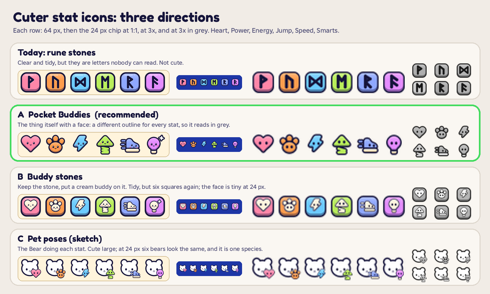
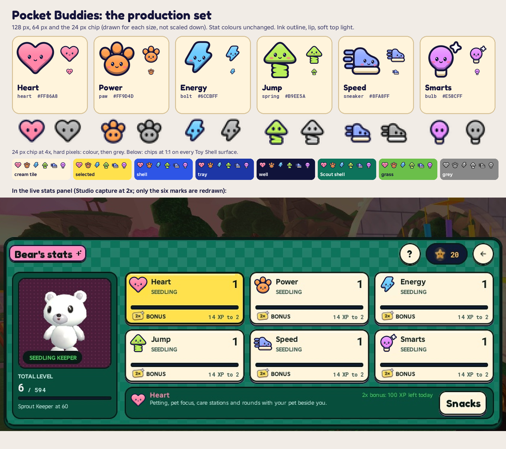
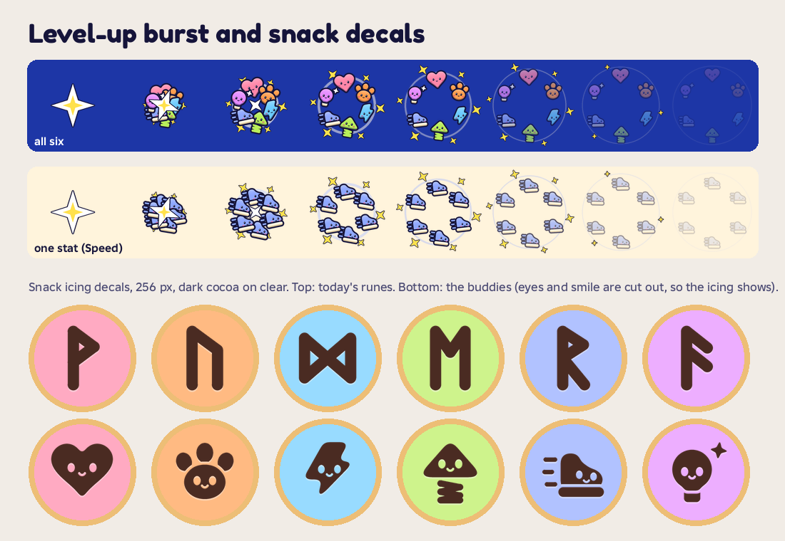
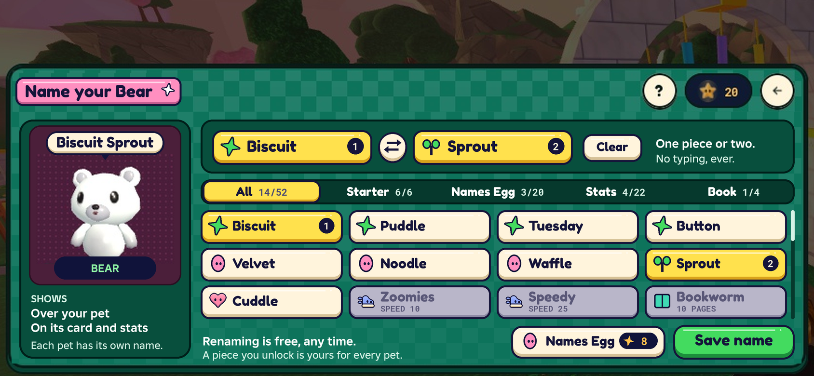

# Pocket Pals v2: cuter stat icons, and pet names

2026-11-20 · Fable as Astra. Scope and art only. **Nothing is uploaded, nothing in `src/` is changed, nothing is committed.**

Spencer: *"i think we should use cuter stats icon, not the runic ones, have fable scope that out. also is the naming and name eggs in this new version scope? or should names be unlocked from stats, levels, etc, or both?"*

Read for this: `CUTE-DESIGN-RULES.md`, `PET-STYLE-GUIDE.md`, `UI-RETRO-RESTYLE-2026-11-19.md`, `V2-SCOPE-2026-11-19.md`, `assets/ui/stat-runes/`, `artifacts/pet-social-scope-2026-11-14/NAMES-EGG-SCOPE.md`, the captures in `artifacts/v2-toy-shell-build/`.

## 0. The answers

1. **Icons:** replace the runes with **Pocket Buddies**: the thing itself with a little face. Heart, paw, lightning bolt, spring arrow, sneaker, light bulb. The set is drawn and ready in `assets/ui/stat-icons/`. The atlas has the same size and rects as the rune atlas, so the swap is two asset ids.
2. **Names in v2:** yes. Ship it with the second pet, as the ranked list already says (slot 6). The Bunny is wired, so the name slot now matters: two pets need two names.
3. **Egg or levels:** **both.** Silly pieces come from the Names Egg. Proud pieces are earned from stat levels, Keeper tiers and the book. Six are free on day one. No typing at all.

## 1. Cuter stat icons

### 1.1 Three directions

| | Direction | For | Against |
|---|---|---|---|
| **A** | **Pocket Buddies.** The object is the icon and has a face. No stone behind it. | Six different outlines, so it reads in grey and at 24 px. Cutest. Same toy language as the pets (round, two eyes, blush). | Icons are not all the same shape, so they sit a little less tidily in a row than six squares. |
| B | **Buddy stones.** Keep the stat-colour stone; a cream buddy sits on it. | Tidy. Closest to what is built. | Still six squares. The face is 3 px wide at 24 px and turns to noise. Half a fix. |
| C | **Pet poses.** The Bear doing each stat. | Charming at 128 px. | At 24 px six bears look the same. It is one species, and we now have two. Needs new art for every pet. |

**Recommendation: A.** It is the only one that gets cuter *and* easier to read. The runes relied on colour and on learning six letters; the buddies say what they mean.

### 1.2 The set

| Stat | Buddy | Why this object |
|---|---|---|
| Heart `#FF86A8` | Heart | The word. |
| Power `#FF9D4D` | Paw (pad and three toes) | A pet's strength is its paw. Three toes, not four, so they stay apart at 24 px. |
| Energy `#6CCBFF` | Lightning bolt | The usual sign for energy. Chunky, corners rounded. |
| Jump `#B9EE5A` | Up arrow on a spring | "Up" reads at any size; the coil says "bounce". A plain ball on a spring read as a little alien, so it was dropped. |
| Speed `#8FA8FF` | Sneaker with speed lines | The scope's "wind lines" alone had no body to put a face on. |
| Smarts `#E58CFF` | Light bulb with a sparkle | An idea. Rays round the bulb read as antlers, so it has one "idea!" sparkle instead. |

How they are drawn (all in `build_icons.py`, PIL and numpy, no AI art, nothing traced):

- **Toy Shell moulding:** ink outline `#15143A` round every piece, flat stat-colour face, a darker lip along the bottom, a soft light on top. Outline is 6 px at 128, 3.3 px at 64, 1.5 px at 24.
- **Face, from the cute rules:** two ink eyes, taller than wide, set low and wide apart; no white ring; a small smile; two blush ovals. Two catchlights at 128, one at 64.
- **Three drawings, not one scaled:** the 24 px chip is its own drawing: bigger eyes, no smile, blush or sparkle, fewer coils, two speed lines instead of three.
- **No points:** every corner is rounded (the bolt and arrow too).
- **Stat colours are unchanged.** They are still fixed and never tinted.

Checked: every icon is told apart in grey at 24 px by its outline alone (sheet 02, second row). Chips are shown on cream, selected lemon, shell, tray, well, the Scout shell and grass. Ink on the six stat colours measures 7.7 to 12.9 (restyle doc 3.8); the ink outline carries the shape on dark surfaces. In the live stats panel they look like this (Studio capture, only the marks redrawn): `artifacts/v2-cute-icons-names-2026-11-20/02b-stats-panel-with-buddies-844x390@2x.png`.

### 1.3 Files (in `assets/ui/stat-icons/`)

| File | Notes |
|---|---|
| `icon-<stat>-128.png`, `-64.png`, `-small-24.png` | 18 PNGs, transparent, 1 px clear padding, colour bled under clear pixels |
| `icon-atlas-512x128.png` + `.json` | **Same size, layout and rects as `rune-atlas-512x128`.** JSON is the same format; `stats.<id>.icon` replaces `.rune` |
| `levelup-burst-8x128.png`, `levelup-burst-<stat>-8x128.png`, `.json` | Same 8 frames of 128 px, same ring, sparkles and timing. The buddies rock 12 degrees and stay upright so the faces read (the stones spun) |
| `build_icons.py`, `README.md`, `_preview.png` | Script, swap steps, check sheet |

**The swap (for Sol, when approved):** upload the atlas and the burst, then change `Panel.Atlas` in `StatsPanel.lua`, `Model.Atlas` in `SnackModel.lua` and the burst id. The rect tables do not change. If any code draws a square or outline behind the sprite, remove it. The "2x BONUS" tags stay as they are.

Follow-ons, small: `StatCatalog` still has a `rune=` field and nodes are named `Rune_<id>`; rename when convenient, it is not player-facing. `UICopy` and the localization table should be searched for the word "rune" before the publish.

### 1.4 The burst and the snacks

**Snack decal: replace it.** A rune on the biscuit and a buddy on the stat tile would be two signs for one stat. Six matching decals are made: `assets/art-source/snacks/export/icon-decal-<stat>-256.png`. They are the same size, colour (dark cocoa `#4A2B22` on clear) and UV use as `rune-decal-*`, so the mesh, icing tint and Decal setup do not change. The eyes and smile are cut out, so the tinted icing shows through and the biscuit smiles. The rune decals are left in place until the swap is approved; I did not edit `snack-export-manifest.json` or `build_snack_images.py` (the manifest's `runeDecals` key should point at the new files when Sol swaps).

Two things to check in Studio before calling it done: the decal's cut-out eyes at real snack size (0.2 studs across the mark), and the buddies on the Stat Egg card and results screen, which I did not mock.

## 2. Names

### 2.1 Does naming ship in v2?

**Yes, with the second pet.** Reasons:

- It is already promised: slot 6 on the ranked list is "Second pet + Names Egg", and the inspect card has an empty name slot.
- The Bunny is wired. With two pets, "Bear" and "Bunny" are labels, not names. A name is what makes the second pet *yours*.
- It gives the stat track cheap, wanted rewards. Levels 25 and 50 today pay a medal and a sticker. A name piece costs no art.
- It is all UI and save work. No new models.

It should come **after** the stats and Toy Shell work that is in flight, as its own slice. It does not block the icon swap.

### 2.2 How it works

Unchanged from the 2026-11-14 proposal, because it was right: collect **name pieces**, put **one or two** together. "Biscuit", "Biscuit Sprout", "Velvet Sidequest". Any piece can go first or second. Swap and Clear are one tap. Renaming is free, forever. No slot is ever lost.

**Kid safety: curated pieces only. No free text, anywhere.** The player never types, so there is nothing to filter: no `TextService` call, no filtered-text failures, no name that is fine for one viewer and hashes for another, and nothing a player can use to write to another player. For an all-ages game this is the safest choice and also the simplest build. The server stores and sends **piece ids**, never strings, and checks that both ids are owned and different. The client builds the text from the catalogue. (Sol: confirm against Roblox's text filtering page that developer-authored fixed strings need no filter; that is my understanding, I did not re-read it today.)

The word list is ours to keep safe: before ship, read every ordered pair (section 2.5), and check each joined pair for a bad word across the join.

### 2.3 Where pieces come from: both, in four lanes

| Lane | Pieces | How | Feels like |
|---|---:|---|---|
| **Starter** | 6 | Free with your first pet. Old saves get them on load | "I can name my pet right now" |
| **Names Egg** | 20 | 8 Stars each, in Hatch eggs. One new piece every time, never a duplicate. 160 Stars buys them all | Silly, collectable |
| **Stats and Keeper tiers** | 22 | Free, the moment the level is reached. Per stat: level 10, 25 (Sprout), 50 (Bloom). Plus four for total level and a first 99 | Proud: "Speedy" means Speed 25 |
| **Book** | 4 | Free, at collection book milestones | Explorer's badge |

Why both, and not one:

- **Egg only** makes every name a purchase and wastes the best free reward we have.
- **Levels only** means a new player waits for words, and the funny words have no home. It also removes a gentle, finite Stars sink.
- Together the egg gives *choice and humour* now, and levels give *names that mean something* later. Other players can read a name and know what it took.

Rules that keep it fair and legal:

1. **Earned pieces are never sold and never in the egg.** Egg pieces are never level-gated. The two lists do not overlap.
2. **Names Egg and the paid random item rules.** Stars can be bought with Robux, so this egg is a paid random item, like the Stat Egg (`V2-SCOPE` 5.5). Unrestricted players: every piece still in the pool is equally likely; the card lists them all with the real figure ("1 in 17, 5.9% each") and the rounding note. **Restricted or unknown players get a fixed, shown order: "Next: Velvet · 8 Stars".** No draw. Same `PaidRandomPolicy` path as today; it fails closed.
3. **No duplicates, no rarity tiers, no reroll fee, no rename fee, no limited-time pieces.** When all 20 are owned the card says "All name pieces collected" and the button is off.
4. **Once unlocked, always unlocked**, for every pet you own. A stat piece earned by the Bear can name the Bunny. (Same rule as shop gates: your best pet opens it for the account.)
5. Level 10 is reached in the first one or two sessions, so every player earns a stat piece early.
6. Nothing else is gated by names, and names gate nothing.

### 2.4 Where the name shows, and per-pet names

- **One name per pet.** Pieces are owned by the account; the choice is saved on each pet. The same piece can be used on both pets.
- **No name set:** the species name ("Bear"), exactly as today. Naming is never forced.
- **Over the pet:** a small cream name tag above your own pet in the garden and park. Other players' tags show when you are near or looking at the pet, not across the map (no cloud of names). Hidden during a round. Follows the existing "hide other players' UI" setting.
- **Inspect card header:** the name, with the species under it: "Biscuit Sprout" / "Bear · with @owner".
- **Stats panel and Companions:** the title becomes "Biscuit Sprout's stats"; the pet row shows the name with the species as the small line.
- **Later, free:** boards and the hatch result can use it.
- **Length:** the longest piece is 10 letters, so the longest name is 21 characters. Tags and the card allow two lines; never shrink below the 12 px floor.
- **Translation:** names are proper names. Show the same authored pieces to every viewer; do not machine-translate a pet's name. The screen's labels and hints go through `UICopy` and the sync as usual. This needs a decision (question 4).

### 2.5 Example pieces (52, all original)

| Lane | Pieces |
|---|---|
| Starter, free (6) | Biscuit, Puddle, Tuesday, Parade, Button, Sprinkle |
| Names Egg (20) | Velvet, Sidequest, Bureau, Mooncrumb, Almost, Marmalade, Teacup, Thunderbun, Noodle, Overture, Pocketful, Moonboots, Crumpet, Detour, Waffle, Stardust, Dumpling, Keepsake, Apricot, Afterparty |
| Heart 10 / 25 / 50 | Cuddle, Sweetpea, Heartsong |
| Power 10 / 25 / 50 | Bonk, Mighty, Thunderpaw |
| Energy 10 / 25 / 50 | Fizz, Sparky, Lightning |
| Jump 10 / 25 / 50 | Boing, Hopscotch, Moonbounce |
| Speed 10 / 25 / 50 | Zoomies, Speedy, Rocket |
| Smarts 10 / 25 / 50 | Hmm, Clever, Professor |
| Keeper tiers (4) | Sprout (total 60), Bloom (total 150), Starbloom (total 450), Champion (first stat at 99) |
| Book (4) | Dogear (first page), Bookworm (10 pages), Footnote (half the book), Librarian (the whole book) |

Sample names: Biscuit Sprout, Speedy Noodle, Professor Waffle, Almost Champion, Thunderpaw Tuesday, Mooncrumb, Velvet Bookworm, Boing Bureau, Sweetpea Parade.

Notes on the list: the egg's 20 are the 2026-11-14 list with "Tumble" changed to "Dumpling" (Tumble was an old stat name). No ordinary first names, no brands, no insults. 52 pieces make 2,652 ordered pairs plus 52 single names. That is one careful read with a printed sheet, plus a script check of each join. Change a word before launch rather than block a pair.

### 2.6 The naming screen

Mockup, 844x390 at 2x, drawn over the Studio stats capture (Scout deck). The Bear is the capture's own pixels; everything else is drawn. **Companions → pet → Name.**

- **Left:** the pet in its well with the name tag as it will float over it, updating as you pick. Under it, where the name shows.
- **Top:** the two slots (lemon = filled), a round Swap key between them, Clear. Tap a filled slot to empty it.
- **Tabs:** All, Starter, Names Egg, Stats, Book, each with owned / total in mono.
- **Grid:** cream keys, one per piece, with a mark for where it came from (green star = starter, pink egg, the stat's buddy, a sprout for Keeper tiers, a book). Tap to put it in the next free slot; the tile turns lemon and shows 1 or 2.
- **Locked pieces are shown**, grey, with what they need ("SPEED 25", "10 PAGES"). The icon keeps its colour. Tapping one says how to get it and offers to take you there; it never sells anything by surprise. Unowned egg pieces show on the Names Egg tab with the egg mark.
- **Bottom:** "Names Egg · 8 Stars" is a cream key that opens the egg card (odds or the fixed next piece shown there, before any spend). **Save name** is the one green primary. Back cancels and keeps the old name.
- Toy Shell throughout: ink outlines, lips, tray for the slots, trough tabs, no new colours.

Not drawn: the Names Egg card, the name tag in the garden, portrait, gamepad focus order.

### 2.7 Save shape (high level, for Sol's architect pass)

All new fields are optional; a save without them loads as "no names yet" (the `LifetimeState.Optional` pattern).

| Where | Field | Notes |
|---|---|---|
| Account | `names.owned` | A set of stable piece ids (strings, append only). Not the pet inventory bitmask |
| Account | `names.starter` | True once the six starters are granted (idempotent, also for old saves) |
| Account | `names.egg = {pool, cycle}` | Pool version and the restricted fixed-order index. A receipt with an operation id per egg, as other eggs |
| Per pet | `petNames[petId] = {a, b}` | One or two piece ids; `b` optional. Missing = species name |
| Public | board attribute `PetName_<petId>` | The two ids, never text. Inspect card and name tags read this |

- **Earned pieces are written into `owned` when granted**, not worked out from levels each time. Retuning the XP curve later must never take a name away.
- Grants happen where level rewards are granted, so a level-up, its medal and its name piece arrive together. On load, a catch-up pass grants anything a save already qualifies for.
- Server checks on save: both ids exist, are owned, are different, at most two. Unknown ids are dropped, never an error.
- Frozen at ship: piece ids and the egg pool's order (append only). Free to change later: display spelling, prices, which level grants which piece (already-granted pieces stay).

## 3. Open questions for Spencer

1. **Icons:** is Pocket Buddies the right direction, and are the six objects right? Jump (arrow on a spring) and Speed (sneaker) are the two I would most expect a note on.
2. **Snacks:** swap the biscuit decals to the buddies too (my recommendation), or keep runes on food only?
3. **Names:** ship with the second pet in v2 as its own slice, after the current stats and Toy Shell work?
4. **Translation:** same authored name for every viewer (recommended), or translated pieces per language?
5. **Names Egg at 8 Stars, 20 pieces, no duplicates:** keep, or make every piece earned and drop the egg? Both is my pick.
6. **Stat pieces at 10, 25 and 50.** Add one at 75 and 99 per stat later, or keep 99 for the Capes and one shared "Champion"?
7. **The word list:** any pieces to cut or swap before the pair read?

## Files

- `assets/ui/stat-icons/`: 18 icon PNGs, `icon-atlas-512x128.png` + `.json`, 7 burst sheets + `.json`, `build_icons.py`, `README.md`, `_preview.png`, `_preview-burst.png`
- `assets/art-source/snacks/export/icon-decal-<stat>-256.png` (6)
- `artifacts/v2-cute-icons-names-2026-11-20/`: `01-icon-directions.png`, `02-pocket-buddies-set.png`, `02b-stats-panel-with-buddies-844x390@2x.png`, `03-burst-and-snack-decals.png`, `04-naming-screen-844x390@2x.png`, `build_sheets.py`
