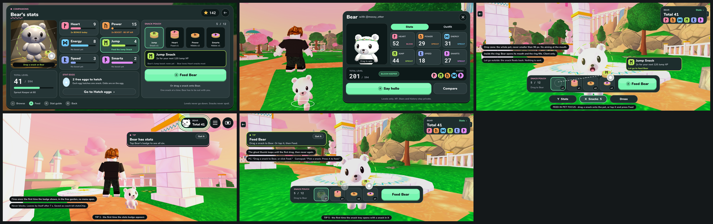
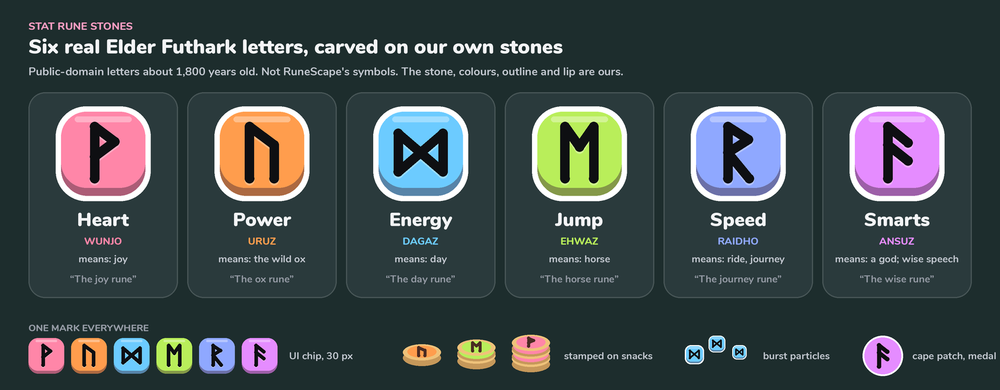
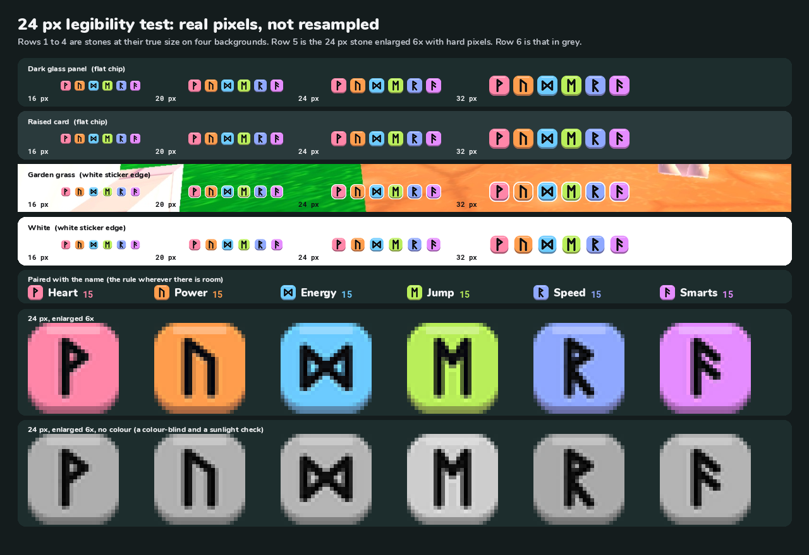
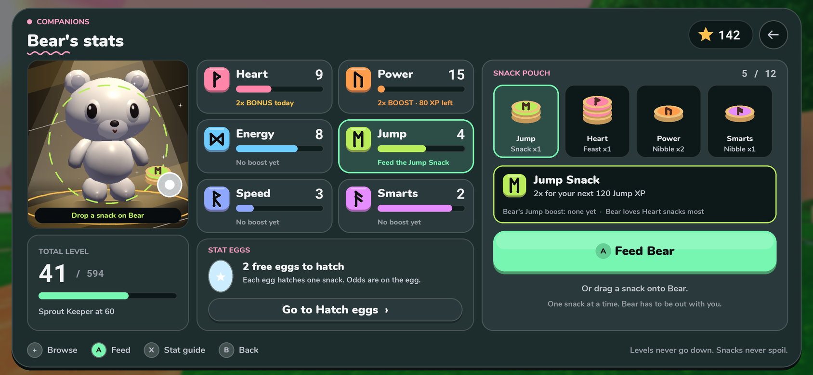
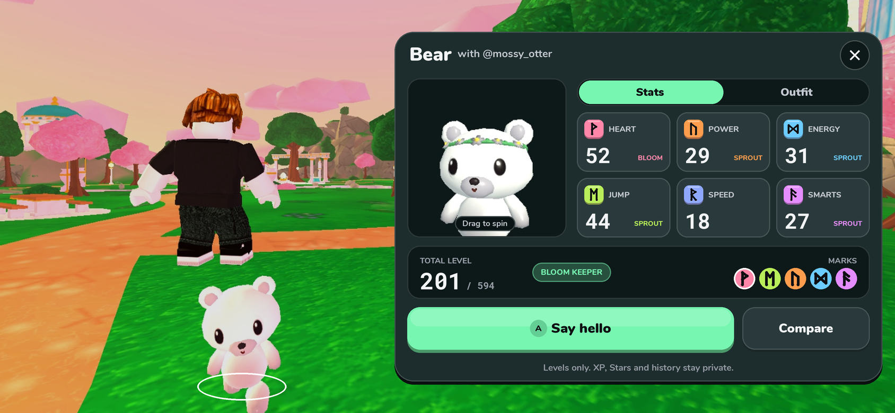
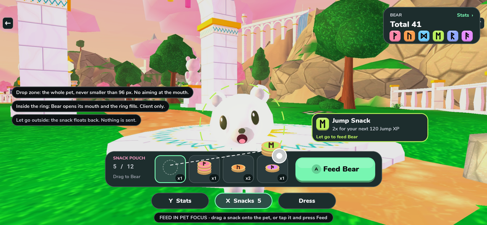
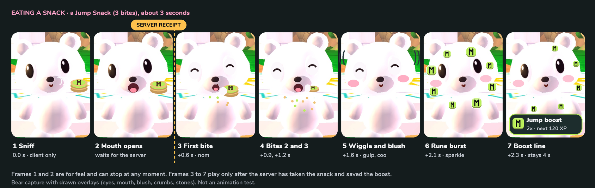
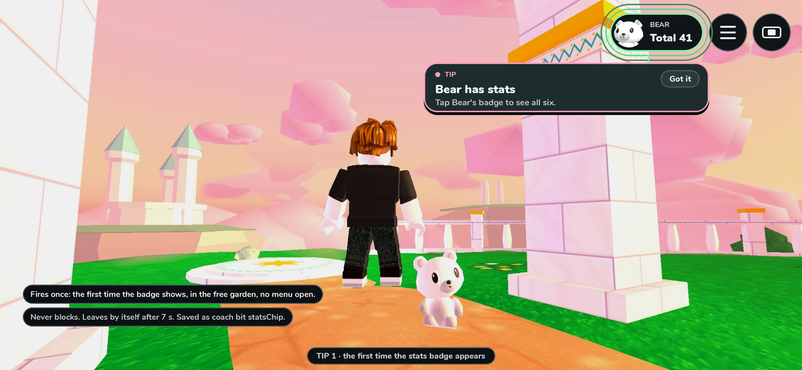
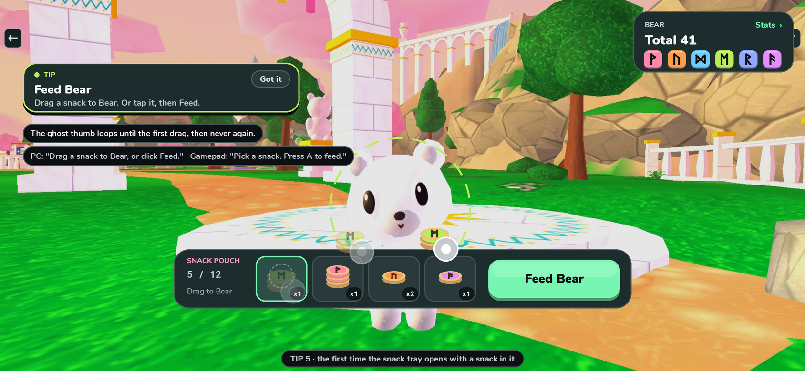

# Pocket Pals v2: rune stat icons, feeding everywhere, eating effects and the tutorials

**Status: scope, art and sound for approval, 2026-11-19 (Fable as Astra). Nothing here is built.** No `src/` code, save, Studio place or published build was changed. It builds on `V2-SCOPE-2026-11-19.md` and `V2-PET-AND-SNACKS-SCOPE-2026-11-19.md` and does not edit them. Where this page differs from them, it says so. Numbers marked [P] are placeholders.

Spencer's asks (2026-11-19): *"can we feed the pet thru the stats menu too?"* · *"can we add a feeding option on the petting screen too, where we can like drag snacks from our inventory to feed it?"* · *"yes base the stats icons on runescape rune symbols!"* · *"we need sound effects and other effects for them eating like a chao too"* · *"we also need onboarding / tutorials for this stuff"*

Art, mockups and sounds: `artifacts/v2-feeding-runes-2026-11-19/`. Mockups are PIL drawings over existing Studio captures, phone landscape 844x390 at 2x, using the Bear. The pet is being redesigned in parallel, so nothing here depends on its look.

## 0. The answer in one place

| Spencer asked | Answer | Why |
|---|---|---|
| Rune symbols for the stats? | **Yes, as real historical runes on our own stones.** Six Elder Futhark letters, each on a small rounded stone in the stat's colour. | RuneScape's rune symbols are Jagex's artwork. Elder Futhark letters are about 1,800 years old and belong to nobody. Same feel, nothing copied. |
| Which runes? | Heart **Wunjo** (joy), Power **Uruz** (wild ox), Energy **Dagaz** (day), Jump **Ehwaz** (horse), Speed **Raidho** (ride), Smarts **Ansuz** (wise speech). | Five of your six examples hold up. **Sowilo is swapped for Dagaz** (section 1.2). |
| Can kids read them? | **A stone never appears without its colour, and gets its name wherever there is room.** Tested at 24 px in colour and in grey. | A rune is a new shape to a 7-year-old. Colour and the word do the reading; the rune is the badge. |
| Feed from the stats menu? | **Yes, without leaving it.** Pick a snack in the pouch and press **Feed**, or drag it onto the pet's preview. The pet eats in the preview. | The earlier pass sent you to pet focus. Two taps in place is better, and the hue fruit already eats on a preview. |
| Feed on the petting screen by dragging? | **Yes.** A snack tray; drag a snack onto the pet. The whole pet is the target. Tap-then-Feed and gamepad do the same thing. | Dragging is the fun way. It must never be the only way. |
| Who decides? | **Unchanged: the server.** The client animates the offer; the bites play only after the receipt. One drop is one request. | Restated for drag in section 2.5. |
| Eating like a Chao? | **Sniff, mouth opens, 2 to 4 visible bites with crumbs, wiggle, blush, a burst of rune stones, the boost line.** Bigger snacks and the favourite stat get more. | The feel only: it loves the food and shows it. No emote ball, nothing of Sega's. |
| Sounds? | **Ten sounds synthesised in numpy**, plus four audition mixes. No samples, no AI audio. | `scripts/synth_feeding_sfx.py`. **Not yet listened to by a person.** |
| Tutorials? | **Nine one-time tips on the existing coach system, and a "Stats" set of How it works cards.** Never block, shown once, saved. | Section 4. One code rule must change first: today's coach cards skip anyone with 5 wins. |

## 1. Rune stat icons

### 1.1 The six

| Stat | Rune | What the rune means in the old sources | Fit | What we tell a child |
|---|---|---|---|---|
| **Heart** | ᚹ Wunjo | Joy (Old English *wynn*) | Strong | "The joy rune" |
| **Power** | ᚢ Uruz | The aurochs, a huge wild ox: strength | Strong | "The ox rune" |
| **Energy** | ᛞ Dagaz | Day, daylight | Good | "The day rune" |
| **Jump** | ᛖ Ehwaz | Horse | Fair: a horse leaps; no rune means "jump" | "The horse rune" |
| **Speed** | ᚱ Raidho | Riding, a journey | Strong | "The journey rune" |
| **Smarts** | ᚨ Ansuz | A god; the Old English poem reads it as "mouth", the source of speech and wisdom | Good | "The wise rune" |

Meanings are from the rune names and the Old English rune poem, as I know them. I did not look them up online today; a quick check against any standard reference is worth doing before the names go into `UICopy`.

### 1.2 One change from your examples: no Sowilo

Sowilo (the sun, ᛋ) is the best meaning for Energy, but its shape is the lightning-bolt S that Nazi Germany used: doubled for the SS, single for its youth organisation. The doubled form is listed as a hate symbol. On a children's game, a zigzag S rune invites reports and bad screenshots, however innocent. **Dagaz (day) keeps the daylight idea with a bow-tie shape that has no baggage.**

For the same reason these runes are never used anywhere in the game, now or for later stats: **Othala (ᛟ), Algiz (ᛉ), Tiwaz (ᛏ)** and the non-Futhark Wolfsangel. All three were Nazi-era insignia and are listed as hate symbols when used that way. Any new rune gets this check first.

### 1.3 The stone (ours)

- **Shape.** A rounded square pebble, corner radius about a third of its width, with a darker lip along the bottom so it reads as a thick little stone.
- **Colour.** The whole face is the stat's colour (scope 2.2). RuneScape's runes are grey stones with a coloured symbol; ours are coloured stones with an ink symbol. Ink `#0E0F12` on every stat fill, as the design system already requires.
- **Rune.** Plain staves with round ends, stroke about a tenth of the stone. At 40 px and up it gets a light chisel line under it and a soft light on the top edge.
- **Edge.** On dark glass panels it is a flat chip with no outline. In the world, on the garden and on light backgrounds it has the white sticker edge.
- **One mark everywhere.** The stone replaces the six pictures (heart, paw, bolt, hop, wind, bulb) from the earlier scopes: UI chips, the stamp on a Stat Snack (cocoa on icing), burst particles, the cape's back patch and the medals.

### 1.4 Can a child read it? The rules and the test

1. **Colour is always there.** A rune is never drawn in grey or white by itself, except a locked medal.
2. **The name is there whenever there is room** (stat tiles, snack cards, the level-up line, tips). Stone-only is for tight rows: the inspect card's marks, the pet focus card, particles.
3. **Tap and hold a stone anywhere** to see "Power · the ox rune".
4. **Fixed order everywhere:** Heart, Power, Energy / Jump, Speed, Smarts.

What the test sheet shows, honestly:

- **24 px passes.** All six are different shapes in colour and in grey. 20 px is usable. **16 px is the floor**, for particles only.
- **Three of them look like our letters:** Wunjo like P, Ehwaz like M, Raidho like R. That helps them read as "a letter on a stone" but **the P shape sits on Heart, not Power.** Wunjo is drawn as a sharp flag to pull it away from a round P, and rule 2 is the real fix. If testers still mix them up, the fallback is Gebo (ᚷ, gift) for Heart, an X shape; I held it back because an X reads as "close" in a menu.
- Dagaz was first drawn tall and closed up into a blob next to Ehwaz. It is now wide and short, a clear bow tie.

### 1.5 On the panels

Stat tiles use a 26 px chip beside the name. The inspect card uses 18 px chips with the name in caps, and stone-only round marks in the summary strip.

**Art list:** six runes as vectors; one stone at 256 px exported per stat, flat and with the sticker edge (12 images, one atlas); six snack decals; six cape patches. No 3D stone is needed unless we want stones to fly in the world burst, in which case one 60-triangle pebble with six decals.

## 2. Feeding everywhere

Three places, one feed request, one set of server checks (pet-and-snacks scope 2.4, unchanged).

| Place | How | Where the pet eats |
|---|---|---|
| **Stats panel** (new) | Tap a snack in the pouch, press **Feed**. Or drag it onto the preview. Tapping a stat tile that says "Feed the Jump Snack" picks that snack for you. | In the panel's live preview. The garden pet plays the public beat for other players. |
| **Pet focus**, the petting screen | Press **Snacks** to open the tray. Drag a snack onto the pet, or tap it and press **Feed**. | The pet itself, close up. |
| **Stat Egg reveal** | **Feed now** opens pet focus with that snack already picked (as scoped). | The pet itself. |

The earlier pass said the stats panel's Feed button "takes you to pet focus". This page changes that: **it feeds in place.** If the pet is not out or a round is running, the button is greyed with one line saying why, and the server refuses anyway.

### 2.1 The drag, by device

| | Pick up | Carry | Feed | Without dragging |
|---|---|---|---|---|
| **Phone touch** | Press a snack tile and move 8 px, or hold 0.15 s. The snack lifts to 1.25x and sits **28 px above the thumb**, so the thumb never hides it. | One finger. Petting rubs are off while a snack is held. The camera does not move. | Lift the finger inside the drop zone. | Tap the snack (it floats to the pet's cheek), then tap **Feed**. |
| **PC mouse** | Press and move 6 px. The cursor becomes the snack. | Hold the button. | Release inside the drop zone. Esc or right-click cancels. | Click the snack, click **Feed**. Keys: 1 to 6 pick, Enter or F feeds [P]. |
| **Gamepad** | No drag. D-pad or stick moves along the tray; the picked snack floats to the cheek. | | **A** feeds. **B** closes the tray. | This is the only way, and it is the same flow as tap-then-Feed. |

A second finger, a lost touch, the app losing focus, a round starting or the tray closing all cancel the carry and return the snack.

### 2.2 The drop target

- **The whole pet is the target**, not the mouth: its on-screen box grown by 30%, and **never smaller than 96 px** across. A child should not have to aim.
- In the stats panel the target is the whole preview well.
- While a snack is held, a dashed ring in the stat's colour shows the zone and the tray dims a little.

### 2.3 Hover feedback (all on your own client)

- **Outside the ring:** the pet watches the snack with its head and eyes.
- **Entering the ring:** the ring fills softly, the pet leans in and **opens its mouth**, the snack shrinks to 1.1x and tilts to the mouth, one light haptic tick on phones, and the snack card's last line becomes "Let go to feed Bear".
- **Leaving the ring:** the mouth closes, the pet keeps watching.
- A first sniff plays once per carry, when the snack first enters the ring.

### 2.4 A miss

Let go outside the ring and **the snack floats back to its slot** in 0.2 s with a soft pop. Nothing is sent, nothing is taken, no error line. The pet tilts its head once. Three misses in a row bring up one quiet line: "Tap a snack, then Feed." The tray stays open.

### 2.5 Server authority, restated for drag

| Step | Who | Rule |
|---|---|---|
| Carry, hover, mouth opens, sniff | Client only | Never sent. Other players see none of it. It can stop at any moment. |
| Drop inside the zone | Client | Sends **one** feed request `{operation id, stat, size, pet id}`: the same request the Feed button sends. The tray locks. The snack hovers at the mouth, mouth open. |
| The checks | **Server** | Owns the snack; the pet is theirs and is out; not in a round, activity, hatch or carry; stat under 99 with queue room; no feed in flight and the last one more than 1.5 s ago. |
| Yes | **Server** | One save step: pouch -1, boost queued, receipt written. It sends the receipt and the public "ate a snack" beat. |
| Bites, reaction, boost line | Client | **Only after the receipt.** The stats panel's preview and pet focus both play from the same receipt. |
| No | Server refuses | Nothing is taken. Mouth closes, head tilt, "hm?", the snack returns to its slot, one plain line ("Bear can't eat during a round"). |
| No answer in 4 s | Client | The offer ends and the snack returns on screen. The server's next state is the truth; no animation is replayed. |

**Drag-and-release spam.** A drop while the tray is locked sends nothing: the tray unlocks only when the receipt's sequence ends, on a refusal, or at the 4 s timeout. Each accepted drop makes one new operation id; the same id sent twice returns the same receipt and takes one snack. A script that skips the lock and fires requests gets one feed per 1.5 s at most and never more feeds than snacks owned. Dragging itself is not network traffic, so waving a snack about costs the server nothing. There is no "feed all" and no auto-repeat.

### 2.6 Accessibility

- Dragging is never required: tap-then-Feed, keys and gamepad reach everything. Feed buttons are 44 px high or more; snack tiles are 54x48 at least.
- No timing, no aiming, no hold longer than 0.15 s. A miss costs nothing.
- **Reduced Motion:** no carry animation, one bite, no wiggle or burst; the boost line and the sound still show the result.
- Snack tiles say their name, size and count to screen readers and in the hold tooltip ("Jump Snack, 1"). Size is told by layers and by the word, the stat by rune, colour and word.
- Sounds are never the only signal. The Feed sounds follow the SFX volume setting.
- Left-handed play: the tray is centred and the drop zone is the pet, so nothing changes.

## 3. Eating effects and sound

Chao Garden is the reference for the feeling only: the pet plainly loves the food, you see each bite, and it reacts big. The emote ball, the Chao, its sounds and every Sega design stay out. Our pet shows feeling with its own face, body and cheeks.

### 3.1 The sequence

Times are from the server's receipt. Steps 1 and 2 happen before it.

| # | Beat | What you see | Sound |
|---|---|---|---|
| 1 | **Sniff** (offer) | The pet leans to the snack, nose twitches twice, two little puff lines | `sniff` |
| 2 | **Mouth opens** (offer) | Mouth open, eyes on the snack, a tiny bounce while it waits | none |
| | *the receipt arrives* | | |
| 3 | **Bites** | The snack hops to the mouth. Each bite: head dips, eyes close into happy arcs, **a round bite disappears from the snack**, 4 to 6 crumbs fall (biscuit colour and the stat's colour), cheeks puff on the chew | `nom_a/b/c`, never the same one twice in a row |
| 4 | **Gulp** | A small swallow, head back up | `gulp` |
| 5 | **Happy wiggle** | Side-to-side wiggle, arms up | `happy_squeak` or `happy_coo` |
| 6 | **Blush** | Two round blush marks fade in on the cheeks and stay 3 s | |
| 7 | **Rune burst** | A ring of the stat's rune stones pops out from the pet, spins a quarter turn and fades, with a soft flash of the stat's colour | `boost_sparkle` |
| 8 | **Boost line** | Rail line: stone, "Jump boost", "2x for your next 120 XP". The stat tile gets its flame. | |

### 3.2 Bigger snack, bigger reaction

| | Nibble | Snack | Feast |
|---|---|---|---|
| Bites (as scoped) | 2 | 3 | 4: the first is the big `crunch_feast` |
| Bite times | 0.6, 0.9 s | 0.6, 0.9, 1.2 s | 0.6, 1.1, 1.4, 1.7 s |
| Reaction | A happy hop, `happy_squeak` | Wiggle and hop, `happy_coo` | Wiggle, `happy_coo`, then a **full spin** with `happy_squeak` |
| Rune stones in the burst | 5 | 8 | 12, in two rings, with sugar-pearl sparkles |
| Whole thing | about 2.4 s | about 3.0 s | about 4.0 s |

**A favourite stat** (the Bear's is Heart) adds one extra beat after the burst: the pet **hugs itself and bounces twice**, the blush is brighter and lasts longer, a second squeak, coo and sparkle play, and the rail line gains "Bear's favourite!". It is a show of feeling only; it changes no numbers.

Other players see beats 3 to 7 on your pet with the sounds at world volume. They never see the offer or the boost line. With Reduced Motion: one bite, the gulp, the line.

### 3.3 The sounds

Made by `scripts/synth_feeding_sfx.py` from sine partials and shaped noise, with the helpers from `scripts/synth_hatch_rarity.py`. Fixed seeds; two runs give the same bytes (checked). No samples, no recordings, **no AI audio**. Files are in `artifacts/v2-feeding-runes-2026-11-19/sfx/` as wav and mp3, with a README and `report.json`.

| Sound | What it is | Length |
|---|---|---:|
| `sniff` | Two quick inhales, the second higher | 0.40 s |
| `nom_a`, `nom_b`, `nom_c` | A soft voiced "nom" closing to "m", a biscuit snap, a few crumb ticks; three pitches | about 0.25 s |
| `crunch_feast` | A thump, two cracks, a crackle of crumbs, a short nom | 0.50 s |
| `gulp` | A small swallow, down then up | 0.16 s |
| `happy_squeak` | A short rising squeak | 0.22 s |
| `happy_coo` | A two-part "oo-ooh" with a little vibrato | 0.52 s |
| `boost_sparkle` | Three rising bells (E, G, C) and glitter, in the rarity chimes' key but smaller | 1.00 s |
| `refuse_hm` | A questioning "hm?" for a refused feed | 0.26 s |
| `sequence-*` | Four audition mixes: nibble, snack, feast, feast-favourite | |

`gulp` and `refuse_hm` were not on the list; the sequence needed them. One sparkle serves all six stats; if we want the stat to be heard, play it at six pitches the way the level-up figure is planned to.

**Honest limits.** I cannot hear. These were checked by measurement only (length, peak, brightness), so **Spencer needs to listen before anything is uploaded.** The "nom" voice is the one most likely to need a second pass. Start with `sequence-snack.mp3`.

## 4. Onboarding and tutorials

### 4.1 What exists (checked 2026-11-19)

| Thing | Where | Use |
|---|---|---|
| One-time coach cards, each a saved bit in `coachMask` (bits 0 to 10 used, room to bit 30, append only) | `src/shared/CoachMarks.lua` | **Yes.** Add nine ids. |
| The rail line: one tip at a time, 7 s, tappable, never takes input, waits while a card or menu is open | `src/client/CoachCards.lua` | **Yes**, unchanged. |
| Copy rule: a title of three words or fewer and one short line | `UICopy.coach` | Followed below. |
| "How it works" cards behind the **?** in every machine header | `UICopy.r3.help`, `HowItWorks` | **This is the help book.** The Stats page goes here. |
| The Collection book | `BookCatalog.lua` | It tracks what you own. It is not a help book, so no Stats page there. |
| "A friend arrived!" card for the earned pet | bit `petArrived`, `UICopy` `arrived` | Reused for the second pet. |

**One rule must change (for Sol).** `Coach.wants` shows no card to a save with 5 or more wins. That was right for launch, but v2 is new to everyone, so every tip below must ignore the veteran rule. Ids must stay 20 characters or fewer (`Coach.validId`).

### 4.2 The tips

All of them: shown once ever, saved as a bit, never during a round, never over a menu or reveal, one at a time, gone after 7 s or a tap, and skipped for good if the player has already done the thing. `{pet}` is the pet's name.

| # | Id | Fires | Title | Line |
|---:|---|---|---|---|
| 1 | `statsChip` | The first time the pet badge shows on the dock, standing free in the garden | **{pet} has stats** | Tap {pet}'s badge to see all six. |
| 2 | `levelUp` | The first level-up line (in the garden, or the first time back there after a round) | **Level up!** | Play to grow {pet}'s stats. Each one goes to 99. |
| 3 | `statEgg` | The first Stat Egg is held and the player is free in the garden | **A Stat Egg!** | Hatch it at Hatch eggs. A snack for {pet} is inside. |
| 4 | `snack` | The first snack is in the pouch and nothing has been fed yet | **A snack!** | Tap {pet}, then Snacks, to feed it. |
| 5 | `feedHow` | The first time the snack tray opens with a snack in it. A ghost thumb drags a snack to the pet and loops until the first drag. | **Feed {pet}** | Touch: Drag a snack to {pet}. Or tap it, then Feed. · PC: Drag a snack to {pet}, or click Feed. · Gamepad: Pick a snack. Press A to feed. |
| 6 | `fed` | Right after the first feed's sequence ends | **Yum! Boost on** | Your next {stat} XP counts double. Go play! |
| 7 | `pouchFull` | The first time the pouch is full | **Pouch is full** | Feed {pet} a snack to make room. |
| 8 | `cape` | The first tier medal (level 25 in any stat) | **Champion Capes** | Reach 99 in a stat to earn its cape. |
| 9 | `petStats` | The first time a second pet is out, after its arrival card | **Fresh stats** | {pet} starts its own six stats. {other}'s are safe. |

Notes:

- **Tip 6 names the size truthfully:** a Feast says "counts triple". The three orders that matter (2, 3, 4) come from saved state, not a script, so leaving and rejoining picks up at the right one.
- **Tip 4 is skipped** if the player pressed Feed now on the reveal: they go straight to tip 5.
- **The second pet's arrival** keeps the existing card ("A friend arrived! {pet} came to stay in your garden." with Say hi). Tip 9 follows it. The first time the tray opens with two pets owned, the tray's small line reads "Snacks go to the pet that is out." It is a label, not a tip, so it needs no bit.
- **Level-ups after a round** show on the results strip (as scoped). Tip 2 waits for the garden so it never covers results.
- **Locked items** need no tip: the tile already says "Needs Jump 30" and its button takes you there.
- **"Show tips again"** in Settings replays these like the others.

### 4.3 Two key moments

The tip card is drawn in the kit's style; the real one is the existing rail line. The ghost thumb is the only new piece of coaching art, and it is the same idea as the Welcome round's ghost thumb in the onboarding scope.

### 4.4 The Stats page: How it works

A **?** in the stats panel's header opens these five cards. It also opens once by itself the first time the panel is opened.

| Card | Title | Line |
|---|---|---|
| a | **Six stats** | Heart, Power, Energy, Jump, Speed and Smarts. Each one goes from 1 to 99. |
| b | **Play to train** | Rounds grow Power and Energy. Petting grows Heart. The park grows Jump. Fetch grows Speed. Quests grow Smarts. |
| c | **Rune stones** | Each stat has a stone with an old rune on it. The colour and the name tell you which is which. |
| d | **Snacks** | Stat Eggs hatch snacks. Feed one to {pet} and that stat grows faster for a while. |
| e | **Capes** | Reach 99 in a stat to earn its Champion Cape. Levels never go down. |

Also: the Companions set's first card ("Bond hearts") becomes **"{pet}'s stats"**: "Tap Stats to see how {pet} is growing. Petting grows Heart." when Bond folds into Heart. Every string goes through `UICopy` and the translation sync; rune names (Wunjo, Uruz and so on) are proper names and should be marked not to translate.

## 5. Order of work

| # | Slice | Size | Depends on |
|---:|---|---|---|
| 1 | Rune stones: final vectors, atlas, swap into the stat chip component | S, art | Spencer's yes on the six |
| 2 | Coach ids 11 to 19, the veteran exemption, tips 1 and 2, the Stats How it works set | S | Stats core (S1 to S3) |
| 3 | Sounds: Spencer listens, fixes, masters to `assets/audio/custom/`, upload, `BoardAudio` | S | A listen |
| 4 | Feed in the stats panel (preview eats) and tap-then-Feed in pet focus | M | Snack pouch and feed request (pet-and-snacks slice 3) |
| 5 | Drag: carry, drop zone, hover, miss, tray lock. Specs: a drop while locked sends nothing; a miss sends nothing; spam takes one snack per accepted feed. | M | 4 |
| 6 | The eating sequence by size, favourite beat, public beat, Reduced Motion | M, animation | 4, the new pet's rig |
| 7 | Tips 3 to 9, ghost thumb | S | 4, 5 |

## 6. Open questions for Spencer

1. **Dagaz for Energy, not Sowilo.** Agree? It is the one change from your list.
2. **Wunjo looks like a P on the Heart stone.** Keep it with the name beside it, or switch Heart to Gebo (an X)?
3. **Runes replace the six pictures everywhere**, including the stamp on snacks and cape patches. Or keep the pictures somewhere?
4. **Feeding inside the stats panel**, on the preview. Agree, or should it still jump to pet focus?
5. **The sounds.** Please listen to the four `sequence-*.mp3` files. Too babyish, too human, too quiet?
6. **Favourite-stat reaction** is a show only. Should a favourite snack also give a little more (I suggest no)?
7. **Tip count.** Nine one-time tips across the first week of v2. Too many?

## Files

- This document: `V2-FEEDING-RUNES-ONBOARDING-2026-11-19.md`
- Rune art: `artifacts/v2-feeding-runes-2026-11-19/01-rune-stones.png`, `02-rune-legibility-24px.png` (true pixels)
- Mockups (844x390 at 2x): `03-stats-panel-runes-feed-844x390@2x.png`, `04-inspect-card-runes-844x390@2x.png`, `05-pet-focus-drag-feed-844x390@2x.png`, `07-tip-stats-chip-844x390@2x.png`, `08-tip-first-feed-844x390@2x.png`, `contact-sheet.png`
- Eating strip: `06-eating-sequence-strip.png` (the Bear capture with drawn overlays; not an animation test)
- Art source: `artifacts/v2-feeding-runes-2026-11-19/build_art.py` (PIL; reuses the kit in `artifacts/v2-scope-2026-11-19/build_mockups.py`; backdrops are crops of `artifacts/store-listing/raw/`)
- Sounds: `scripts/synth_feeding_sfx.py`; outputs, `README.md` and `report.json` in `artifacts/v2-feeding-runes-2026-11-19/sfx/`

Not done in this pass: nothing was heard by a person; no Studio work, no animation, no upload; rune meanings and the hate-symbol listings were not re-checked online today; `TODO.md` was not updated; nothing was committed.
