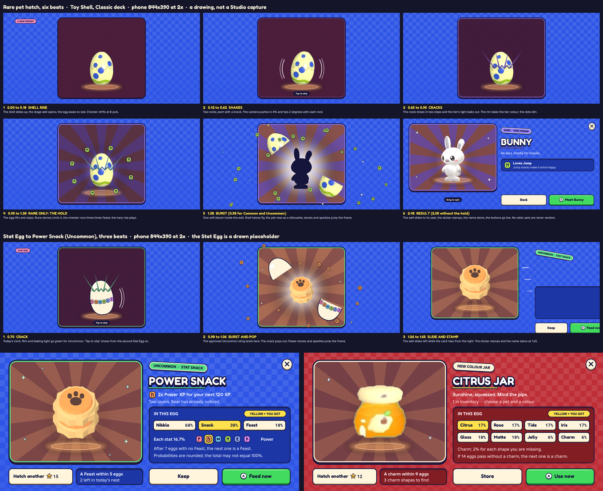
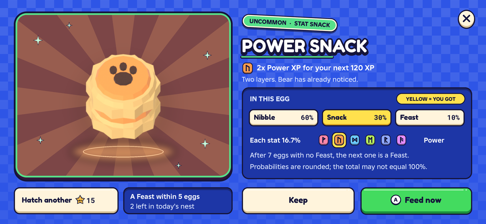
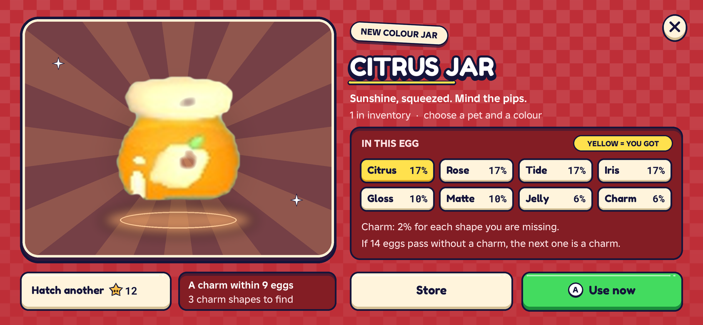

# Pocket Pals v2: the hatch, redesigned ("Pop-Out Stage")

**Status: direction, timings and mockups for approval, 2026-11-19 (Fable as Astra). Nothing here is built.** No `src/` code, other doc, Studio place or published build was changed. Nothing was synthesised. Numbers marked [P] are placeholders.

Spencer (2026-11-19): *"we need to update the hatch screen to be exciting and match for v2 also."*

It builds on `UI-RETRO-RESTYLE-2026-11-19.md` (Toy Shell, Revision 1), `V2-SCOPE-2026-11-19.md` (Stat Eggs), `V2-PET-AND-SNACKS-SCOPE-2026-11-19.md` (snack pouch, Feed now / Keep), `V2-FEEDING-RUNES-ONBOARDING-2026-11-19.md` (rune stones, feeding sounds) and the approved rarity sounds (`artifacts/hatch-sounds-2026-11-15/`).

Mockups and generator: `artifacts/v2-hatch-redesign-2026-11-19/` (`python artifacts/v2-hatch-redesign-2026-11-19/build_mockups.py`).

## 1. Diagnosis

### 1.1 Today, beat by beat

Read from `HatchDisplayPose`, `HatchItemStage.sample`, `RevealStage` and `HatchRarityCue`, and from the stepped Studio frames in `artifacts/reveal-2026-11-15/`. Nobody has recorded it playing live; the frames are real modules stepped by `scripts/RevealCaptureFixture.lua`.

| Time (s) | Items (Toy, Hue, Finish, Charm) | Pets |
|---|---|---|
| 0.00 to 0.18 | Screen dims to a near-black stage (`#06070B`); egg fades in and eases up | Same, with a narrow spotlight and floor ring |
| 0.12 to 0.94 | Three rocks (5, 8, 10 degrees); a glow and beam in the tier's colour build | Same rocks |
| 0.65 to 0.95 | Crack line draws | Same |
| 0.98 | Burst: full-screen flash (22 / 40 / 62% by tier), rings, rays, shards. The tier's sting lands here (Rare starts at 0.28) | Shell opens with a flash |
| 1.06 to 1.26 | Item pops onto a tilted card, card flies left | 1.05: hand-off to the Smash-style stage; silhouette rises |
| 1.65 | Name slams under a slanted banner; buttons go live | 2.05: headline, name plate, confetti popper, Back / Meet |
| after | Item turns slowly; receipt buttons (Use now / Store / Keep / Give to Bear) | Wave every 3.4 s; drag to spin |

Reduced Motion: one 150 ms fade to the settled screen, silent.

### 1.2 What feels flat

1. **Every tier has the same clock.** A Rare bursts at 0.98 s exactly like a Common. More rays and a louder sting are decoration on the same beat; there is no moment where the player thinks "wait, is this one...?".
2. **The anticipation is under a second and nothing escalates in it.** Three rocks, same rhythm every time, no sound of their own. The tier glow ramps smoothly, so there is no tell to learn.
3. **It happens in a black void.** The stage is `#06070B`, the same dark dashboard the restyle is removing. In v2 every menu is bright plastic in the deck's colour; the hatch would be the one screen that is not.
4. **The burst stays inside its picture.** Shards and rings are drawn in the middle of an empty screen. Nothing reaches the edges or touches the UI.
5. **The result is a dead end.** No "Hatch another", so each egg is: close, find the egg, press Hatch, wait. No pity counter on the result either, so the best reason to open one more is on a different screen.
6. **Uncommon is nearly invisible.** It has a look and a sting, but nobody has captured it and only the finish jars reach it. Stat Snacks (30% Snack) make Uncommon the second most common thing in v2, so it needs to read on its own.
7. **Flat details:** grey capsule tier banner, a thin underline as the only ornament, teal-grey buttons, a hairline close button.

### 1.3 What already works and stays

- **The three rarity stings** (approved 2026-11-15): one family in C major pentatonic, each containing the one below. Untouched; everything new is layered under them.
- **The tier colours:** cream, leaf green, blue-violet.
- **The clock:** rocks, crack at 0.65, burst at 0.98, name at 1.65 (items) and 2.05 (pets). Buttons arriving with the name.
- **The disclosure rule:** no name and no tier word before the receipt beat (`HatchDisclosure` spec).
- **3D results:** a finish shown worn by a Bear, toys turning, the pet's silhouette rise, wave and drag to spin.
- **The fun line** under the name (`hatch.reveal.describe.*`) and the host's own receipt buttons, mirrored by the stage.
- **Positions:** result picture on the left, name on the right, two buttons bottom right, close top right.

## 2. The v2 sequence

### 2.1 The idea

**The hatch happens inside the toy, and a good one breaks out of it.**

- The screen is the **shell**: the deck's colour, ink outline, the diagonal checker drifting.
- The egg sits in one big **stage well**: the fixed warm stage from Revision 1 (berry `#4A1D3A`, dots `#7A3458`, apricot `#FFB26B` light pool and sunburst). It is never deck-tinted, so a pet or jar always reads the same.
- **Rarity is light, not chrome.** The tier colour is the well's rim, the light leaking from the crack, the sticker, and the sparkles. Only Rare also tints the sunburst.
- **At the burst the confetti leaves the well** and lands on the shell: rune stones and four-point sparkles. The frame that held everything in is the thing that gets broken. Common barely leaks; Rare covers the screen.

### 2.2 Beats and timing (seconds on the hatch clock)

| # | Beat | Common / untiered | Uncommon | Rare |
|---|---|---|---|---|
| 1 | **Shell rise** 0.00 to 0.18 | Shell slides up, well opens, egg eases to size | same | same |
| 2 | **Shakes** 0.12 to 0.62 | Two rocks, a knock on each | same, rim starts to take the tier colour at 25% | same |
| 3 | **Cracks** 0.65 to 0.95 | One crack, cream light | Crack in two steps, green light leaks, dots dim | Crack in two steps, violet light, dots go dark, checker speeds up |
| 4 | **The hold** (Rare only) 0.95 to 1.38 | none | none | Egg lifts 6 px and stops. Eight blank pebbles (or the stat's stones) circle it once. Rim pulses twice. The harp rise plays here |
| 5 | **Burst** | 0.98 | 0.98 | **1.38** |
| 6 | **Pop** burst + 0.08 | Item pops with a Back-out bounce; pets rise as a silhouette | same | same |
| 7 | **Slide and stamp** burst + 0.28 | Well slides to its seat on the left; the card rises from the right | same | same |
| 8 | **Name** | 1.65 (pets 2.05) | 1.65 | **2.05** (pets 2.45) |
| 9 | **Settle** name + 0.2 to + 0.7 | Odds strip ticks in, the won cell turns lemon, pity counter ticks down by one | same | same, plus one sheen sweep across the sticker |

The hold is the one structural change: **Rare is 0.40 s longer than everything else.** A player learns in two or three eggs that "it stopped" means Rare, which is the anticipation today's flow lacks. Common and Uncommon keep today's length exactly. If the hold proves risky to build (section 7), the fallback is today's single clock with everything else here.

**Skip.** The first hatch of each egg type plays in full. From the second on, a "Tap to skip" chip shows from 0.15 s and any tap, A, Space or Enter jumps to the settled card with the tier's sting cut to its last 0.4 s. The press that skips never presses a button (as today).

### 2.3 Rarity escalation

| | Common / untiered | Uncommon | Rare |
|---|---|---|---|
| Rim and crack light | Cream, 25% | Green, full | Violet, full, two pulses in the hold |
| Sunburst | Berry and apricot, still | Berry and apricot, turning (20 s) | Berry and violet, turning (12 s) |
| Confetti | 6 pieces, stay inside the well | 14 pieces (8 stones, 6 sparkles), some cross the rim | 30 pieces (20 stones, 10 sparkles), reach the screen edges |
| Camera | 4% push in over the shakes | plus a 2 degree tip per rock, 6% pull back at the burst | plus a 10% pull back with overshoot and a 3 px shake for 0.2 s |
| Checker | 8 px/s throughout | 8 px/s, 16 px/s for 0.5 s after the burst | 24 px/s through the hold and burst, easing back by 2.4 s |
| Bloom (inside the well only) | 20% | 35% | 50% |
| Sticker | Cream, tilts 3 degrees | Green, boing | Violet, boing, one sheen sweep |
| Sound | Common sting | Uncommon sting | Rare sting, drum roll in the hold |
| Length to the name | 1.65 | 1.65 | 2.05 |

Confetti is **rune stones and four-point sparkles**. It is never Stars gold and never a five-point star: that colour and shape mean the wallet.

### 2.4 Every egg type

| Egg | Tiers | In the well | Confetti stones | Result buttons (second / **primary**) | Hatch another |
|---|---|---|---|---|---|
| **Toy Egg** (20 Stars) | The toy's catalogue rarity; untiered toys use the Common look with "NEW TOY" | The toy, turning | Blank pebbles in the tier colour | Store / **Give to {pet}** | Yes, until every toy is owned |
| **Customization Egg** (12): colour jar | Common | The jar | Pebbles in the jar's colour | Store / **Use now** | Yes |
| ... finish jar | Gloss, Matte Uncommon; Jelly Rare | A Bear wearing the finish (as today) | Blank pebbles, tier colour | Later / **Use now** | Yes |
| ... charm | Rare | The charm in its capsule | Blank pebbles, violet | Later / **Wear on {pet}** | Yes |
| **Stat Egg** (15, 3 a day) | Nibble Common, Snack Uncommon, Feast Rare (60 / 30 / 10) | The 3D Stat Snack, mark facing the player | **The won stat's rune stones** | Keep / **Feed now** | Yes, while the nest has stock and the pouch has room |
| **Pets** (Bear's first egg; the Bunny's arrival) | Common, or Rare for a pet in `Pets.rares` | Silhouette, then the pet; drag to spin | The pet's favourite stat's stones (Bear Heart, Bunny Jump) | Back / **Meet {pet}** | Never |

- **Stat Egg and disclosure.** The snack and its stones appear at the pop, like every other item today. Before the burst only the tier light shows, so the stat is not given away early.
- **Feed now** leaves the hatch for pet focus with that snack picked, where the eating sequence plays (feeding doc, section 3). **Keep** puts it in the pouch and closes. The hatch never plays the eating animation itself.
- **The Bunny is adopted, not hatched.** It uses this same stage with a basket in place of the egg (the lid lifts where the shell would split). The strip shows the Bunny in the Rare look to show the top of the ladder; whether it is a Rare-tier pet is Spencer's call (section 8).
- **Pets show no odds and no "Hatch another"**: the Bear is earned and the Bunny has a fixed price, so neither is a random item.

### 2.5 The result card

- **Sticker** (tier and kind), **name** (Fredoka, white with an ink edge, on the shell), one effect line, the fun line.
- **"In this egg" tray: odds and pity.**
  - Today the odds and the pity line are on the egg card in Hatch eggs, before the spend, and that stays exactly as it is. The result itself shows neither.
  - v2 adds "Hatch another" to the result, which makes the result a place where Stars are spent on a random item. **So the full odds table and the pity rule must be on this card too, before that button can be pressed.** They are not decoration.
  - The table is the same one the egg card shows, from the same functions (`EggHatchView.oddsRows`, `lookOdds`, and the Stat Egg's equivalent), evaluated on the state **after** this hatch. If the next egg is the promised one, it reads Feast 100% or Charm 100%.
  - The cell for what was just won is lemon with a raised key ("you got this"); it is a highlight on the table, not a second number.
  - The rounding note stays where a table is rounded. Restricted players see "Next: {item}" in place of the table, as on the egg card.
- **Pity line**, under the well beside Hatch another: "A Feast within 5 eggs" / "A charm within 9 eggs" (the existing `hatch.look.pityShort` wording), ticking down by one as the card settles. Second line: stock or what is left to find.
- **Hatch another** is a cream key with the price and the faced Star. Rules:
  - never the default focus; A lands on the primary;
  - locked for 0.4 s after the card settles, so a skip tap or a mashed A cannot spend;
  - disabled with its reason beside it: "Pouch is full. Feed a snack first.", "Back tomorrow", "{n} more Stars needed", "Every toy found";
  - pressing it keeps the shell and well up, and the next egg drops into the well (no close and reopen). A second hatch of the same type is skippable at once.
- **Close** is a cream round key, where it is today.

## 3. Sound

All new cues are synthesised the house way: `numpy`, sine partials and shaped noise, fixed seeds, the helpers in `scripts/synth_hatch_rarity.py`, in C major pentatonic so they sit under the approved stings. **No samples, no recordings, no AI audio. Nothing was made for this page, and I cannot hear: Spencer must listen before any upload.**

| Cue | When | What | Length |
|---|---|---|---:|
| `hatch_knock_1`, `_2` | Each rock (0.20, 0.45) | Hollow shell "tok", the second a third higher | 60 ms |
| `hatch_crack` | 0.65; again at 0.80 for Uncommon and Rare | Dry snap with a short downward chirp | 120 ms |
| `hatch_roll` | Rare hold, 0.95 to 1.38 | Soft rattle speeding from 12 to 24 ticks a second under a rising hiss; ends in silence 40 ms before the burst | 0.43 s |
| `hatch_shell_pop` | Burst | Plastic "pok" and three shell-bit clicks, 12 dB under the sting | 180 ms |
| `stone_scatter_s`, `_m`, `_l` | Burst + 0.10 | 6, 14 or 30 pebble ticks, falling in pitch, fixed seed | 0.3 to 0.7 s |
| `card_thock` | Slide | The restyle's `open` "ka-chunk", reused | 140 ms |
| `sticker_stamp` | Name | Rubber-stamp thud with a paper tick; replaces `tag_slam` on items | 70 ms |
| `pity_tick`, `pity_ready` | Settle | One counter tick; two rising notes when the next egg is the promised one | 40 / 160 ms |
| Stat register | Name, Stat Egg only | The existing `boost_sparkle` at one of six pitches, one per stat | 1.0 s |

- The stings keep their gains (0.55, 0.75, 1.0) and their place on the burst. With the hold, the Rare sting and the hatch body both start 0.40 s later; nothing inside them changes.
- **Pets:** the pet line (`RevealStage.Cues`) is built from older cues. Recommended: give pets the Rare or Common sting plus a new four-note "hello" figure in the same key, so every hatch is one family. The 2026-11-15 README left this question open.
- Everything follows the SFX volume and the existing duck. No cue is the only signal for anything.

## 4. Reduced Motion and photosensitivity

**Reduced Motion** (`Kit.reduced()` / the profile key), 0.6 s in place of 1.65 s:

1. 0.00: shell and well appear with the existing fade. The checker and sunburst are drawn but still.
2. 0.15: the egg is shown with its crack already drawn, in the tier's rim colour.
3. 0.30 to 0.45: the egg cross-fades to the result. No rocks, no camera push, tip or shake, no bloom, no flying confetti; six stones sit still around the well.
4. 0.60: the name and buttons are there. The sticker fades in; nothing slides or bounces.
5. **The tier sting plays** (recommended change: today Reduced Motion is silent, but sound is not motion and it is the rarity moment). Knocks, roll and scatter are skipped.

**Flash rules, for everyone, not only Reduced Motion:**

- **No full-screen flash at all.** Today's 22 to 62% full-screen flash is replaced by one bloom inside the well: at most 50% white, radius 120 px (about 14% of a phone screen), rising in 80 ms and fading over 320 ms.
- **One bloom per hatch.** With Hatch another, blooms are at least 1.2 s apart, so under 1 per second.
- The Rare rim pulses twice in 0.43 s on a 3 px outline, a change of colour, not brightness. Nothing on screen alternates more than **3 times in any second**; that limit is a spec case (section 7).
- No saturated red is used in any flash or pulse. The shake is 3 px for 0.2 s, Rare only, and is off under Reduced Motion.

## 5. Phone and PC layouts

Phone, 844x390 (points):

| Piece | Rect | Compared with today |
|---|---|---|
| Stage well before the slide | 232, 20 to 612, 366 | The egg is where it is now (centre) |
| Stage well, seated | 24, 20 to 404, 312 | Today's card position, larger |
| Hatch another / pity tray | 24, 326 to 206, 370 / 214, 326 to 404, 373 | New; the strip under the well is empty today |
| Sticker, name, two lines | from x 420; y 40, 80, 118, 138 | Same column as today's banner and name |
| "In this egg" tray | 420, 152 to 820, 312 | New; this area is empty today |
| Two buttons | 420, 326 to 616, 370 and 626, 326 to 820, 370 | **Unchanged** |
| Close | centre 810, 32, radius 15 inside a 44 px target | **Unchanged** |

- **Small phone (568x320):** the tray drops its two note lines behind an "Odds" key that opens the full table over the well; the cells and the pity line stay. Text never goes under 12 px.
- **Portrait (390x844):** well on top (full width, 300 tall), then sticker, name, tray, Hatch another with the pity line, and the two buttons at the bottom, as today's portrait stack.
- **Safe areas:** every piece sits inside the insets as the close button does since v775; only the checker runs under the notch.
- **PC (1649x734 viewport):** same two columns, centred in a 1100 px band so they do not drift apart; well 460 px square; sheet lip 5 px; the checker fills the rest. Hover states as in restyle 3.4. Keys: A / Enter primary, B / Esc second, X / H Hatch another, with glyph caps on the buttons.
- **Pets** keep "Drag to spin" under the well, and Back / Meet in the two button rects.

## 6. Mockups

Phone 844x390 at 2x, drawn with PIL in the Toy Shell kit from `artifacts/v2-ui-restyle-2026-11-19/build_mockups.py` (imported, not edited).

| File | What |
|---|---|
| `01-rare-pet-hatch-beat-strip.png` | Six beats of a Rare pet hatch: shell rise, shakes, cracks, the hold, burst, result |
| `02-stat-snack-hatch-strip.png` | Three beats of a Stat Egg giving an Uncommon Power Snack: crack, burst and pop, slide and stamp |
| `03-result-card-stat-snack-844x390@2x.png` | Result card, Stat Snack, Classic deck |
| `04-result-card-colour-jar-ember-deck-844x390@2x.png` | Result card, Citrus jar (Common), on the Ember deck to show the shell following the deck |
| `contact-sheet.png` | All four |

Honest limits:
- **These are drawings, not Studio captures.** `RevealCaptureFixture.lua` was not run; nothing was rendered in Studio for this page.
- What is real: the egg is cut from a Studio frame (`reveal-2026-11-15`), the Bunny and the snack are our Blender blockout renders, the jar is cut from a 1x Studio capture and is soft. No generated art.
- **The Stat Egg is a drawn placeholder** (cream shell, a belt of six stones). It has no art yet.
- The snack render still carries the older paw picture; in the game the stamp is the Power rune.
- The six frames are stills. The hold, the checker speed and the confetti leaving the well are described, not shown moving. Odds on the jar card are the live table for three missing charms; Stat Egg odds and the Feast promise are the scope's placeholders.
- PC, portrait and the small phone are specified in section 5 but not drawn.

## 7. Implementation notes for Sol

**Order:** after restyle steps 0 to 4 (`Kit.sheet` with the moving checker, `Kit.previewWell` as the stage, tiles, buttons, chips). The hatch should not ship its own copy of the shell.

| Module | Change | Risk |
|---|---|---|
| `HatchRarityCue.lua` | `Look` gains confetti counts, camera, checker speed, bloom; a per-tier burst time (`Policy.burstAt(tier)`); new kind `"stat"` in `Policy.tier` (Nibble, Snack, Feast) | **Medium.** `BurstAt` is a single constant read by three modules and pinned by specs |
| `HatchDisplayPose.lua` | Shell, crack and receipt times become offsets from the tier's burst (they are literals 0.95 to 1.18 today); Reduced Motion sample becomes the 0.6 s version | **High** for the hold: pure and well covered, but every spec that pins a time moves |
| `HatchItemStage.lua` | Repaint with Kit pieces (sheet, well, sticker chip, tray, keys); new options `odds()`, `pity()`, `again()`; `stage:rearm(result)` for Hatch another; layout table from section 5 | Medium. The structure (borrowed scene, external clock, mirrored host buttons) is reused as is |
| `RevealStage.lua` | Pets on the same shell and well; headline and slanted plate become sticker and title; Back / Meet, wave, drag to spin kept | Medium. 1,318 lines; restyle only, keep the cue and focus code |
| `CelebrationKit.lua` | Confetti pool draws stones and sparkles and can parent above the well | Low. Keep the 24-bit pool limit in mind on phones: Rare needs 30, so raise it or reuse rings |
| `HatchDisplayScene.lua`, `HatchCinematic.lua` | Camera push, tip, pull back; the first-time-per-type skip rule; start offset for the hatch body sound on Rare | Medium. The one clock and its owner rules must not change |
| `HueEggView.lua`, `HueItemReveal.lua`, `EggHatchView.lua` | Lend `again` (the same intent the Hatch button uses) and the odds rows to the stage; Stat Egg host | **High** for Hatch another: double-spend guard, a receipt per egg, pending and retry states shown on the key |
| `BoardAudio.lua`, new `scripts/synth_hatch_v2.py` | Ten new cues | Low; needs Spencer's ears |
| `UICopy.lua` | About 14 strings (`hatch.result.*`); run the export and localization sync | Low |
| `scripts/RevealCaptureFixture.lua` | Add `stat`, Uncommon, the Rare hold and a settled card with odds, at 844x390 and 568x320 | Low |

Reused unchanged: the receipt and transaction path, `OddsText`, `LookEggCatalog.odds` and `pityLeft`, `View.oddsRows` and `lookOdds`, the three stings, `HatchDisplayScene:setSpin`, the finish-on-a-Bear scene, the open and leave rules, `seen` receipt keys, the skip-input guard.

Specs to add or update:
1. `HatchDisclosure`: nothing that names the stat, item or tier word exists before the burst, including confetti stones.
2. `HatchRarityCue`, `HatchRarityAudio`, `HatchDisplayPose`: times as offsets; Rare's sting still lands on its burst.
3. New: the result table equals the egg card's table for the same state; the promised egg reads 100%.
4. New: Hatch another is not focused by default, is locked for 0.4 s, and one press makes one request.
5. New: sampled at 60 Hz for every tier, no full-screen brightness step, and no more than 3 alternations in any second.
6. Reduced Motion: no camera, bloom or moving confetti; the sting event is present.

Slices: **H1** repaint items and pets on the shell with the result tray (no hold, no Hatch another). **H2** Hatch another. **H3** the Rare hold and the new sounds. **H4** Stat Egg host, with slice S6 of the stats plan. H1 alone answers "match v2"; H2 and H3 are the "exciting" part.

The "first time per egg type" rule needs to remember four booleans. Recommended: bits beside the tip bits, saved; a session-only table is the no-save fallback.

## 8. Open questions for Spencer

1. **The Rare hold (0.40 s longer for Rare only):** yes, or keep one clock for every tier?
2. **Hatch another on the result card:** yes? It is the biggest feel change and the reason the odds table moves onto the card.
3. **Is the Bunny a Rare-tier pet** on arrival, or does it get the Common look?
4. **Should Reduced Motion keep the rarity sting?** Recommended yes.
5. **Redo the pet sound line in the rarity family?** Recommended yes.
6. **Stat Egg shell art:** a belt of six rune stones, as the placeholder suggests, or something else?
