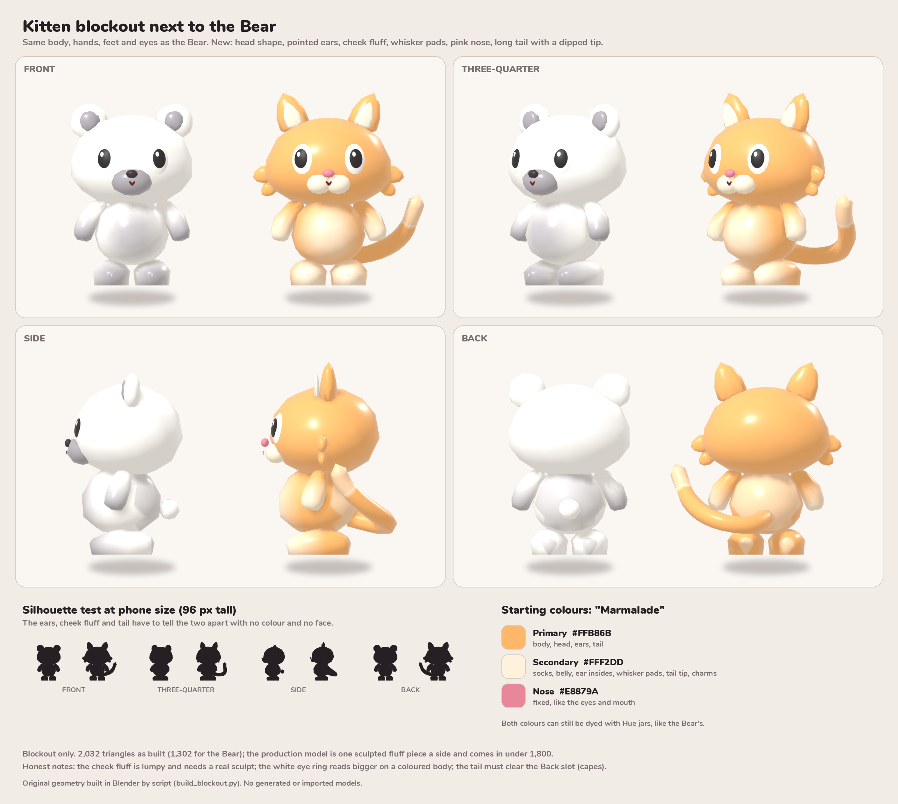
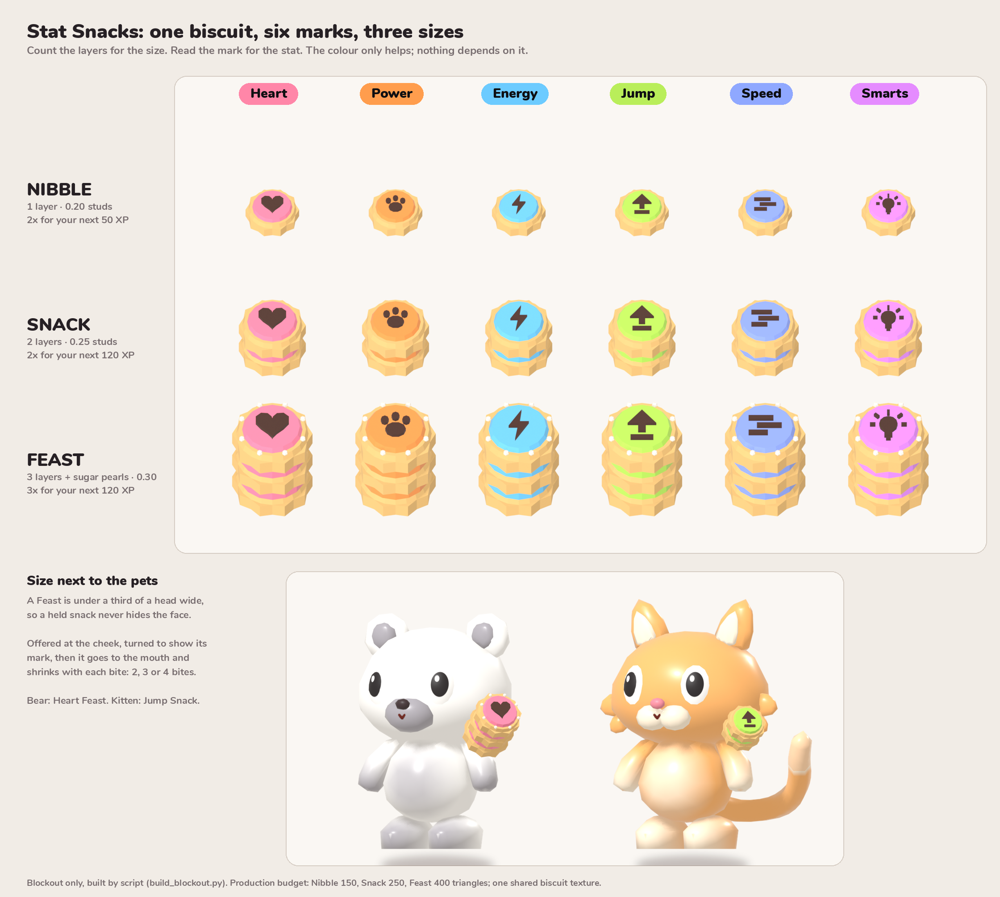
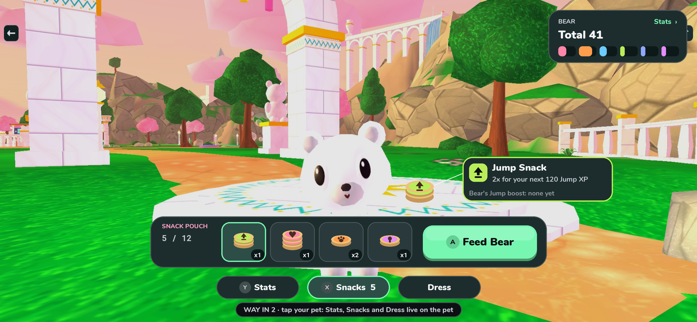
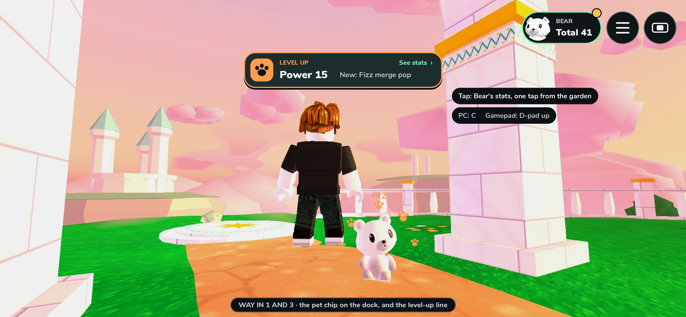
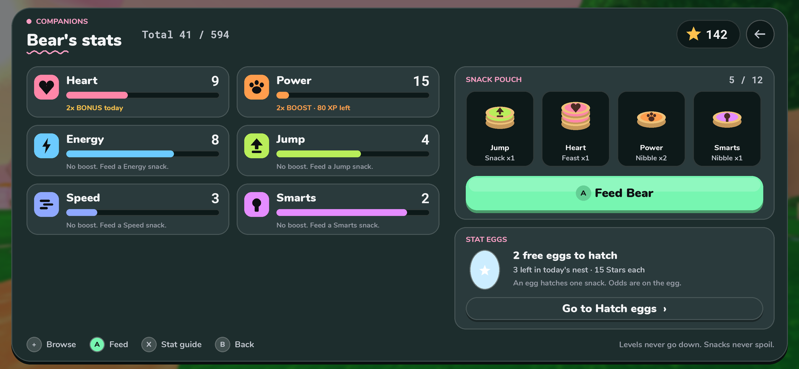

# Pocket Pals v2 scope: the second pet, Stat Snacks you feed, and the way into stats

**Status: scope and art study for approval, 2026-11-19 (Fable as Astra). Nothing here is built.** No code, save, Studio place or published build was changed. Numbers marked [P] are placeholders. It builds on `V2-SCOPE-2026-11-19.md` (revisions 1 and 2) and changes two things in it: the Boost Treat becomes a 3D **Stat Snack** kept in a **snack pouch** (was: eaten on the reveal), and the stats panel gets real entry points (was: a row in Companions).

Spencer's ask (2026-11-19): *"lets scope of v2 the next pet too? maybe like a cat? or something. lets look to webkinz for inspo but in the same style we're doing now. stat snacks should have a 3d model? and we can feed directly to the pet (it has an animation, with proper checking etc, proper visual vs backend management). and we need a proper and sensible way into the stats menu."*

Webkinz is the inspiration for the **feel** only: a plush pet you adopt, name, feed, dress and play with. No Webkinz pet, name, art or screen is copied. `PET-STYLE-GUIDE.md` already says this and it still holds.

Art studies (Blender blockouts built by script, original geometry, no generated or imported models) and mockups (PIL over Studio captures): `artifacts/v2-pet-snacks-2026-11-19/`.

---

## 0. The answer in one place

| Spencer asked | Recommendation | Why |
|---|---|---|
| The next pet? A cat? | **Yes: a Kitten.** Pointed ears, fluffy cheeks, a long tail with a dipped tip. Starts ginger and cream ("Marmalade"). | It is the clearest shape change from the Bear's round ears and nub tail, everyone knows what it is, and it is in the style guide's own list (teddy bear, puppy, kitten). The alien designs were rejected; a real animal is the safe, cute choice. |
| Same style? | **Same body, hands, feet, eyes and mouth as the Bear.** New head shape, ears, cheek fluff, whisker pads, nose and tail. | The style guide's rule: a new animal changes its head pieces and tail, not the body. Shirts, collars, wrist and ankle items fit with no work. |
| Its favourite stat? | **Jump** (+10% Jump XP). The Bear keeps Heart. | Cats leap. It also sends Kitten owners to the Pet Park, which is the social place. |
| How do you get it? | **Adopt it. Free when your stamp card reaches 7 stamps, or adopt now for 400 Stars [P].** Fixed, never random, never Robux directly. | The stamp rule is already coded (`EarnedPets`). The Star price gives rich players something big to buy. A fixed price is not a paid random item. |
| Clothes on a second body? | **One slot system, one closet for the whole account, a small fit table per species.** | "A hat you own fits every pet" is the plush-toy feel. Only head items need a fit pass. |
| Should snacks be 3D? | **Yes. One biscuit, six marks, three sizes: count the layers.** Nibble 1, Snack 2, Feast 3 with sugar pearls. | Readable with no colour and no text. One mesh family, one texture. |
| Feed it to the pet? | **Yes, in pet focus. The pet sniffs, the server says yes, then it eats.** The client never decides anything. | The hue fruit already works this way (`HueEatingProof`): the bite plays only after the server's receipt. |
| Pouch or eat at once? | **A snack pouch (12 slots). The reveal offers "Feed now" and "Keep".** | With two pets you must choose who eats. Eggs open during rounds and in menus, when the pet cannot eat. |
| The way into stats? | **Three ways: a pet chip on the garden dock, the pet itself (pet focus), and the level-up line.** | Today's plan was three taps deep (Menu, Companions, Stats). The chip is one tap. |
| Where are eggs and snacks? | **Eggs stay in Hatch eggs. Snacks live in the pouch, opened from pet focus and from the stats panel.** | One place for every egg and its odds. Snacks belong with the pet. |

---

## 1. The second pet

### 1.1 What exists today (checked 2026-11-19)

| Thing | Where | Reusable? |
|---|---|---|
| The Bear: 1,302 triangles, anchors for every slot, two-colour gradient material | `assets/art-source/pets/pet-bear.blend`, `BearRigDefinition.lua` | **Yes.** Body, hands, feet, eyes, mouth patch, materials, every anchor name. |
| Ovelle, Tikket, Nuum (old "strange babies"), Zivvi | `PetCatalog.lua`, `NewBabyRigDefinitions.lua`, `PetRigDefinitions.lua` | **No art reuse.** Older style, retired before launch. Their save bits stay as they are. |
| Vezzi, Kiprik, Nolli (rares of the old families) | `PetCatalog.rares` | No. |
| Blip, the alien: every design rejected ("i hate the alien pet") | `PetCatalog.earned`, `artifacts/blip-v2-*`, `blip-v3-*` | **The plumbing, not the pet.** The earned-pet grant, the 7-stamp rule, the `ownPalette` flag and `FeatureFlags.SecondPet` all work and are tested. |
| Wearables: owned and worn **per pet** | `WearableState.lua` (`petWearables[petId]`), `PetAttachmentRules.lua` | The slot keys and rules, yes. Ownership needs one change (1.7). |
| Pet idles, tricks, reactions, sit, coo, look-at | `PetIdleBeats`, `PetReactions`, `PetSitPose`, `PetLookAt` | **Yes**, they drive named pieces and anchors the Kitten shares. |

One thing for Sol: `inventoryMask` is capped at 255 and Blip holds the last bit (0x80). Blip was never granted to anyone, so either the Kitten takes that slot or the cap is raised. Sol's call.

### 1.2 The pick, and what else was looked at

| Option | For | Against | Verdict |
|---|---|---|---|
| **Kitten** | Pointed ears and a long tail are the biggest silhouette change on the shared body. Spencer's own idea. Curious, playful, a bit cheeky: a different mood from the huggy Bear. | Ear tips must clear hats. | **Recommended.** |
| Bunny | Tall ears read from very far away. Jump is an obvious favourite stat. | Tall ears fight every hat and the floating charm. Nub tail is the Bear's tail again. | Good third pet. |
| Puppy | Floppy ears, wagging tail, loves fetch (Speed). | Floppy ears and a round muzzle are too close to the Bear at phone size. | Good third or fourth pet, with a very different ear. |
| Fox | Pretty, big tail. | Reads as "orange cat" beside a Kitten. | Later, as a Kitten-family rare. |

The phone-size silhouette row on the sheet above is the test that matters: at 96 px, with no colour and no face, the Kitten and the Bear are easy to tell apart from the front, three-quarter and back. The side view relies on the tail.

### 1.3 Silhouette and personality

- **Shape.** The Bear's head, 10% wider at the cheeks and 10% lower at the crown, so it is a little flatter and wider. Soft pointed ears set wide and tipped out 20 degrees. One piece of cheek fluff a side. Two small whisker pads and a tiny pink nose in place of the Bear's big muzzle. A long tail that sweeps round to one side, so you see it from the front.
- **Size.** Same body and head height as the Bear. Ear tips make it 1.61 units tall against the Bear's 1.48, and the tail makes it 1.42 wide against 0.99.
- **Personality.** Curious and springy. It looks at things before the Bear does, pounces on toys, and is a little proud of itself. The Bear hugs first; the Kitten investigates first.
- **Species line** (60 characters at most, like the others): "Lands on its feet. Mostly. Pretends it meant to."
- **Honest notes on the blockout.** The cheek fluff is lumpy and needs a proper sculpt as one piece. The Bear's white eye ring looks bigger on a coloured body, so try the ring at 90% size. The blockout is 2,032 triangles; the real model must come in under 1,800.

### 1.4 Colours

| Role | Colour | Where |
|---|---|---|
| Primary | Marmalade `#FFB86B` | Body, head, ears, tail |
| Secondary | Cream `#FFF2DD` | Socks, lower belly, ear insides, whisker pads, tail tip, and **charms** |
| Nose | Rose `#E8879A` | Fixed, like the eyes and mouth |

It keeps the house rule of exactly two body colours and the same gradient. It arrives in its own colours (the `ownPalette` flag that exists) so two pets in a garden never look like the same white toy. Both colours can still be dyed with Hue jars. A cream charm reads well against the dusk sky; check it against the white arch.

### 1.5 Stats

The Kitten gets its own fresh sheet of six stats (scope 2.1: stats belong to each pet). Its **favourite stat is Jump: +10% Jump XP**, fixed for the species, never rolled.

| Stat | How the Kitten shows it |
|---|---|
| Heart | Purrs (a soft rumble and a slow blink) when petted; head-bumps your hand |
| Power | Wiggle, then pounce on the merge pop when it sits beside you in a round |
| Energy | The zoomies: a quick lap round you after a win |
| **Jump** | **Favourite.** Springs onto the swing and the slide; lands and looks pleased |
| Speed | Chases a thrown toy low and fast; brings it back, drops it, bats it once |
| Smarts | Stares at a sparkle spot, tail tip flicking, before it finds it |

Shop gates still read your best pet, and boards rank your best pet's total (scope 2.1). So a new Kitten never locks you out of anything you unlocked with the Bear.

### 1.6 Idle, tricks and reactions

All of these use the shared rig, so the Bear's existing poses work on day one. The Kitten needs only its own flavour on top:

| Kind | Bear today | Kitten adds |
|---|---|---|
| Idle | Look about, sway, sit | **Tail swish** (always on, slow), ear flick, a stretch with the back end up, loaf sit with the tail wrapped round |
| Happy | Hop, blush | Tail straight up with a hooked tip; purr |
| Surprised | Small jump | Puffed tail and a tiny hop sideways |
| Sleepy | Sit and nod | Curl into a ball, tail over the nose |
| Eating | Nod and bite | Sniff twice first; lick after |
| Tricks (Heart levels) | The ten that exist | The same ten work. Two swaps later: "Pounce" for "Hop", "Loaf" for "Cosy" |

New animation work: one tail channel (three bones or a simple curve), ear flick, puff. The rest is posing.

### 1.7 How a player gets it

**Adopt, don't hatch.** A basket appears by the Care Cradle with the Kitten asleep in it.

- **Earned:** free when your stamp card holds 7 stamps (one stamp per day played, never lost). This rule is already written in `EarnedPets` for the old second pet. Players who already have 7 stamps on update day can adopt at once.
- **Or adopt now for 400 Stars [P].** A fixed price for a known pet. Not random, so not a paid random item. Never sold for Robux directly.
- **The adoption moment:** pick it up, it wakes, you name it (the Names Egg scope gives the two-part name; the first name is free with a new pet [P]), and you get a **welcome card** with its name, the day you met and its favourite stat. The card is ours: a house sticker card, shown on the inspect card later.
- The Bear stays everyone's first pet. You choose who follows you in **Companions, Pets** (exists).
- Not recommended: a "pet egg" with random species. It would be a paid random item with duplicates, and there are only two pets.

### 1.8 Wearables on a second body

**One slot system, shared.** Slot keys stay exactly as they are (`Hat`, `Shirt`, `Neck`, `EarPiercingL/R`, `Eyewear`, `Cheek`, `Wrist`, `Ankle`, `Tail`, and `Back` for capes). Each species has a small **fit table**: for each slot, an offset, a turn and a scale from the Bear's anchor. An item can carry its own override for one species when the table is not enough.

| Slots | Fit on the Kitten |
|---|---|
| Shirt, Neck, Wrist, Ankle, Back | **None needed.** Same body. The cape must be checked against the long tail. |
| Hat | Crown is 2.4% lower. One offset for all hats. Wide brims are checked against the ear tips; crowns and beanies sit between the ears. |
| Ear piercings | New anchors on the pointed ear's outer edge. One offset and turn per side. |
| Eyewear, Cheek | Small offset (wider cheeks). Cheek stickers sit in front of the fluff. |
| Tail | Anchor at the tail base, as now. Bows sit at the base, not the tip. |
| Eyes, Mouth | Shared pieces. No fit. |

**The closet belongs to the account** (recommended): buy a hat once and any pet can wear it; each pet remembers what it has on. Today ownership is stored per pet, so this is a save change for Sol: merge every pet's owned list into one. It is the Webkinz feel and it avoids the worst moment a second pet could have, which is "I have to buy my hats again".

### 1.9 Art list

| Asset | Size | Notes |
|---|---|---|
| Kitten model | 1,500 to 1,800 triangles; pieces named like the Bear's | New: Head, EarL/R, EarInnerL/R, CheekFluffL/R, WhiskerPadL/R, Nose, Tail (3 segments). Shared: Body, Hands, Feet, Eyes, Mouth. |
| Rig definition | Same schema and anchor names | Generated like `BearRigDefinition`; adds `fit` |
| Gradient UVs | Uses the Bear's mask, no new texture | Tail tip and ear insides in the secondary |
| Fit pass | About 30 head items checked, 6 to 10 nudged | Renders of every hat on the Kitten for review |
| Animation | Tail swish, ear flick, stretch, loaf, puff, curl, sniff and lick | Seven short loops or poses |
| Sound | Purr, two mews, a chirp | Recorded or synthesised in-house. No generated audio. |
| Portrait and icons | Journal portrait 256 px, pet chip face 96 px, adoption basket | |
| Welcome card | 512x320 sticker card | Reused for every later pet |
| Store art | One new thumbnail with both pets | |

### 1.10 Staged plan

| Stage | What | Done when |
|---|---|---|
| K0 | Spencer approves the blockout direction, colours and name | A yes on this page |
| K1 | Production model, UVs, two-colour material; render next to the Bear at phone size | Under 1,800 triangles; silhouette row still passes |
| K2 | Export, Studio import, rig definition, fit table | All Bear poses and tricks play on the Kitten with no clipping |
| K3 | Wearable fit pass; account closet (Sol) | Every hat reviewed on the Kitten; an old save keeps every item |
| K4 | Kitten idles, tail, sounds | Astra reviews captures in the garden at dusk |
| K5 | Adoption basket, welcome card, Pets selector, stats sheet per pet, Jump favourite | Two-account test; a new pet starts at total level 6 |
| K6 | Flip `SecondPet` on in a private build, then public | Spencer's phone pass |

K1 to K4 are art-led and can run while the stats core (scope slices S1 to S4) is built.

---

## 2. Stat Snacks: 3D, and fed to the pet

### 2.1 The model

A Stat Egg hatches one **Stat Snack** (the scope's Boost Treat, renamed to match the sizes). It is a small scalloped biscuit with icing in the stat's colour and the stat's mark on top in dark cocoa.

| Size | Look | Width | Boost (unchanged from scope 5.1) | Bites |
|---|---|---|---|---|
| **Nibble** | 1 biscuit | 0.20 studs | 2x for your next 50 XP | 2 |
| **Snack** | 2 biscuits with a cream layer | 0.25 | 2x for your next 120 XP | 3 |
| **Feast** | 3 biscuits, 2 cream layers, a ring of sugar pearls | 0.30 | 3x for your next 120 XP | 4, then a happy spin |

- **Size is the number of layers.** A child can count it. The Feast's pearls are a second tell.
- **The stat is the mark**, never only the colour: heart (Heart), paw print (Power), bolt (Energy), hop arrow on a pad (Jump), wind lines (Speed), light bulb (Smarts). The cocoa mark has strong contrast on all six icings. These are the same six marks the UI will use; the snack versions are chunkier.
- **Budget:** Nibble 150, Snack 250, Feast 400 triangles. One biscuit texture; the icing and cream are tinted, the mark is a small decal mesh. The blockout is heavier than this and only shows the idea.
- **Kept away from:** gold on the snack (gold means Stars), and anything that looks like a real brand of biscuit.

### 2.2 Pouch or eat at once: a pouch

**Recommendation: every hatched snack goes to a snack pouch. The reveal's main button is "Feed now"; the second is "Keep".**

- With two pets, the player must choose who eats it.
- Eggs get opened in menus, after rounds and from the stats panel. The pet is often not out, or a round is running.
- Feeding becomes a small pet moment you can do any time, in front of friends, which is the Webkinz feel Spencer asked for.
- The pouch holds **12** [P]. A full pouch stops hatching with a plain line ("Your pouch is full. Feed a snack first."). Nothing is ever thrown away. Snacks never spoil.
- Snacks cannot be traded, gifted or sold (scope 5.4). They are not items in the wardrobe sense; the pouch is six by three counters.

Boost rules stay as scoped: no timer, boosts in the same stat queue up, a stat at 99 takes no more snacks.

### 2.3 Feeding, step by step

1. **Open the pouch** in pet focus (the Snacks button), or press Feed in the stats panel or on the reveal, which takes you to pet focus with the pouch open.
2. **Pick a snack.** It floats beside the pet's cheek, turned to show its mark. A card says what it will do and what boost that stat already has.
3. **Press Feed** (or drag the snack to the mouth on touch).
4. **The offer.** The pet looks at the snack, sniffs and opens its mouth. This part is only for show and can stop at any moment.
5. **The server answers.** Only then:
6. **The bites.** The snack moves to the mouth and shrinks with each bite, crumbs in the stat's colour, eyes closed on each chew.
7. **The reaction.** Happy hop, a ring of the stat's marks, and one rail line: "Jump boost: 2x for your next 120 XP". The stat tile gets its small flame.

The whole thing takes about 2 seconds for a Nibble and 3.5 for a Feast. With Reduced Motion it is one bite and the rail line.

**What exists to build on:** `PetFruitEating.lua` (the hue berry: approach, bite, nod, eyes closed) and `HueEatingProof.lua` (plays the bite only after a matching server receipt). The berry runs only on the preview portrait in Customize today, so the snack needs a garden-pet version, several bites, and the 3D snack in place of the ball.

Other players see steps 6 and 7 on your pet, because the server sends one small "ate a snack" beat after it has saved. They never see the offer.

### 2.4 Who decides what

| | Server | Client |
|---|---|---|
| Hatching the egg and choosing the snack | **Decides**, in the egg transaction (scope 5 and 10) | Shows the reveal from the receipt |
| The pouch count | **Owns it**, in the save | Draws what the server last sent |
| "Can I feed this now?" | **Checks everything** (below) | May grey the button as a hint. Never the real check. |
| Taking the snack and adding the boost | **One save step: pouch -1, boost queued, receipt written** | Nothing |
| The offer animation | Nothing | Plays at once, for feel |
| The bites and the reaction | Sends the receipt and the public beat | Plays them **only after the receipt** |
| The boost on later XP | **Applies it** when XP is granted | Shows "+12 +12" from what the server granted |

**The server's checks for a feed request** `{operation id, snack stat, snack size, pet id}`:

1. The player owns at least one of that snack.
2. The pet is theirs and is the pet that is out.
3. They are not in a round, a park activity, a hatch or a carry.
4. That stat is under 99 and its boost queue has room (3 [P]).
5. No other feed is in flight for this player, and the last one was more than 1.5 seconds ago.

### 2.5 When things go wrong

| Case | What happens |
|---|---|
| **The server says no** (any check fails) | Nothing is taken. The pet closes its mouth and tilts its head, the snack pops back into the pouch, and one plain line says why: "Bear is busy playing", "Jump is already full of boosts", "Bear can't eat during a round". |
| **Double tap, or mashing the button** | The button locks on the first press. The client sends one request with one operation id. If the same id arrives twice, the server returns the same receipt and takes one snack. A second, different request inside the cooldown is refused and takes nothing. There is no "feed all" button. |
| **No answer in 4 seconds** | The offer ends and the snack returns to the pouch on screen. The next state from the server is the truth: if the feed did save, the count drops and the rail line shows, with no replayed animation. |
| **Disconnect mid-feed** | The save step is all or nothing. Either the snack is still in the pouch, or the boost is saved and waiting on the stat tile at the next join. The animation is never needed for the result, and nothing is "half eaten" in the save. |
| **A round starts during the offer** | Opening the deck cancels the offer on the client. The server would refuse it anyway. |
| **The pet is swapped during the offer** | The request names the pet. If it is no longer the pet that is out, the server refuses and the snack stays. |
| **The pet's model rebuilds mid-bite** (a hat changes) | The bite stops cleanly, as the hue berry does now. The boost is already saved. |
| **A cheater sends fake requests** | They can only ask. Every check is on the server, the pouch is in the save, and a snack that is not owned is refused. |
| **Server restarts after the save but before the reply** | On rejoin the boost is there. The receipt is kept (the last 64, like hue receipts), so a retry of the same operation returns the same answer. |

---

## 3. A sensible way into the stats menu

### 3.1 How menus are entered today

| Entry | What it opens | Where in code |
|---|---|---|
| The dock: two round buttons, **Menu** and **Deck** | Menu opens the garden hub; Deck opens the Pocket Deck | `RoomView.lua` (dock), `MachineHub.lua` |
| The hub: six tiles | Hatch eggs, Deck style, Companions, Quests, Book, Settings | `MachineHub.lua` |
| Companions: a pet pane and four rows | Pets, Wardrobe, Customize, Toys | `CompanionsHub.lua` |
| Garden stations | The same screens as the hub tiles (Care Cradle opens Companions) | station prompts |
| Tap or click your pet; E or X near it | Pet focus: Back, a bond card, pick up, petting | `PetClickTarget.lua`, `PetFocusUI.lua` |
| Tap another player's pet | The inspect card | `PetInspect.lua` |

The first scope put Stats as a fifth row in Companions. That is Menu, Companions, Stats: three taps, and hidden from a new player. Stats are the reason to come back, so they need to be closer.

### 3.2 Three ways in

**1. The pet chip (always there, one tap).** A third thing on the dock, left of Menu: your pet's face, its name and "Total 41". Tap it and the stats panel opens. A gold dot shows when something is waiting (a snack in the pouch, a free Stat Egg, an unseen reward). It pulses once in a stat's colour when that stat levels up. With two pets it shows the pet that is out.

**2. The pet itself (the natural one).** Tap your pet and pet focus opens, as today. The bond card at the top right becomes a **stats card**: name, total level and six tiny bars. Under the pet sits one row of three buttons: **Stats · Snacks · Dress**. This makes the pet the menu, which is the plush-pet feel: you tap your pet to do pet things.

**3. The level-up line (the moment).** When a stat levels up in the garden, the rail line shows the mark, "Power 15", the new unlock if there is one, and **See stats**. Tapping it opens the stats panel on that stat's guide. After a round, the results screen keeps its two buttons (that rule stays); the Stats strip there is not a button, and the pet chip pulses when you are back in the garden.

Also kept, as the "I am already in menus" route: the Companions hub's pet pane gets a **Stats** button under the pet, and the Companions tile on the hub shows "Total 41". No fifth row, so the four rows keep their size on a phone.

### 3.3 By device

| | Open stats | In pet focus | Notes |
|---|---|---|---|
| **Phone** | Tap the pet chip (48 px high, 98 wide, in the dock's safe space) | Tap Stats, Snacks or Dress (each 100x44 at least) | The dock already moves clear of the jump button; the chip moves with it |
| **PC** | Click the chip, or press **C** [P] | Click, or 1 / 2 / 3 | M and Tab stay as they are |
| **Gamepad** | **D-pad up** [P] in the garden | X on your pet opens focus (exists); then Y Stats, X Snacks | Y opens the Menu in the garden today, so it is not reused there. Sol confirms the free buttons. |
| **Level-up** | Tap the line; on gamepad the same button as the chip while the line shows | | The line stays 4 seconds |

Another player's pet still opens the inspect card with its Stats tab (scope 6). Your own pet never opens the inspect card; it opens focus.

### 3.4 Where Stat Eggs and snacks are reached

| Thing | Lives in | Also reached from |
|---|---|---|
| **Stat Eggs** (buy, odds, hatch) | **Hatch eggs**, with every other egg. The odds tables and the restricted-player rule stay in one place. | A strip in the stats panel: "2 free eggs to hatch · 3 left in today's nest" with **Go to Hatch eggs**. The gold dot on the chip. |
| **The snack pouch** | **Pet focus**, the Snacks button | The stats panel's pouch card with **Feed** (takes you to pet focus with the pouch open). The reveal's **Feed now**. |
| **Boosts in use** | The stat tile: "2x BOOST · 80 XP left" | The offered snack's card in pet focus |
| **The stat guide** (every unlock, 1 to 99) | Tap a stat tile | The level-up line |

The stats panel shown here is the first scope's panel with the right-hand column added. If both do not fit beside the unlock detail strip on a phone, the pouch and eggs become a second tab ("Stats · Snacks").

---

## 4. Order of work

| # | Slice | Size | Depends on |
|---:|---|---|---|
| 1 | Pet chip on the dock, stats card and Stats button in pet focus, level-up line | S to M | Stats core (scope S1 to S3) |
| 2 | Snack models (three sizes, six marks) and the Stat Egg reveal using them | S + art | Scope S6 |
| 3 | Snack pouch in the save; feed request, checks, receipt, public beat | M | 2 |
| 4 | Feeding in pet focus: offer, bites, reaction, every failure in 2.5 | M | 3. Specs: double tap takes one snack; a refused feed takes none; a replayed operation returns the same receipt. |
| 5 | Kitten K1 to K4 (art-led) | L (art) | Approval of this page |
| 6 | Account closet, fit table, adoption, per-pet stats sheet, Jump favourite; flag on | M | 5, stats core |

Slices 1 to 4 need only the Bear. The Kitten can land a build or two later without holding them up.

---

## 5. Open questions for Spencer

1. **The Kitten.** Is this the pet, and is the blockout the right direction? Anything to change in the ears, cheek fluff or tail before the real model?
2. **Starting colours.** Marmalade and cream, or should every new pet start white like the Bear?
3. **How you get it.** Free at 7 stamps or 400 Stars: both, or earned only? Is 400 the right size?
4. **One closet for the account.** Agree that a hat you own fits every pet? It is a save change.
5. **Favourite stat.** Jump for the Kitten?
6. **Pouch size and names.** 12 slots; "Stat Snack" for the item and Nibble, Snack, Feast for sizes (the middle size shares the item's name; "Bite, Snack, Feast" is the other option).
7. **Does feeding give Heart XP?** I suggest +2 Heart per snack fed. It is capped by how many snacks you can get.
8. **The pet chip.** A third thing on the dock, or would you rather keep the dock at two and rely on tapping the pet?
9. **Keys.** C on PC and D-pad up on gamepad for stats, if Sol confirms they are free.
10. **The Kitten's first name.** Free with adoption, or from a Names Egg like the Bear's?

---

## Files

- This document: `V2-PET-AND-SNACKS-SCOPE-2026-11-19.md`
- Art studies: `artifacts/v2-pet-snacks-2026-11-19/01-kitten-turnaround.png`, `02-stat-snacks.png`
- Mockups (844x390 at 2x): `03-way-in-garden-chip-844x390@2x.png`, `04-pet-focus-feed-844x390@2x.png`, `05-stats-panel-pouch-844x390@2x.png`, `contact-sheet-ui.png`
- Sources: `build_blockout.py` (headless Blender 5.2 on a copy of `pet-bear.blend` in memory; the Bear source file is untouched), `kitten-and-snacks-blockout.blend`, `blockout-report.json`, `raw/` renders, `build_sheets.py` and `build_mockups.py` (PIL; backdrops are crops of `artifacts/store-listing/raw/` captures; snack icons in the mockups are drawn stand-ins for the models)

Not done in this pass: no Studio import, no in-engine render of the Kitten, no animation, no sound. The Blender MCP link was down (its add-on is out of date), so the blockout was built and rendered with Blender run from the command line instead of through `look`.
