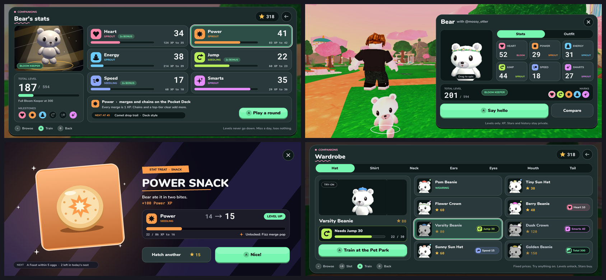
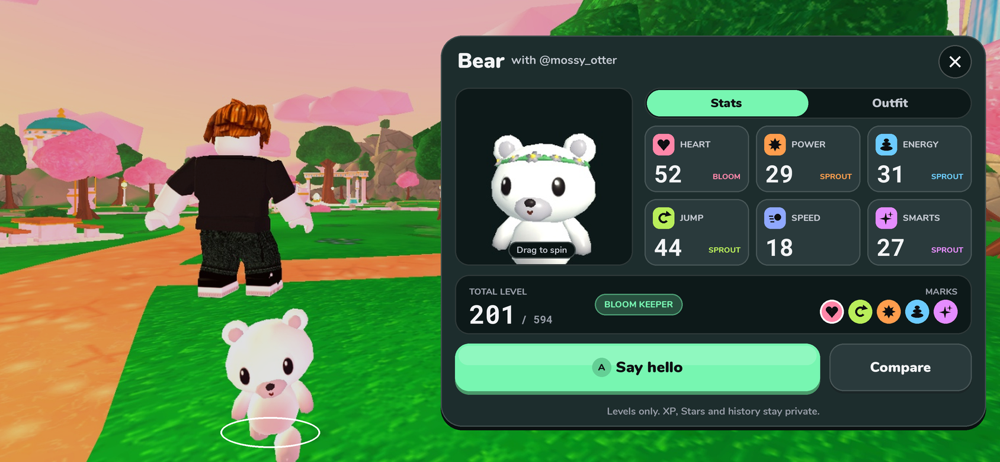
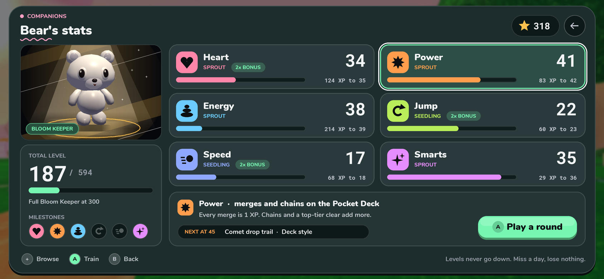
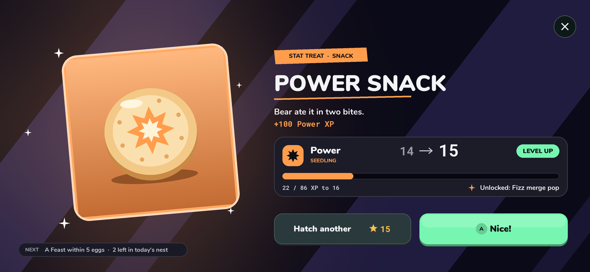
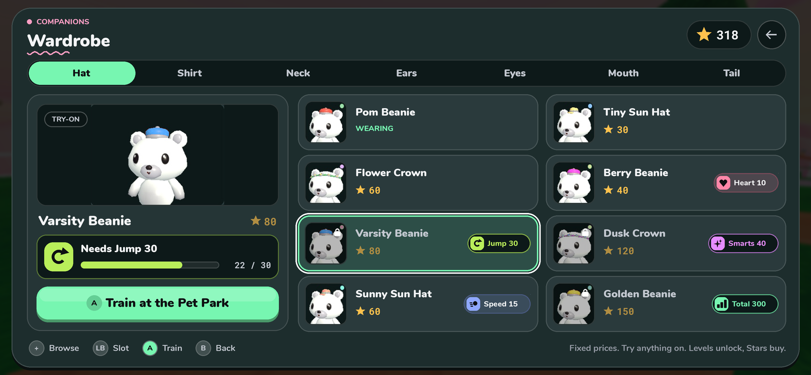

# Pocket Pals v2 scope: Bear stats, Stat Eggs and what ships next

**Status: scope for approval, 2026-11-19. Nothing here is built.** No code, save format, Studio place, Creator Hub setting or published build was changed. Live build is public v935. Every number marked [P] is a placeholder to tune from real play data.

It answers Spencer's ask (2026-11-19): *"i wanna add stats that are kinda levelable with runescape like progression, and we get random stats from stat eggs? this way the player has reasons to come back. maybe we can only buy certain items once stats are at a certain level? kinda like runescape? and players can see these stats when they inspect another person's bear. and should the stats go to 99? and the total stat score is a sum of all the stats?"*

Read for this pass: `AGENTS.md`, `V2.md`, `V2-PINBALL.md`, `CHAO-GARDEN-DIRECTION.md`, `PRODUCT-SCOPE.md`, `GAME-DESIGN.md`, `PLAY-FOREVER-SCOPE-2026-11-13.md`, `ROUND-ITEMS-AND-BALL-THEMES-SCOPE-2026-11-13.md`, `PET-PARK-V1-SCOPE-2026-11-13.md`, `UI-DESIGN-SYSTEM.md`, the top of `PLAY-BUILD.md` and `TODO.md`, `artifacts/pet-social-scope-2026-11-14/VISITOR-PET-SCOPE.md`, and the catalogues and state modules named in section 1. Roblox's paid random items page was re-read on 2026-11-19.

**Revision 1 (Spencer, 2026-11-19):** *"should we make the stats more child friendly, less big words? and more like runescape. actual stats like chao garden that can help users when they do minigame competitions against each other etc, when we add that later."* Changes in this pass:

- **Simple names a young player can read:** Heart, Power, Energy, Jump, Speed, Smarts (were Heart, Pop, Poise, Tumble, Fetch, Wonder). "Mastery Kite" is now the **Champion Kite**, and "Fresh XP" is now **Bonus XP**.
- **Real stats:** each stat now has a job in future pet competitions (races, jump courses, tug of war, treasure hunts). It is described in section 2.4. The Pocket Deck stays stat-free, so the main game and its score board stay fair.
- **More like RuneScape:**
  - an XP pop on every gain;
  - a level-up fanfare;
  - a guide for each stat listing every unlock by level (section 2.5).

RuneScape is the inspiration for the feel only: many small level-ups, a number that is yours, items you grow into. The stat names, icons, XP formula, tier names and the cap reward below are our own.

Mockups (drawn with PIL over crops of existing Studio captures, no generated art): `artifacts/v2-scope-2026-11-19/`. Phone landscape, 844x390 at 2x.



---

## 0. The answer in one place

| Spencer asked | Recommendation | Why |
|---|---|---|
| Stats with levels? | **Six stats, owned by the pet: Heart, Power, Energy, Jump, Speed, Smarts.** Simple words, each trained by something the game already has, and each with a job in future pet competitions (section 2.4). | Six fills a 3x2 grid on a phone inspect card, and every loop in the game (deck, care, park, toys, quests) gets a number. More than six cannot be read on a phone. |
| Should they go to 99? | **Yes, 99.** | Two digits fit the tile, 99 reads as "maxed" to every player, and it is a general game convention, not anyone's property. |
| Is the total the sum? | **Yes. Total level = the six levels added, 6 to 594.** | One number to compare, show on the card and rank on a board. |
| The curve? | **`xp(L) = floor(n^3/40 + 2n^2 + 12n)`, `n = L - 1`.** First level-up after about 14 XP (the first few merges). Half of the XP to 99 is at level 75. | A new player gains about 19 levels across the six stats in the first session. A daily player gets their best stat to 99 in about four months and all six in about ten. |
| Random stats from Stat Eggs? | **A Stat Egg hatches a Stat Treat: XP for one random stat, in three sizes.** It never rolls permanent stat points. | Every roll moves a bar forward, so there is no dead roll and no duplicate. Random permanent points would be a reroll gamble and would make levels something you buy. |
| Stars or Robux? | **Stars, plus free earned eggs. Never Robux directly. Three bought eggs a day.** | Engaged players already bank about 900 Stars a week with nothing to buy. Because Stars are also sold for Robux, the egg is a paid random item under Roblox policy and gets the full treatment the live eggs already have. The daily stock keeps bought XP to about 17% of a daily player's XP. |
| Level requirements on items? | **Yes, on new v2 items only. Nothing for sale today is ever locked.** A gated item needs the level and the Stars. First gates are at level 5 to 10. | Players grow into the shop without anyone losing something they could buy yesterday. |
| Stats on the inspect card? | **Yes: a Stats tab with six level tiles, total level, a tier chip and earned marks. Levels only.** | Fits the existing 460 px phone card. XP, Stars and history stay private, as the visitor-pet scope already requires. |
| Reasons to come back? | **Bonus XP** (the first 100 XP in each stat each day counts double, banks for 3 days), a free daily Stat Egg, the nest's daily stock, a weekly featured stat. **No decay, no streaks.** | Rewards showing up without punishing absence. |
| Cap reward? | **A Champion Kite**: a small kite in the stat's colour that flies behind the Bear at 99. A seventh, the Garden Star Kite, at total 594. | Reads from across the garden, is original, and fits a garden with a park in it. |

Two things need a decision before anything else: **who owns the stats** (section 2.1) and **start counting now** (section 10.3).

---

## 1. What exists today (checked 2026-11-19)

| Fact | Where |
|---|---|
| One pet is live: the Bear (`pip`). A second pet is flagged off. | `PetCatalog.lua`, `FeatureFlags.SecondPet=false` |
| The Bear already has a **Bond** level, 1 to 10, stored as XP per pet. Sources: petting 1, round 2, win 3, Play date 5. Each level unlocks a trick. | `BondCatalog.lua`, `BondState.lua` |
| Rounds pay Stars by difficulty: Easy 5 (tidy 6), Medium 6 (8), Hard 9 (12). A round is a 24-drop field with goals, chains and round items. | `HeatPayout.lua`, `BoardConfig.lua`, `RoundItems.lua` |
| Lifetime counters are saved: rounds, wins by difficulty, tidy wins, merges, best chain, tier five, items used, park games, Stars earned and spent. | `LifetimeState.lua` |
| Pet Park is on: swing, slide, see-saw, sandcastle, ball; a daily Play date (3 activities, +4 Stars); server-owned fetch. | `ParkActivities.lua`, `ParkFetch.lua`, `ParkGameCommit.lua` |
| Daily and weekly quests, a stamp card, a collection book and a weekly 20% shelf are live. | `QuestCatalog.lua`, `StampCard.lua`, `BookCatalog.lua`, `WeeklyShelf.lua` |
| Eggs sold for Stars: Toy Egg (20) and Customization Egg (12, with a charm pity). Odds are shown as percentages. | `ToyCatalog.lua`, `LookEggCatalog.lua`, `OddsText.lua` |
| Stars are also sold for Robux (20 for 39 up to 400 for 499), and a 2x Stars pass exists. | `StoreCatalog.lua` |
| The paid random item policy is read per player and **fails closed**: a restricted or unknown player gets no Star packs and every Star egg gives a fixed, shown next item. | `PaidRandomPolicy.lua` |
| Fixed-price shop: faceplates 40 / 100 / 250, ball themes 40 / 100 / 250, Bear wearables and recolour variants. | `DeckThemes.lua`, `BallThemes.lua`, `WearableCatalog.lua`, `WearableVariants.lua` |
| An inspect card exists: a spinnable 3D preview, name slot, owner, bond level, a 3-column grid of what the pet wears, Say hello. It reads only public board attributes. | `PetInspect.lua` |
| The Pocket Deck runs client-side in lockstep with a server host that owns the result. | `BoardRoundSim.lua`, `ClientSimHost.lua` |

---

## 2. The stats

### 2.1 Who owns them: the pet

**Recommendation: stats belong to each pet, saved by pet id exactly as Bond is today.** The card says "Bear's stats", and the inspect card shows the stats of the pet you are looking at.

- It is what Spencer described ("inspect another person's bear").
- A second pet arrives with its own fresh sheet. That is months of new goals from one piece of art, and it is the Chao idea the garden direction already wants.
- It costs nothing extra now (one pet) and cannot be changed cheaply later.

Two rules keep it fair when more pets exist: **shop gates read your best pet** (an item unlocked once stays unlocked for the account), and **boards rank your best pet's total**. Later, each species can have one favourite stat (+10% XP; the Bear's is Heart). That is fixed per species, never rolled.

### 2.2 The six

Names are one short word a 7-year-old can read and say, and each one says what it does in a race. The words are everyday words. The set is ours: it is not the Chao set and not RuneScape's skills.

| Stat | Mark and colour | Trained by (all exist except one small addition) | What levels give (never deck score, odds or Stars) | Its job in competitions (later, section 2.4) |
|---|---|---|---|---|
| **Heart** | heart, rose `#FF86A8` | Petting, pet focus, care stations, your pet beside you in rounds. **Replaces Bond** (section 10.2). | The Bear's tricks (the ten that exist), new idles, cosy wearables. | Gets back up faster after a trip or bump; cheers boost a teammate. |
| **Power** | flexed paw, tangerine `#FF9D4D` | Merges and chains on the Pocket Deck. Every merge counts, win or lose. | Deck "juice": merge pops and drop trails (new cosmetic kind), ball themes. | Pushing and pulling: tug of war, rolling the big ball, bumping. |
| **Energy** | lightning bolt, sky `#6CCBFF` | Finishing and winning rounds, goals met, tidy wins. Harder difficulty pays more. | Faceplates, round-start flourishes. | Slows down less in long races; a bigger dash meter. |
| **Jump** | spring, lime `#B9EE5A` | Pet Park activities you start, the daily Play date, a bonus with another player's pet. | Park flourishes (a higher swing, a slide spin: looks only), sporty wearables. | Higher hops over hurdles and gaps, faster climbs. |
| **Speed** | wind lines, periwinkle `#8FA8FF` | Throw and fetch, toy play in the garden. | New toys, a longer throw and a mid-air catch (garden play only). | Top running speed on flat ground. |
| **Smarts** | light bulb, orchid `#E58CFF` | Daily and weekly quests, stamps, collection book discoveries, and **garden finds** (new, small: sparkle spots the pet sniffs out). | Charms and finishes sold directly, book hints. | Spots shortcuts and hidden things sooner; more time in puzzle rounds. |

Stat colours are fixed like the Stars gold: the faceplate never tints them. Every stat has its own mark, so nothing depends on colour. Marks are drawn new in the house sticker style (Fable). The mockups still show the first marks.

Why these six and not Agility and Focus from the garden direction: those two needed a stepping course and a chime game that do not exist. These six can all be trained on the day the update ships. The courses stay a later candidate (section 11).

### 2.3 The fairness rule

**On the Pocket Deck, a stat never changes the physics, score, goals, item odds, egg odds or Star payouts.** Stats count only in pet competitions, which are separate games with their own boards (section 2.4). Levels unlock looks, tricks, toys and the right to buy things. So a level 1 player and a level 99 player play the same board, the same weekly board, and earn the same Stars per win. This is the line that keeps score boards and the economy honest, and it is why "Energy 50: +10% score" style perks are not in this document.

One thing was considered and rejected: letting Heart raise the daily petting Star cap. It is small, but it is the first step of stats printing money.

### 2.4 Stats in pet competitions (later, not in the first stats release)

Pet competitions are where stats become real, as in a Chao race. The pet races, jumps and pulls, and how well it does depends on its stats and on how the player plays. None of these games exist yet. These rules are written now so the stats ship ready for them and nobody has to rebalance later.

| Rule | Why |
|---|---|
| **Stats help, the player still matters more.** A level 99 stat gives at most about a 25% edge in its job over level 1 [P] (for example top speed 16 vs 20). Timing, steering and dashes can beat that. | A new player can still win sometimes, and a high level still feels strong. |
| **Fair groups.** Matchmaking puts pets with a similar total level together (bands such as 6 to 99, 100 to 249, 250 to 449, 450+ [P]). A **Just for Fun** mode sets everyone's stats equal. | A level 500 pet never farms beginners. Friends at different levels can still play together. |
| **Mixed jobs.** Each event uses two or three stats: a garden race uses Speed, Energy and Jump; tug of war uses Power, Heart and Energy; a treasure hunt uses Smarts and Speed. | No single maxed stat wins everything, so training all six pays. |
| **Money can't buy wins.** Bought Stat Eggs stay capped at three a day (about 17% of a daily player's XP). Stats can't be traded, and there are no paid boosts in competitions. | With stats that matter, a pay-to-win shortcut would be the fastest way to lose players' trust. |
| **Prizes are mostly bragging.** Ribbons, trophies for the garden, a weekly "Champion" title and small capped Stars. No stat XP as a prize. | Winning doesn't snowball, and competitions don't print Stars. |
| **The Pocket Deck stays stat-free.** | The main game and its weekly board stay fair for everyone on day one. |

First candidates, in order (each M plus art, after the second pet):

1. **Garden Dash**: a 4 to 8 pet race around the garden path with hurdles and a shortcut.
2. **Tug of War**: 1v1 or 2v2, tap in rhythm.
3. **Treasure Hunt**: find the most garden finds in 60 seconds.

### 2.5 The RuneScape feel (all original art and sound)

- **XP pops.** Each gain floats a small "+12" with the stat's mark up from the pet, or from the results screen after a round.
- **Level-up fanfare.** A short jingle (an original sting, not anyone's tune), a burst of the stat's marks, and the pet's happy hop. A bigger one plays at 10, 25, 50, 75 and 99.
- **Stat guide.** Tap a stat to see every unlock from 1 to 99 in a list: rewards, items and competition perks. Locked rows show the level they open at, and the next one is highlighted. This is the "what am I working toward" screen.
- **Total level** sits under the pet's name on the inspect card and on the boards.

---

## 3. Levels, XP and the curve

### 3.1 Cap and total

- Each stat runs 1 to **99**. XP keeps counting past 99 (to a stored cap of 2,000,000 [P]) so boards can break ties and a later cap raise needs no migration. `BondCatalog` already works this way.
- **Total level** is the sum: 6 for a new pet, 594 at the top.
- Levels never go down. There is no decay and nothing is lost by not playing.

### 3.2 The formula

```
xp(L) = floor( n^3 / 40  +  2 n^2  +  12 n ),   n = L - 1        (integer form: (n^3 + 80 n^2 + 480 n) // 40)
```

Script and full 99-row table: `artifacts/v2-scope-2026-11-19/xp_curve.py`, `xp_table.csv`.

| Level | XP to reach it | XP from the level before | Share of the XP to 99 |
|---:|---:|---:|---:|
| 2 | 14 | 14 | 0.03% |
| 3 | 32 | 18 | 0.1% |
| 5 | 81 | 27 | 0.2% |
| 10 | 288 | 52 | 0.7% |
| 25 | 1,785 | 147 | 4.1% |
| 50 | 8,331 | 383 | 19.0% |
| 75 | 21,970 | 711 | 50.0% |
| 90 | 34,534 | 954 | 78.6% |
| 99 | 43,913 | 1,115 | 100% |

The shape, in words: the first ten levels come in minutes, 25 in a week, 50 in a month, and the last 24 levels are half of the whole climb. It is gentler than an exponential curve on purpose. The audience is all ages, and a level every day or two at level 80 keeps a daily player moving.

### 3.3 XP sources [P]

All XP is granted by the server inside transactions that already exist. Nothing is reported by the client.

| Stat | Action | XP |
|---|---|---:|
| Power | Each merge | 1 |
| | Each chain link after the first | +2 |
| | Making the top tier / a top-tier clear | +5 / +8 |
| Energy | Round finished (win or lose) | 6 |
| | Win on Easy / Medium / Hard | +10 / +15 / +24 |
| | Tidy win | +6 |
| | Each goal met (also on a loss) | +3 |
| Heart | Accepted petting pulse | 2 |
| | Care station action finished | 6 |
| | First hello to your pet each day | 10 |
| | Round finished with your pet out | 1 |
| Jump | Park activity you started, finished | 6 |
| | ...with another player's pet in it | +3 |
| | Play date done (daily) | +20 |
| Speed | Speed completed (thrown and brought back) | 5 |
| | Garden toy play beat | 3 |
| Smarts | Daily quest claimed | 30 |
| | Weekly quest claimed / all three | 100 / +50 |
| | Stamp | 20 |
| | Book discovery / page milestone | 25 / 60 |
| | Garden find (new) | 8 |

Design rate: about 8 to 12 XP a minute in whatever you are doing. A round is about 25 Power and 15 to 35 Energy. Caps against macros: 150 Power per round, and 20 XP a minute per stat for Heart, Jump and Speed. An AFK owner earns nothing, as today.

**Bonus XP.** The first 100 XP earned in each stat each day is doubled. Unused Bonus XP banks for up to 3 days, so a player back from a weekend finds 300 waiting in every stat. It is a bonus on top, never a limit: play past it at the normal rate for as long as you like. Treat XP from eggs is never doubled.

### 3.4 How long it takes

Estimates, to be replaced by real numbers. Three players: **casual** (5 rounds and 5 minutes with the pet, 5 days a week), **daily** (10 rounds and 10 minutes, every day, about 30 minutes), **engaged** (15 rounds and 15 minutes, about 45 minutes). Bonus XP included. Counted in play days.

| Reach | Power, the fastest stat (casual / daily / engaged) | Heart, a pet-time stat (casual / daily / engaged) |
|---|---|---|
| Level 10 | 2 / **1** / 1 days | 4 / **2** / 2 days |
| Level 25 | 8 / **6** / 4 days | 23 / **12** / 9 days |
| Level 50 | 38 / **24** / 18 days | 105 / **53** / 38 days |
| Level 75 | 98 / **63** / 47 days | 275 / **138** / 100 days |
| Level 99 | 196 / **126** / 93 days | 549 / **275** / 200 days |

- Daily player: first 99 in about **4 months**, all six (594) in about **10 months** (314 play days; Speed is the slowest).
- Engaged player: first 99 in about 3 months, all six in about 7.
- Casual player: level 50 in their main stat in two months, a 99 in about nine. Most casual players will never max, and that is fine: their goals are the tiers at 25 and 50.
- A player who cares about one pet stat can put all their pet time into it and roughly halve its column.

### 3.5 The first session

A new player's first session (Welcome round, four more rounds, one pet, one park game, one throw): Power 8, Energy 6, Smarts 4, Heart 3, Jump 2, Speed 2. **Total level 25, nineteen level-ups, and the first one lands inside the first round** (14 XP, about seven merges with Bonus XP). Power 5 arrives in round two or three and hands over the first free reward (section 4.1).

Level-ups earned during a round are shown on the results screen, not over the board. The round is never interrupted.

### 3.6 Tiers

Garden names for the milestones, used on tiles, the card and medals:

| Level | Tier | Total level | Keeper tier |
|---:|---|---:|---|
| 1 | Seedling | 6 | Seedling Keeper |
| 25 | Sprout | 60 | Sprout Keeper |
| 50 | Bloom | 150 | Bloom Keeper |
| 75 | Full Bloom | 300 | Full Bloom Keeper |
| 99 | Starbloom | 450 | Starbloom Keeper |
| | | 594 | Garden Star |

---

## 4. What levels unlock, and gates on items

### 4.1 Two kinds of unlock

1. **Level rewards**: free, granted the moment you reach the level. A trick, a merge pop, a sticker.
2. **Gated shop items**: need the level **and** the Stars. The level opens the door, Stars still buy.

First-pass track [P]. Items marked (art) need new art from Astra; the rest reuse what exists (the ten Bond tricks, recolour variants through `WearableVariants`, existing poses).

| Level | Heart | Power | Energy | Jump | Speed | Smarts |
|---:|---|---|---|---|---|---|
| 5 | Sit trick | **Confetti merge pop** (art, small) | "Steady" start flourish | Swing cheer | Quick toy swap | Book "where to find" hints |
| 10 | Wiggle trick; gate: Berry Beanie | Gate: new common ball theme (art) | Gate: new common faceplate | Higher swing (looks only) | Longer throw; gate: Sunny Sun Hat at 15 | Gate: first charm sold directly |
| 15 to 22 | Stretch, hop, peekaboo tricks | Fizz merge pop (art) | | Slide spin | Mid-air catch | |
| 25 (Sprout) | Medal + Heart sticker | Medal + Power sticker | Medal + Energy sticker | Medal + sticker | Medal + sticker | Medal + sticker |
| 28 to 33 | Cosy, sneezy, show-off, best friends tricks | Bubble drop trail at 30 (art) | Gate: rare faceplate at 30 | Gate: Varsity Beanie at 30 | Gate: new toy at 30 (art) | Gate: finish sold directly at 30 |
| 40 to 45 | Nap-on-the-bench idle (art) | Comet drop trail at 45 (art) | Gate: showcase faceplate at 45 | See-saw hop | Gate: new toy at 45 (art) | Gate: Dusk Crown at 40 |
| 50 (Bloom) | Medal with a ring | same | same | same | same | same |
| 60 | | Firework pop (art) | Gate: second showcase faceplate (art) | | | |
| 75 (Full Bloom) | Medal, card frame trim | same | same | same | same | same |
| 99 (Starbloom) | **Heart Kite** | **Power Kite** | **Energy Kite** | **Jump Kite** | **Speed Kite** | **Smarts Kite** |

Total-level gates sit on a few showpieces: Golden Beanie at total 300 [P], a book-style faceplate at total 150 [P].

The track does not need every cell filled to ship. The stats panel shows "Next at N" only where something exists. Target for the first release: one reward by level 5 in every stat, something every 5 levels to 25, then every 10 to 15.

### 4.2 Gating rules (so new players are never locked out of the fun)

1. **Nothing for sale on 2026-11-19 is ever gated.** Every faceplate, ball theme, wearable, toy and egg that is live stays open to a level 1 player.
2. The Pocket Deck, all three difficulties, the park, petting and every egg type are never gated.
3. The first row of every shop tab is ungated. At most about a third of any tab is gated.
4. The lowest gates (5 and 10) are reached in the first one or two sessions.
5. A locked item is fully visible, can be tried on, shows its price, shows the level it needs with a progress bar, and its button takes you to where that stat is trained. It is never a dead end.
6. Once unlocked, always unlocked, for every pet you own.
7. A gate never sits on something sold for Robux. Passes and Star packs have no level.

---

## 5. Stat Eggs

### 5.1 What one is

A Stat Egg hatches one **Stat Treat**. The Bear eats it (the eating animation from the hue fruit already exists) and gains XP in that treat's stat.

| Roll | Outcomes | Shown odds |
|---|---|---|
| Which stat | Each stat below 99, equally likely | 16.7% each with six stats in the pool |
| Which size | Nibble +40 XP / Snack +100 XP / Feast +250 XP [P] | 60% / 30% / 10% |

Average: 79 XP an egg. At level 30 a Feast is a little more than one level; at level 90 it is a quarter of a level. Eggs matter most early and in the stats you train least, which is the right place for them.

### 5.2 Why a bad roll still feels good

- Every outcome is progress on a bar you can see. There is no empty result and no "already owned".
- A Nibble in your weakest stat is often a level-up, because low levels are short. Half the time an early egg ends in the level-up moment.
- **A Feast within 8 eggs** [P]: after seven eggs without one, the eighth is a Feast. The reveal's corner pill counts down ("A Feast within 5 eggs"), the same way the Customization Egg shows its charm promise.
- The Bear eats it. The moment is a pet moment, not a slot machine.

### 5.3 Duplicates and edge cases

- There are no duplicates: a treat is XP, not an item.
- A stat at 99 leaves the pool and the shown odds update for that player (five stats left: 20% each).
- When all six are 99 the egg is hidden for that pet, and any unopened free eggs turn into 15 Stars each.
- With several pets, the treat goes to the pet that is out. The card names it before the hatch.

### 5.4 Price and supply

- **15 Stars** [P] from the nest in Hatch eggs. **Three a day** from the nest's stock [P].
- **Free eggs**, kept until opened (up to 10): one with the first finished round each day, one for finishing all three weekly quests, one on the seventh stamp, one with every tier medal.
- **Never sold for Robux directly. No XP boost pass. Treats cannot be traded or gifted.**

Why Stars and not earned-only: engaged players empty the shop in about a week and then bank about 900 Stars a week (`PLAY-FOREVER-SCOPE` 3.4). The game needs a small repeatable thing to spend on. Why the daily stock: three bought eggs are about 237 XP a day spread over six stats. A daily player earns about 1,390 XP a day by playing, so the most Stars can add is about 17%, the same order as the 2x Stars pass. Levels stay something you play for.

If Spencer would rather levels can never be bought at all, the fallback is clean: make the egg earned-only (no price). It then needs no odds under the policy, though we would still show them.

### 5.5 Roblox policy (re-read 2026-11-19)

Source: [Paid random items policy guidelines](https://create.roblox.com/docs/production/monetization/paid-random-items).

| What the policy says | What the design does |
|---|---|
| Random items bought "directly or indirectly with Robux" are covered, including with paid in-game currency. Egg hatching, enhancement items and pity systems are named. | Stars are sold for Robux, so a Star-priced Stat Egg is a paid random item. It gets everything below. |
| Show all possible outcomes and the actual numerical odds before the spend, as percentages totalling 100%, with a rounding note if needed. A bare (i) icon is not enough. | The egg card lists both tables in the open, as the live eggs do: "Each stat: 16.7%" and "Nibble 60%, Snack 30%, Feast 10%", plus the note "Probabilities are rounded; the total may not equal 100%." Grouped odds ("for each item listed below") are allowed. |
| When an outcome can only be won once, update that player's remaining odds. | A stat at 99 leaves the pool and the per-stat figure changes for that player. |
| Probability modifiers (pity, luck) must be explained before purchase and the shown odds must update while active. | The Feast promise is written on the card. On the promised egg the card shows Feast 100%. No luck boosts are sold. |
| `PolicyService` `ArePaidRandomItemsRestricted`: when true the user must not use paid random item generators. Allowed treatments include a disclosed non-random order. | Same as today (`PaidRandomPolicy`, fails closed): a restricted or unknown player gets no roll. Stats come in panel order and sizes in a fixed ten-egg cycle (6 Nibble, 3 Snack, 1 Feast, the same average), and the card shows "Next: Energy Nibble" before the hatch. Applied to bought and free eggs alike, to keep one rule. |
| Rewards earned without Robux or currency need no odds. | Free eggs would be exempt. We show the odds on them anyway. |
| `IsPaidItemTradingAllowed`: ineligible users must not trade paid or paid-random outcomes. | Treats and levels cannot be traded. This flag matters for trading later (section 11). |

Regions and ages: the policy page names no countries or ages. The flag is the test and must be read per player. Search results for Roblox's own posts say paid random items are off for under-18s in the UK and in Brazil, and that an experience which declares them in the maturity questionnaire without using `PolicyService` becomes unavailable to those users ([DevForum, UK](https://devforum.roblox.com/t/update-on-paid-random-items-restriction-for-uk-users-under-18/3072183), [Roblox help, Brazil](https://en.help.roblox.com/hc/en-us/articles/48706630819476-Brazil-Digital-ECA-Updates)). I could not open either page directly today (one returned empty, one 403), so treat those two lines as unverified summaries. Our code already uses `PolicyService`.

**One check for Spencer in Creator Hub** (I did not open it): `PLAY-BUILD.md` records that the age rating "still reads unspecified in the API". The live game already sells Star eggs, so the Maturity and Compliance questionnaire should already declare paid random items. Confirm it is filled in and declares them before a Stat Egg ships.

---

## 6. Inspecting another player's Bear



The card that exists gains two tabs. **Stats** is the default; **Outfit** is today's grid of what the pet wears.

| Part | Content |
|---|---|
| Header | Pet name (the species until Names ships), "with @owner", close |
| Left | The live spinnable preview, unchanged |
| Stats tab | Six tiles in a 3x2 grid, in the fixed order Heart, Power, Energy / Jump, Speed, Smarts. Each: mark, name, level in mono, tier word from 25 up |
| Summary strip | Total level out of 594, Keeper tier chip, **Marks**: one medal per stat at Sprout or better (ring at Bloom, double ring at Full Bloom, star at Starbloom), then a count of kites |
| Actions | Say hello (unchanged rules), **Compare** |
| Footer | "Levels only. XP, Stars and history stay private." |

- **Compare** adds "You 41" under each number. No red or green, no "better" or "worse".
- **Public data**: the server publishes one small attribute beside `PublicBond`: six levels, the total and the kite bits of the pet that is out. No XP, no wallet, no inventory. The Heart level replaces the bond line.
- **Phone**: the card stays 460 px wide in compact (`Inspect.geometry`). Tiles are 88x56, the level is 20 px mono, labels 7.5 to 8 px caps (the same size as today's row labels). Say hello and Compare are 40 px high and full width between them. It sits on the right so the pet you tapped stays in view on the left.
- **Settings**: one toggle, "Show my pet's stats to visitors", default on. Off shows the Outfit tab only.
- A pet with a kite shows it in the world, so a maxed stat is visible before anyone opens a card.

---

## 7. Reasons to come back

Nothing here takes anything away from a player who misses a day, a week or a month.

| Rhythm | Reason | How it ties to stats |
|---|---|---|
| Every session | A level-up somewhere, most sessions, until the 70s | Results screen "Stats" strip; panel bars |
| Every day | **Bonus XP** in six stats | Six "2x BONUS" tags on the panel. Touching all six loops is worth 600 bonus XP. Banks 3 days. |
| Every day | **Free Stat Egg** with the first finished round | The Bear eats a treat |
| Every day | The nest restocks three Stat Eggs | A Star sink that feeds the bars |
| Every day | Quests and the stamp | Now also Smarts XP |
| Every week | **Featured stat**: one stat, rotating on the Monday roll the quests and shelf already use. Gain 500 XP in it [P] for a Stat Egg and that week's sticker. | A personal goal, not a rank. Everyone who does it gets it. |
| Every week | The shelf puts one gated item at 20% off | "I am two levels away" |
| Every few weeks | A tier medal, a new reward on a track | 25 / 50 / 75 |
| Months | A kite. Then the next one. | 99 |
| A new pet | A fresh sheet | Total starts again at 6 for that pet |

Coming back after a break: the banked Bonus XP is the welcome. No "you lost your streak", no decayed bar, no missed-forever reward (weekly stickers return in rotation).

---

## 8. Milestones, kites and boards

**Medals.** Sprout (25), Bloom (50), Full Bloom (75), Starbloom (99) per stat. Each medal pays one free Stat Egg; 25 also gives the stat's deck sticker (six small stickers, art).

**The Champion Kite (our cap reward).** At 99 the Bear gets a small diamond kite in the stat's colour with the stat's mark on it. It flies a little above and behind the pet on a short string and flutters as the pet walks; it settles on the pet's back when it sits or sleeps. One kite flies at a time, chosen in Customize. Seven in all: six stat kites and the **Garden Star Kite** (six tails, one per colour) at total 594. Earned only, never sold, never in an egg. One mesh, seven colourways, one flutter loop. It needs a clearance test against the floating charm before the art is final.

**Roblox badges** [P]: First Sprout, First Bloom, First Starbloom, Garden Star.

**Boards.**

| Board | What | Cost |
|---|---|---|
| Garden board | A signpost in the garden: total levels of the pets in this server, highest first | S. No storage, reads the public attribute |
| Global Top Keepers | Top 100 total level, ties broken by total XP. `OrderedDataStore`, written when the total changes, at most once every few minutes per player and on leave | M |
| Featured stat | This week's XP gained in the featured stat, top 100 | M, shares the store code |

Because stats change no scores, these boards cannot be bought into beyond the egg stock, and they cannot distort the Weekly Board of deck scores proposed in `PLAY-FOREVER-SCOPE`. A setting hides a player from global boards (default: shown, with the Roblox display name only).

---

## 9. UI and visual direction

All screens use the existing kit (`DeckKit`): teal glass panel, raised cards with a 1 px light stroke, dark wells, pill tabs, the pink squiggle under the title, wallet pill and back arrow at top right, hint row at the bottom, Roboto Mono for every number that ticks. New tokens: the six stat colours (section 2.2), used only on stat marks, stat bars, requirement chips and medals. Ink `#0E0F12` on every stat fill.

### 9.1 Stats panel



- **Where**: Companions hub, a "Stats" destination beside Wardrobe and Customize; also the Bear's level chip in pet focus.
- **Left**: the pet's live preview with its Keeper tier chip, then total level in Counter L with "/ 594", a bar to the next Keeper tier, and six milestone medals (dark until earned).
- **Right**: six stat tiles in two columns. Tile: 30 px mark chip, name, tier word in the stat colour, level at the right in mono, a bar in the stat colour, "83 XP to 42". A "2x BONUS" tag shows while today's bonus is unused.
- **Detail strip** for the selected stat: one line on how it is trained, the next unlock ("Next at 45: Comet drop trail"), and a primary button that takes you there ("Play a round", "Go to the park").
- **Footer**: "Levels never go down. Miss a day, lose nothing."
- Desktop: the same grid with room; tiles grow to show the next two unlocks. Portrait: one column of six tiles, the detail opens as a sheet.

### 9.2 The level-up moment

- **In the garden** (petting, park, fetch, finds): the pet does its hop, a ring of the stat's marks bursts from it in the stat colour, and one line slides into the notification rail: mark chip, "Power 15", and the unlock if there is one. Under 1.5 seconds. Several level-ups in a few seconds merge into one line ("Power 15, Energy 12").
- **After a round**: the results screen gains a "Stats" strip under the payout: Power and Energy bars fill from where they were, the number ticks over, a "LEVEL UP" pill pops. It counts with the existing count-up and the first A press finishes it.
- **A tier or a reward** (25 / 50 / 75 / 99, or any level with an unlock): the existing reveal stage, tinted in the stat colour, with the medal or item on the tilted card.
- **Sound**: one three-note rising synth figure, the same shape for all six stats in six registers, so a player learns "that is a level" and can tell which. Tiers reuse the rarity chime family. Composed in-house.
- Reduced Motion: no burst, the number changes and the rail line shows.

### 9.3 Stat Egg hatch



- **Egg card** (in Hatch eggs, same layout as the Customization Egg): description, the two odds tables in the open, the Feast promise line, "2 left in today's nest", "Bear will eat it", and the hatch button with the price. Restricted players see "Next: Energy Nibble" in place of the tables.
- **Reveal**: the existing reveal stage in the stat's colour. The treat sits on the tilted card. Chip "STAT TREAT · SNACK", title "POP SNACK", then "Feed Bear" as the one primary.
- **After feeding**: the Bear's bite, then the stat row: the bar fills, runs over, the level ticks 14 to 15, "LEVEL UP" pill, and the unlock line. Buttons: "Hatch another ★15" and "Nice!". Corner pill: "A Feast within 5 eggs · 2 left in today's nest".
- Treat models: one biscuit mesh, six stamp colours, three sizes. (The biscuit in the mockup is a drawn placeholder.)

### 9.4 Locked item



- **Tile**: the item's picture stays visible, slightly dimmed, with a small lock on its corner. A requirement chip sits at the right: mark, "Jump 30", outlined in the stat colour. When the level is met the chip fills softly and loses the lock. The price stays on the tile, dimmed until unlocked.
- **Detail card**: "TRY-ON" preview on the pet, the name and price, a requirement row with the mark, "Needs Jump 30" and a bar "22 / 30", and one primary button that goes to the training place ("Train at the Pet Park"). When the level is met it becomes "★ Buy 80".
- **Footer line**: "Fixed prices. Try anything on. Levels unlock, Stars buy."
- Total-level gates use the mint accent and a small bar-chart mark.
- Never used: red, the word "can't", a greyed-out silhouette, or a hidden price.

---

## 10. Save, server and migration

### 10.1 Data

- `petStats[petId] = {heart, pop, poise, tumble, fetch, wonder}`: whole XP numbers, in the hatching save beside `bond`. Missing reads as 0, so no old save fails (the `LifetimeState.Optional` pattern).
- `fresh = {day, used = {six numbers}, bank = {six numbers}}`.
- `statEgg = {held, misses, boughtDay, boughtCount, cycleIndex}` plus a receipt per egg with an operation id, like every other egg.
- Unlock bits for level rewards claimed, kite bits, medal egg claims.
- Frozen at ship: the stat id list and order (append only), the XP formula version, stored bounds. Tunable without touching saves: every XP amount, the Fresh size, egg odds (a new pool version, as `LookEggCatalog` does).

### 10.2 Bond becomes Heart

Two level systems for the same pet would confuse everyone. **Heart XP starts as Bond XP x 4.** The ten tricks move to the Heart levels that conversion gives, so no one loses a trick:

| Bond level | 1 | 2 | 3 | 4 | 5 | 6 | 7 | 8 | 9 | 10 |
|---|---|---|---|---|---|---|---|---|---|---|
| Heart level after conversion | 1 | 5 | 10 | 14 | 18 | 22 | 25 | 28 | 31 | 33 |

The heart pips in pet focus become the Heart level chip. `BondCatalog`'s numbers stay readable for old receipts.

### 10.3 Start counting now (slice 0)

Launch was two days ago. Play that is not counted today cannot be credited later. `LifetimeState` already has what Power, Energy and Jump need (merges, rounds, wins by difficulty, tidy wins, park games), and Bond covers Heart. **Speed and Smarts have no counter.** Add optional counters in the next live build, with no UI: fetches completed, quests claimed (daily, weekly), garden toy beats, care actions. Then on the day stats ship, every existing player opens the panel to levels they already earned. This is one small server change and should not wait for the rest.

### 10.4 Authority

- XP comes only from server-validated events: the round result from the lockstep host (`ClientSimHost` / `BoardRound`), `PetContact` pulses, `ParkGameCommit`, `ParkFetch` completions, `QuestState` claims.
- Gates are checked on the server at purchase.
- Public stats are a derived attribute, never trusted as input.
- New strings go through `UICopy` and the translation sync. Stat names are short on purpose; "Power" and "Energy" need a human check in translation.

---

## 11. The other v2 candidates, ranked

Sizes as in `PLAY-FOREVER-SCOPE`: S under a session, M one to two sessions with review, L more than that or needs new art.

### Goes first

| # | Item | Size | Why here |
|---:|---|---|---|
| 1 | **Counters now** (10.3) | S | Cannot be backfilled. Every day it waits is lost credit. |
| 2 | **Stats core**: six stats, XP from existing events, Bond into Heart, stats panel, level-up moments, results strip | L | The ask. Everything else here reads from it. |
| 3 | **Stats on the inspect card** + garden board | S to M | Small once 2 exists, and it is the social half of the ask. |
| 4 | **Level rewards and gated items**: first tracks, deck juice (merge pops, drop trails), about 12 recolours, locked state in the shops | M + art | Gives levels something to open. Also the first new shop content since launch. |
| 5 | **Stat Eggs** with Bonus XP and the featured stat | M | The daily loop and the Star sink. Reuses the Customization Egg's transaction, odds and restricted path. |
| 6 | **Second pet + Names Egg** | L (art) + M | Already promised as the first update. A second sheet doubles the goals, and the inspect card's name slot is waiting. Blip still needs an approved design. |
| 7 | **Kites, medals, global board** | M + art | The long goal. Not needed on day one: nobody reaches 99 for three months, so the kite art has time. Medals at 25 should ship with 4. |
| 8 | **Second Pet Park** | M | Already on the list for full servers (9 slots, 12 players). Jump will send more pets to the park, so this moves up. |

### Next

| Item | Size | Why it waits |
|---|---|---|
| Weekly Board (one shared seeded board, medals) | M | Still the best deck-skill goal. Pairs with the board storage from 7. |
| Garden finds beyond the basic sparkle spots | S to M | Start with the simple version in 2; grow it if Smarts feels thin. |
| Training courses (stepping course, chime game from the garden direction) | M + art | Active training for Jump and Speed. Worth it once we see which stats players enjoy. |
| Challenge / puzzle boards | M to L | Fits Energy well (fixed boards, fewest drops). Needs authored content. |
| Theme weeks | M | Good with a featured stat. Needs the content beat first. |
| Polish (gold-trim versions for Stars) | S to M | A deep sink if Stars still pile up after Stat Eggs. |

### Waits

| Item | Size | Why |
|---|---|---|
| Cartridges (other games on the Pocket Deck), including pinball as a cartridge | L | A second game. `V2-PINBALL.md` says wait for retention data, and that has not changed. A new cartridge could bring its own stat later. |
| Two-player board modes | L | The lockstep host makes it possible. Do it when there are enough players on at once to match. |
| Guilds and team boards | L | Needs concurrency, moderation and chat policy work. Personal boards come first and tell us if anyone looks at boards. |
| Trading | L, high risk | One pet, and stats and treats are untradable by design, so there is little to trade. It also needs `IsPaidItemTradingAllowed` handling, escrow, history and scam protection (`V2.md`). Revisit after three or four pets exist. |
| Pet showcase trading floor | - | Covered by the inspect card, kites and boards. Drop unless trading ships. |
| Stat perks that touch the deck, battles, evolution | - | Not proposed (2.3). |

### Stats slices, for the implementation plan

| Slice | Contents | Done when |
|---|---|---|
| S0 | Optional counters in the live build | Counters appear on fresh and old saves; no UI |
| S1 | `StatCatalog` (ids, formula, tiers, XP table), `StatState` (grant, Fresh, caps), save bump, backfill from counters and Bond | Specs: curve table matches `xp_table.csv`; replayed transactions never double-grant; old saves load |
| S2 | XP hooks on round settle, petting, care, park, fetch, quests, stamps, book | Server specs per source; caps hold under spam |
| S3 | Stats panel, level-up rail line and hop, results strip | Phone 844x390 and 667x375 captures; controller focus; Reduced Motion |
| S4 | Public stats attribute, inspect Stats tab, Compare, setting, garden board | Two-account test; no XP or wallet in the attribute |
| S5 | Level rewards, gate field on catalogues, locked state in Wardrobe / Deck style / Customize, server gate check | A level 1 save can still buy every launch item; a gated buy is refused server-side below the level |
| S6 | Stat Egg: catalogue, transaction, odds card, restricted order, reveal and feeding, nest stock, free egg grants | Odds text matches the roll table; restricted path shows the next treat; reopening a receipt shows the same treat |
| S7 | Garden finds (simple), featured stat | Finds are server-placed and rate-limited |
| S8 | Medals, kites, global board, badges | Kite clears charm and wearables on the Bear; board writes stay inside the store budget |

S1 to S4 are the smallest thing worth publishing. S5 and S6 can follow a week later.

---

## 12. Open questions for Spencer

1. **Per pet or per player?** I recommend per pet (2.1). This is the one that is hard to change later.
2. **Fold Bond into Heart?** I recommend yes, with the trick mapping in 10.2.
3. **Names.** Heart, Power, Energy, Jump, Speed, Smarts; tiers Seedling, Sprout, Bloom, Full Bloom, Starbloom; "Keeper"; the Champion Kite. Any to change?
3b. **Competitions.** Which one first, Garden Dash, Tug of War or Treasure Hunt? And is a 25% maximum edge from stats the right size?
4. **Stat Egg for Stars (15, three a day) or earned-only?** I recommend Stars with the daily stock (5.4).
5. **The pace.** A first 99 in about four months of daily play, all six in about ten. Faster, slower, or right?
6. **Counters now.** Can slice S0 go into the next live publish?
7. **Gates on new items only.** Confirm nothing live today is ever locked.
8. **Creator Hub.** Is the maturity questionnaire filled in, with paid random items declared? The API still read "unspecified" at launch.
9. **Boards.** Global Top Keepers shown by default with an opt-out, or opt-in?
10. **Art budget.** First release: six stat marks, six stickers, about four deck juice effects, about twelve recolours, one treat mesh. Later: seven kites. Is that the right size for Astra's lane?

---

## Files

- This document: `V2-SCOPE-2026-11-19.md`
- Mockups: `artifacts/v2-scope-2026-11-19/01-stats-panel-844x390@2x.png`, `02-inspect-card-844x390@2x.png`, `03-stat-egg-level-up-844x390@2x.png`, `04-locked-item-wardrobe-844x390@2x.png`, `contact-sheet.png`
- Mockup source: `artifacts/v2-scope-2026-11-19/build_mockups.py` (PIL; bear, hats and garden are crops of `artifacts/store-listing/raw/` Studio captures; recolours are hue shifts of those crops; the treat is drawn)
- Curve: `artifacts/v2-scope-2026-11-19/xp_curve.py`, `xp_table.csv`

Sources: [Roblox paid random items policy](https://create.roblox.com/docs/production/monetization/paid-random-items) · [DevForum: paid random items restriction for UK users under 18](https://devforum.roblox.com/t/update-on-paid-random-items-restriction-for-uk-users-under-18/3072183) (not opened, search summary only) · [Roblox help: Brazil Digital ECA updates](https://en.help.roblox.com/hc/en-us/articles/48706630819476-Brazil-Digital-ECA-Updates) (not opened, search summary only)
