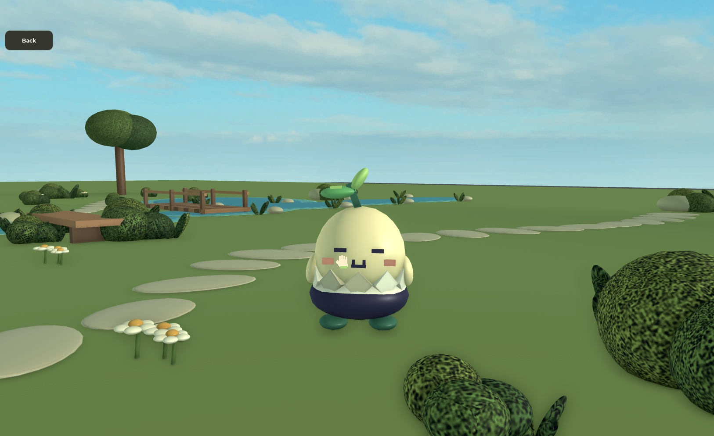
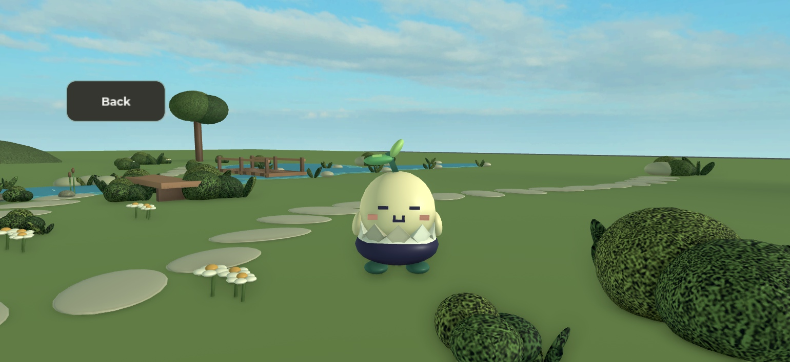
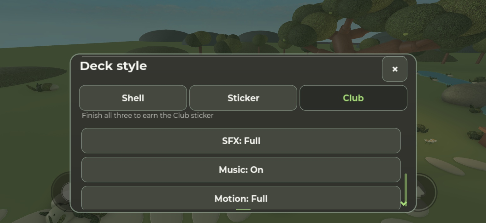
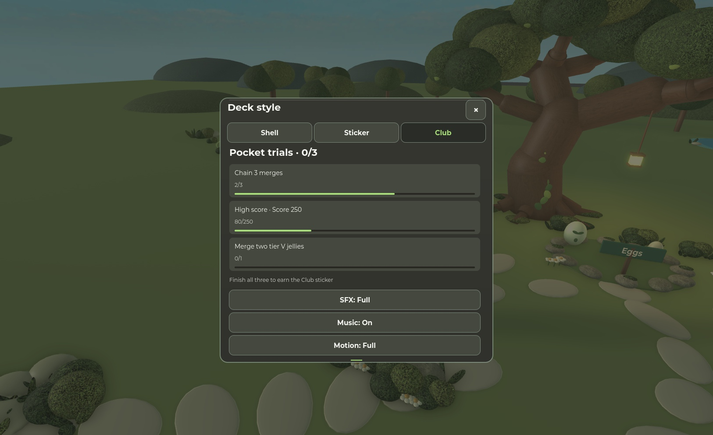
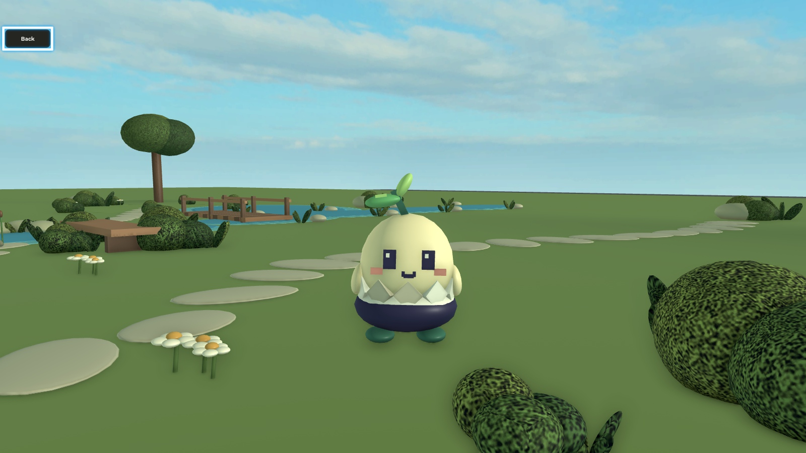
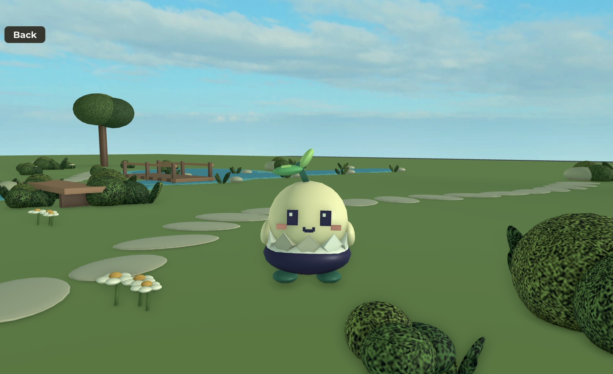

# Direct petting and original audio — accepted evidence

Astra screenshot GO. Captures are native Studio renders, not physical phone evidence. No photo establishes an audible mix.

One purr voice crossed five natural loops during continued movement. Actual release stopped it. Back returned Custom/walk16.

Glove has gone; grin persists briefly. Back clears the crown. This is emulator touch, not a handset.

Frame-spaced Touch scroll reached this position; actual Music Off/On changed the loaded voice. A coalesced Sky.drag did not provide useful swipe motion and is not counted as passing scroll evidence.

Controller diagram emitted verified Gamepad1 X/A/B. Physical-controller comfort is untested.

Actual E entry, no Greet,44px-high Back, retired hints; actual Back restored camera/movement.

Detailed boundaries, semantic fixtures, engine counters and limitations: [results](contact-results.json).
