# Final station and loop evidence

Astra source and render GO. All input is Studio desktop/emulator or virtual controller; no physical handset evidence.

## Native phone prompt comparison

These PNGs are Studio-window captures including native CoreGui. The before/after pair for each station keeps camera/root fixed and changes only its offset; those accepted offsets were then implemented and verified from a fresh build.

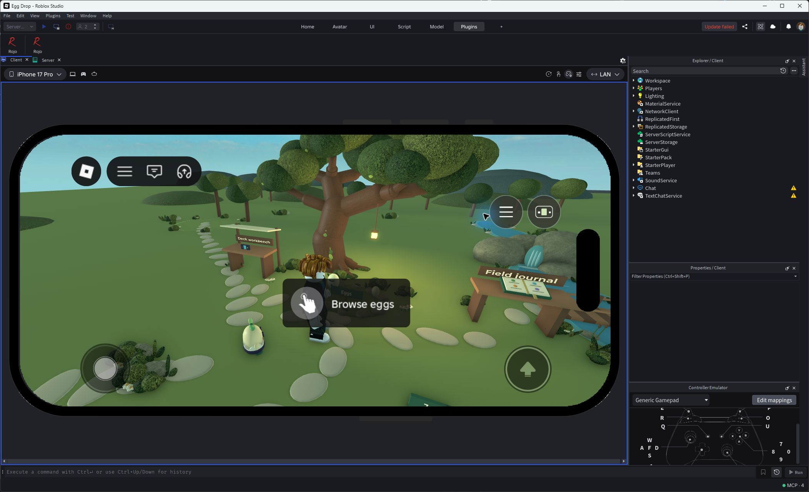
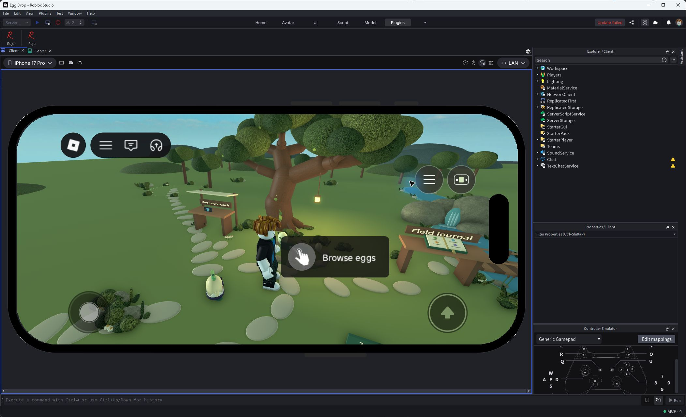
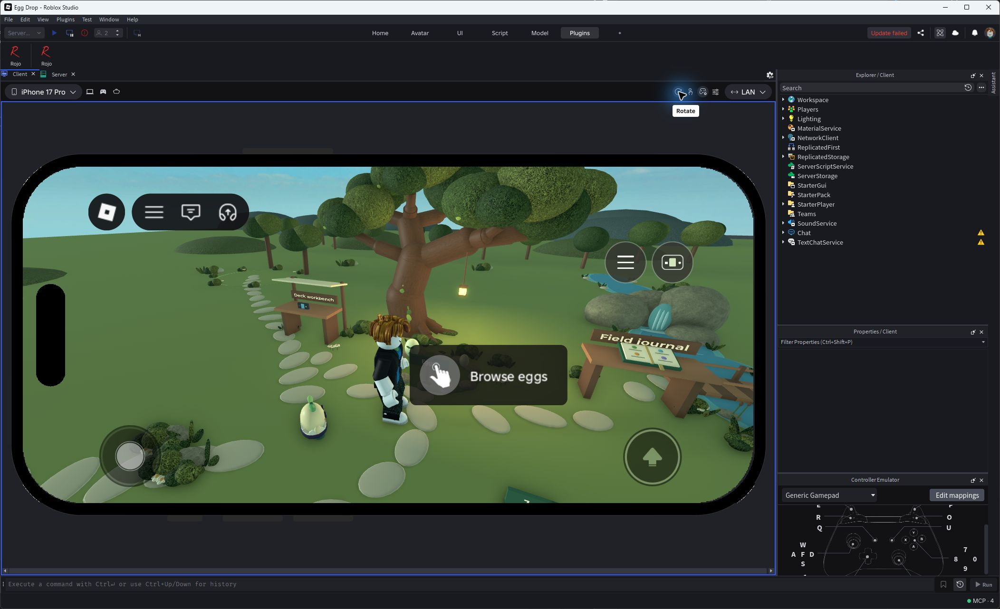
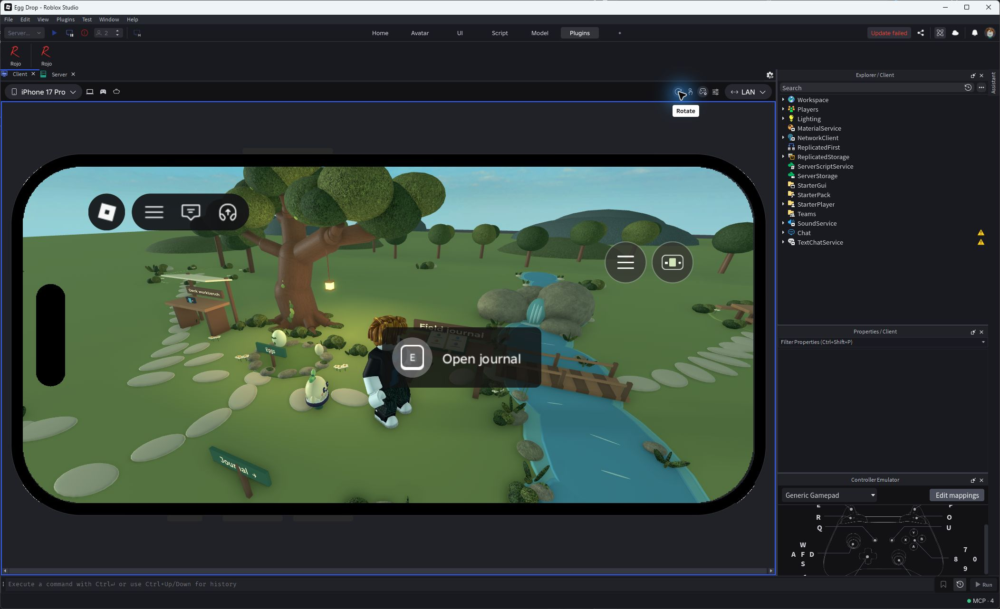
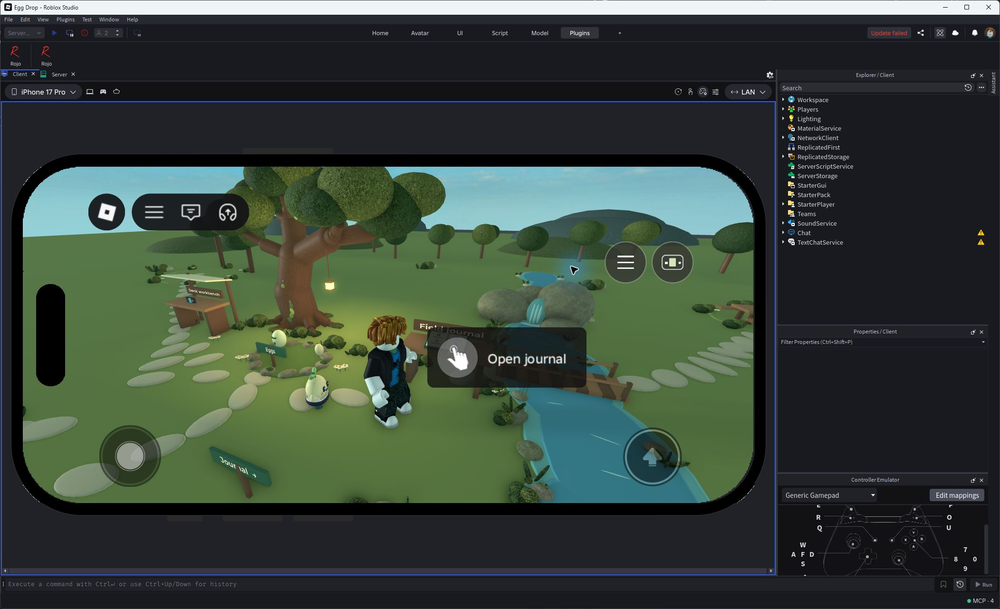
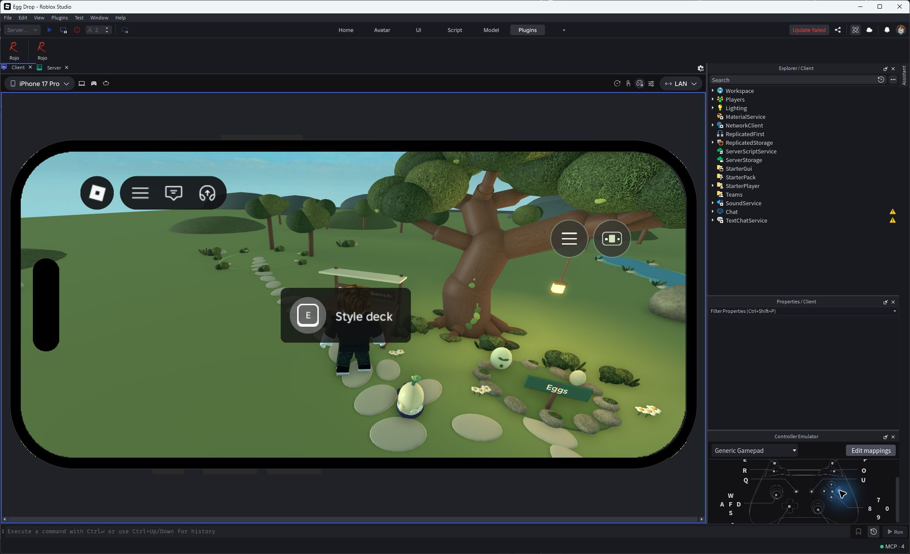
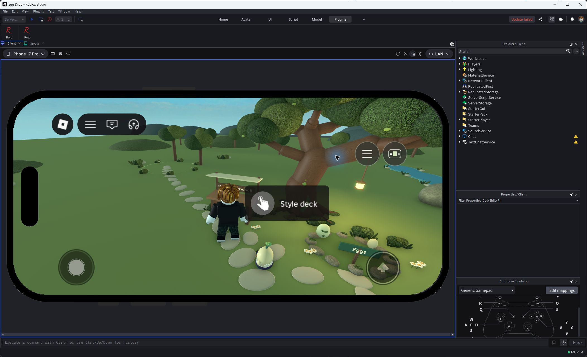

## World proportions and ordinary routes

The following MCP renders show geometry and omit native prompts.

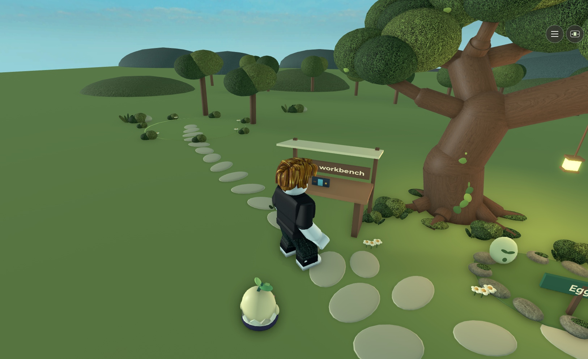
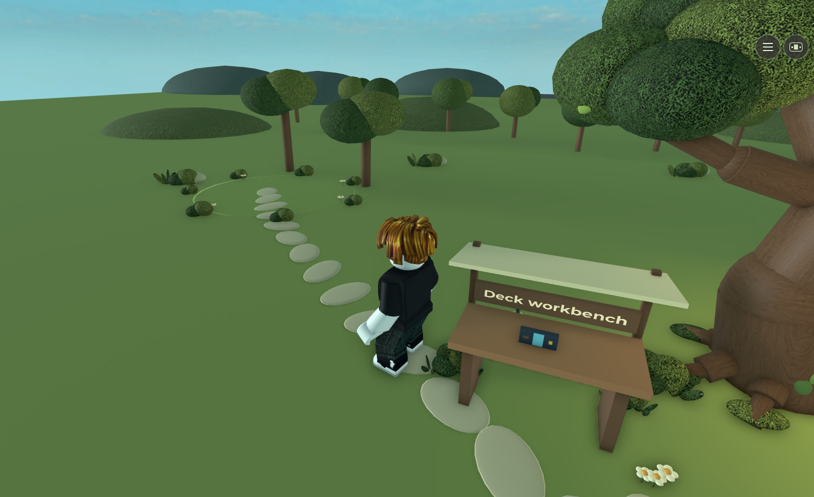
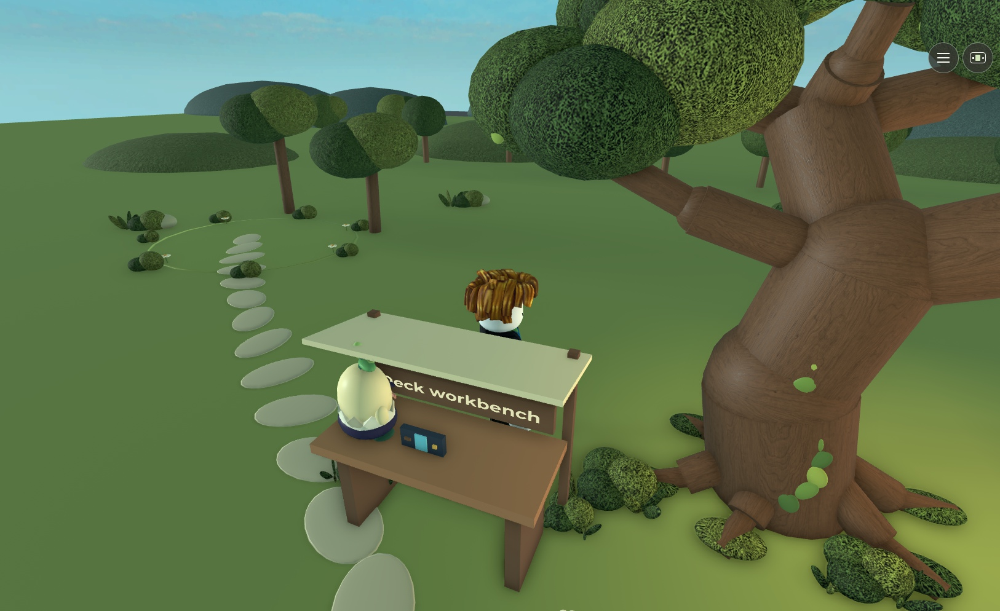

A too-close diagonal walking target briefly auto-stepped onto the solid table. Original collision/climbing remains; the outside route returns to floor.

## Final fresh-source round and hatch

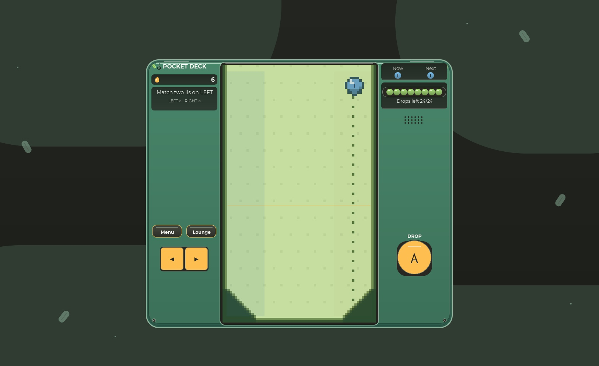
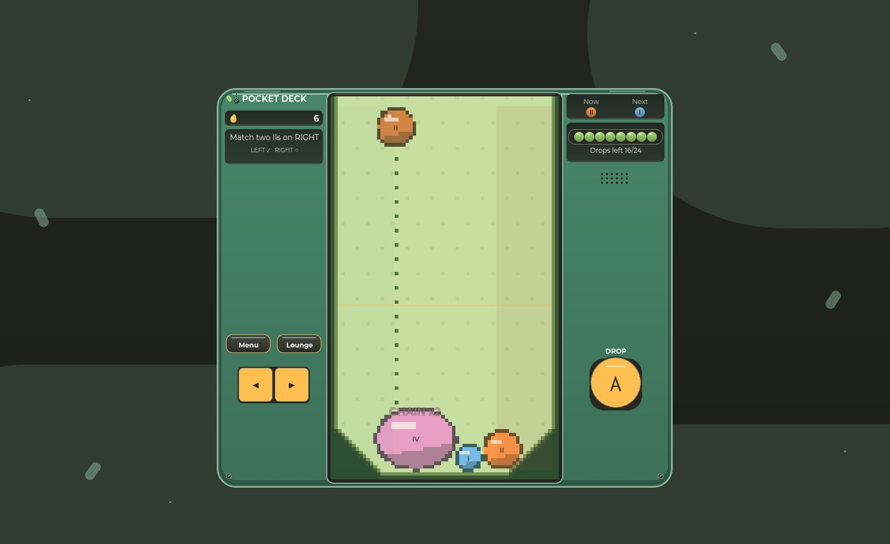
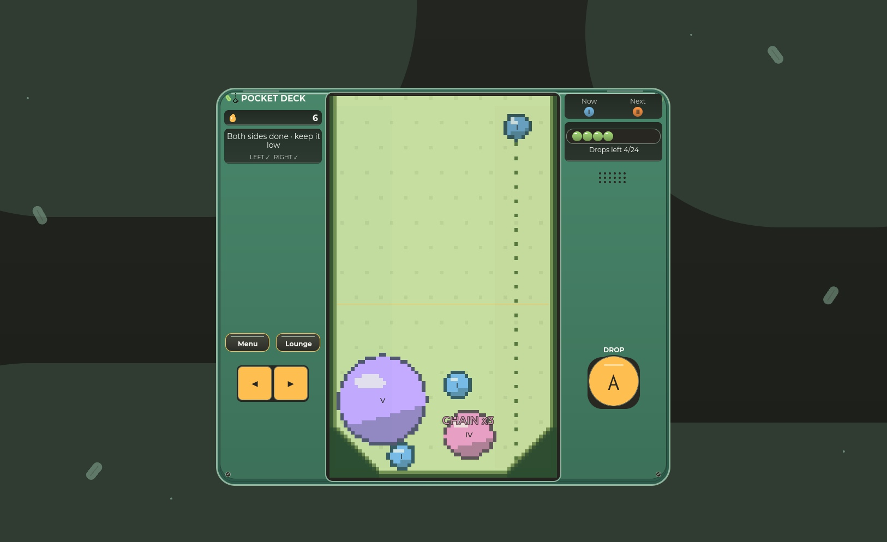
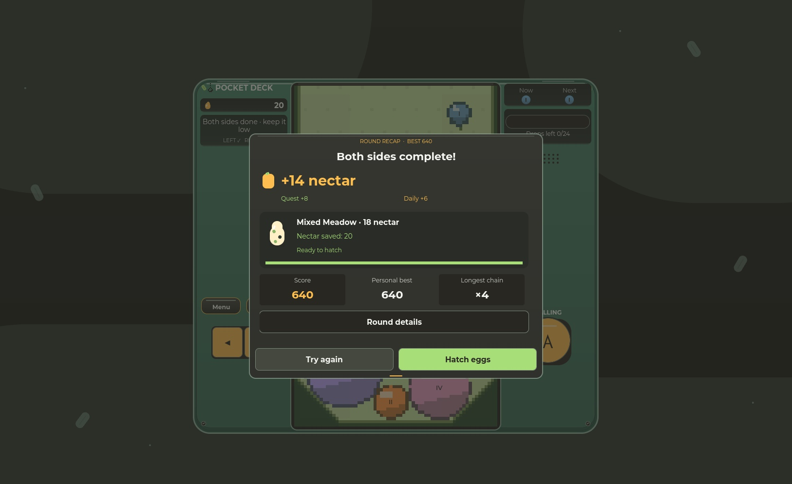
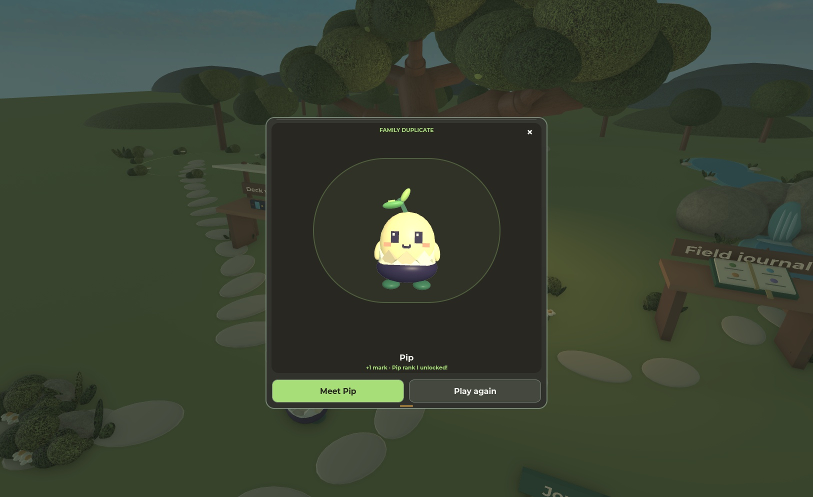
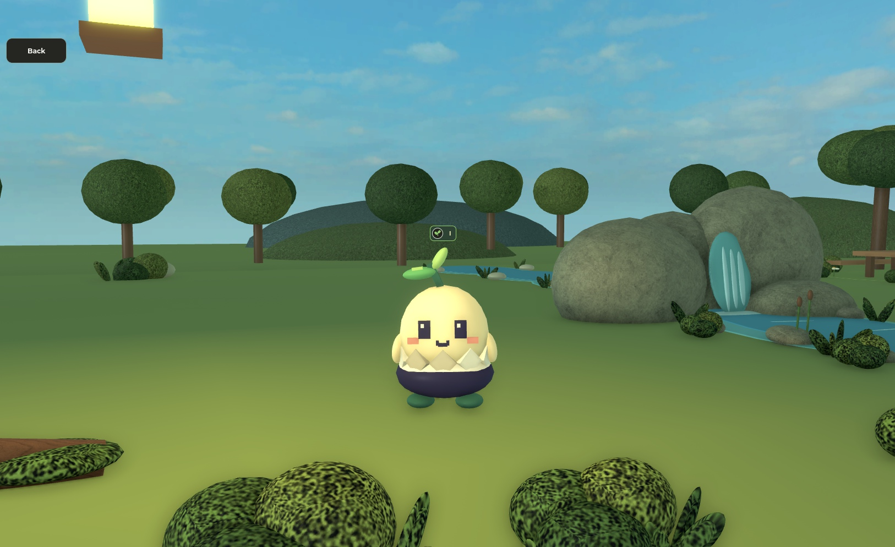

Actual solver-assisted inputs, not a human difficulty test. Server observed one hatch and one acknowledgement. Result X/reopen preserved the exact ID/bank/revision. [Structured evidence and limitations](station-integration-results.json).
