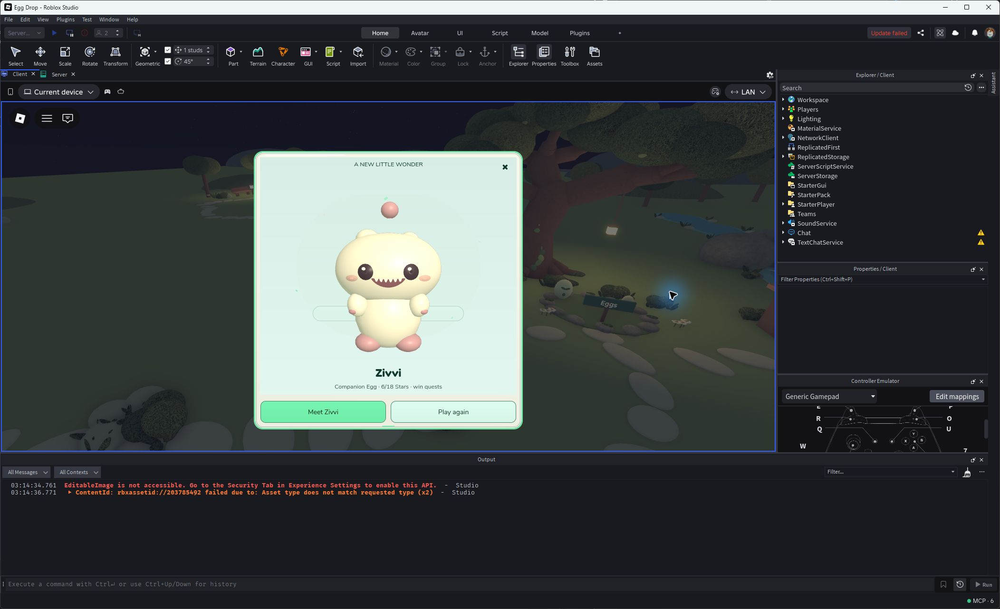
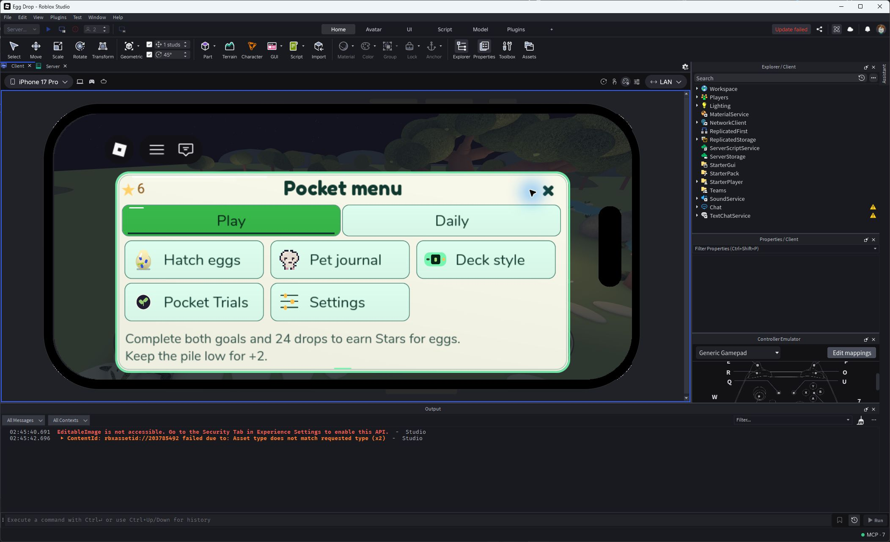
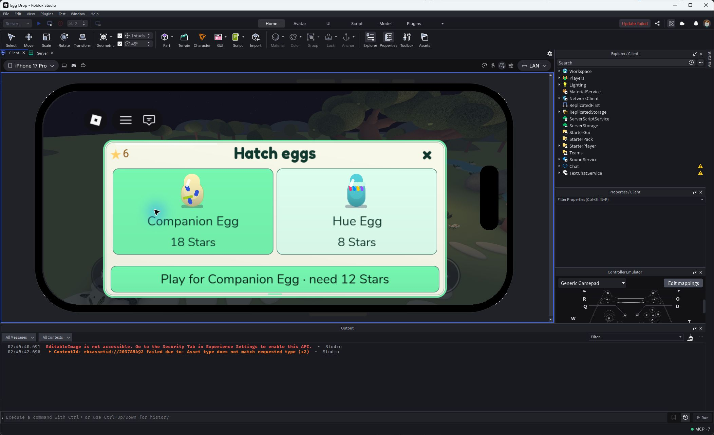
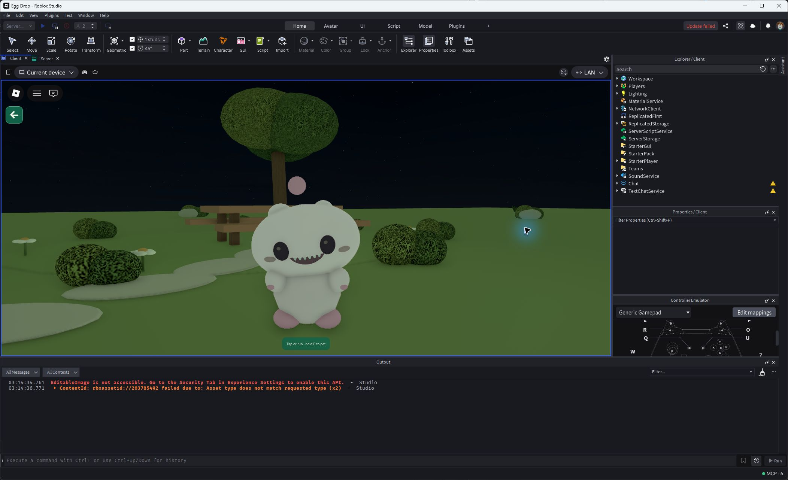
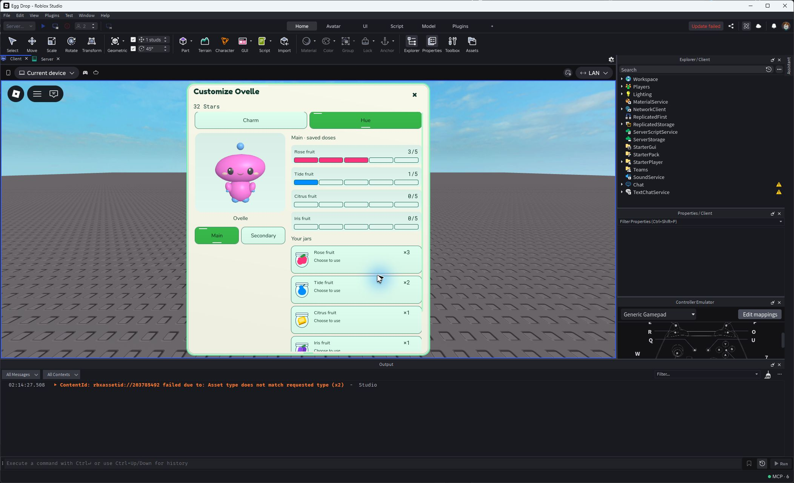
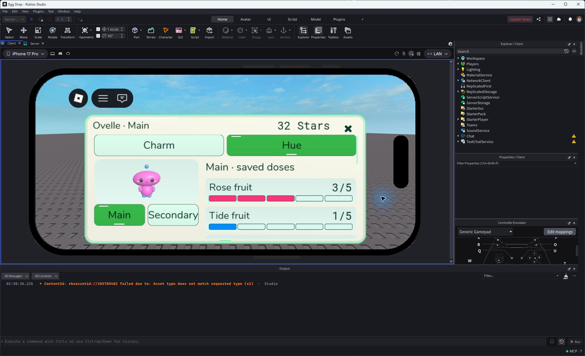
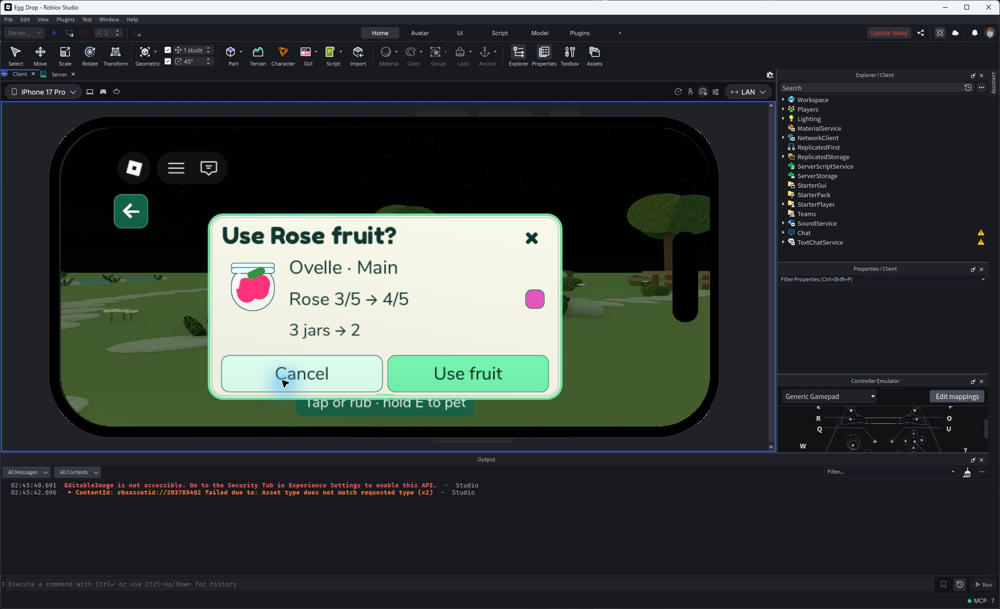
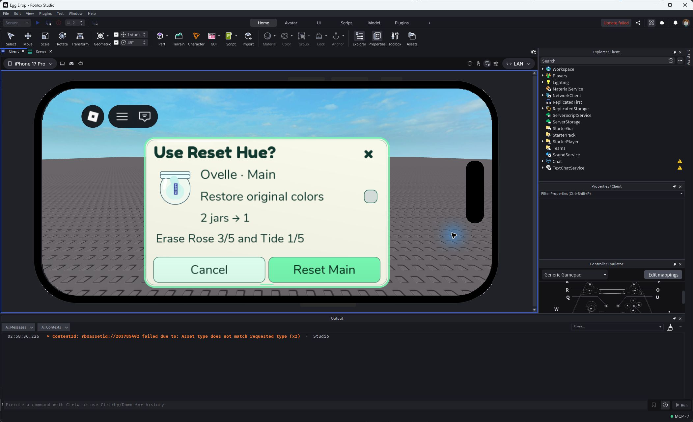
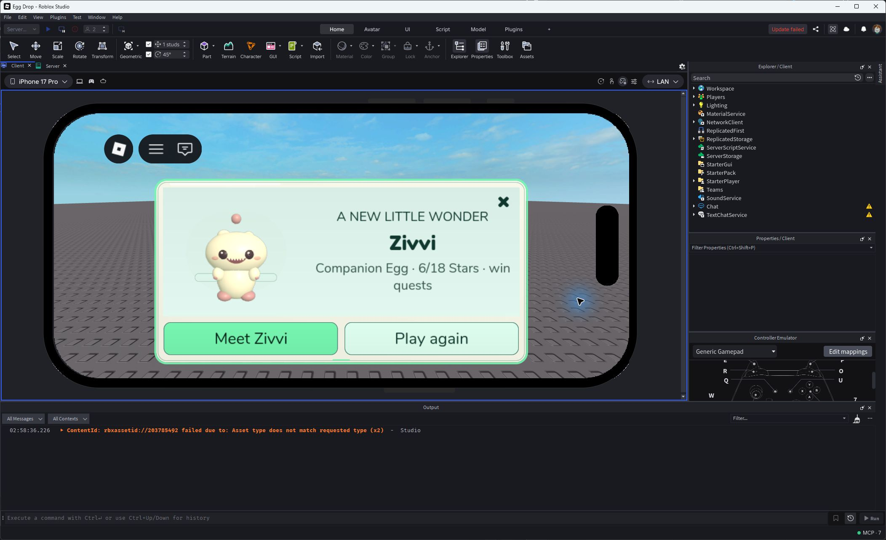
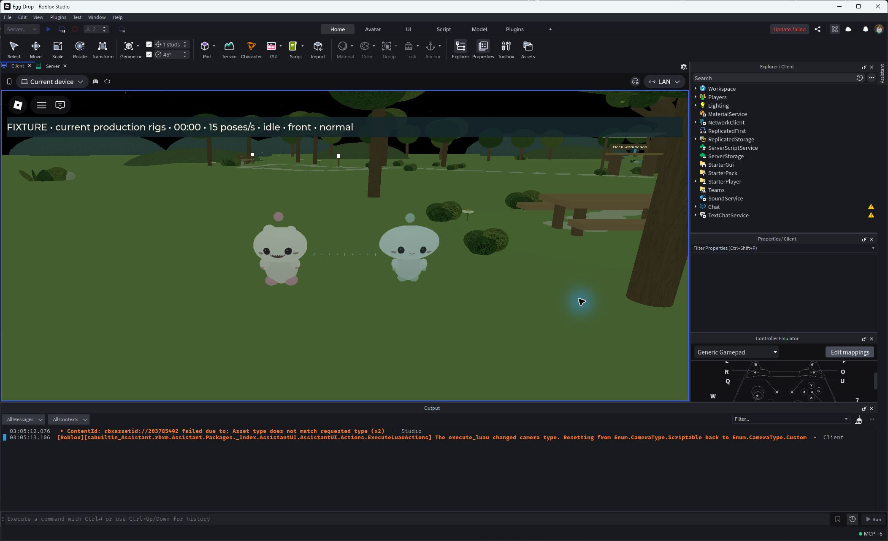

# Item eggs and Aero gallery

Native Studio screenshots. Phone images are emulation; FIXTURE images use injected snapshots or controlled renderer paths. Open on GitHub for relative image rendering, or use the absolute embeds in the morning chat.

[Final15Hz two-pet walking film](gait15-two-pet-weight-native-FIXTURE.mp4) · [12Hz comparator](gait12-native-FIXTURE.mp4) · [Continuous comparator](gait-continuous-native-FIXTURE.mp4).

[Exact tests and limitations](VERIFY.md). BEFORE/rejected images remain iteration evidence, not accepted output.
