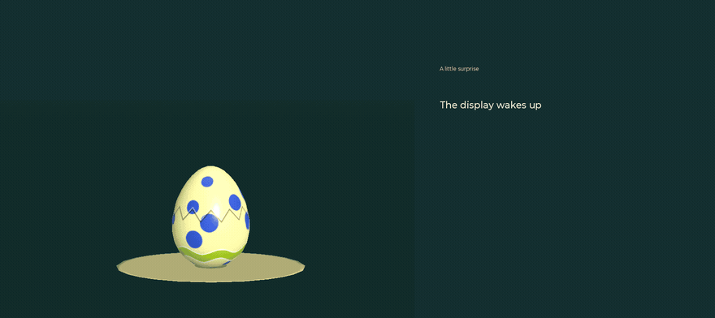
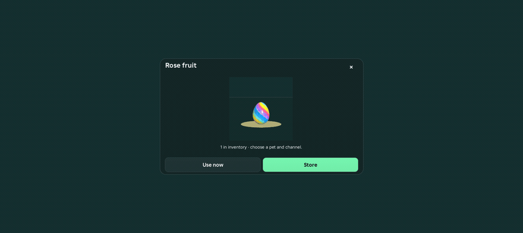
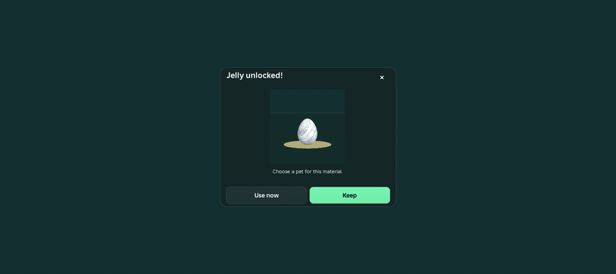
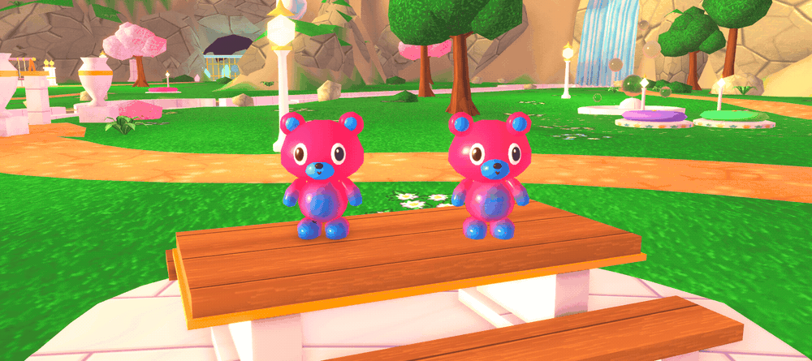
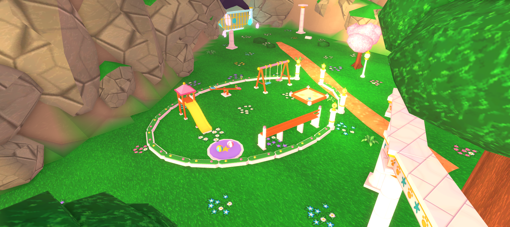
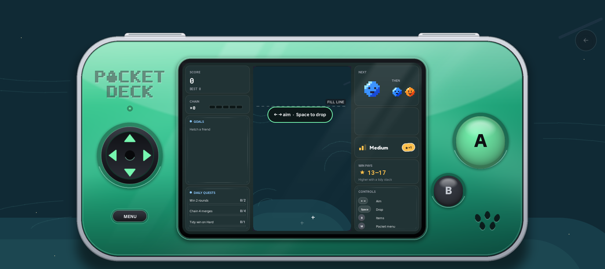

# Actual Roblox previews — private v685

Published privately November 14, 2026, after these previews were shown. [Play on phone](https://www.roblox.com/games/96451847774961/). The universe remains PRIVATE; phone and tablet are enabled. Current 72-second v3 garden/Deck music retained by Spencer's explicit choice. V4 stays a separate local audition.

## Bear hatch

[Watch with sound](bear-hatch-native.mp4).

## Toy hatch

[Watch with sound](toy-hatch-native.mp4).

## Hue and material hatches

[Hue with sound](hue-hatch-native.mp4).

[Material with sound](material-hatch-native.mp4). This receipt displays the actual production finish-sample mesh; Jelly on a pet is shown below.

## Jelly in the garden

**Left: Standard. Right: Jelly.** Same Rose/Tide colours, authored Bear meshes and real garden lighting/scenery. The comparison is standing on an existing garden bench, not a new display platform. Jelly body transparency independently read back as 0.15000000596, with NativeVerified BodyTwoToneJelly; the reference body is opaque.

[Video](jelly-garden-native.mp4) · [Still](jelly-garden-comparison.png).

## Other new visuals

Second Pet Park in the grove:

Moonpond applied through the real DeckArt background renderer on the existing handheld:

The build also contains the world overlap/collision fixes, shared fetch, interface/help/notification/price corrections, loss payout and First Toy fix recorded in the [QA walkthrough](../PRE-PUBLISH-QA.md).

## Capture and release evidence

These are actual Roblox-rendered frames from the production Cinematic/Scene/receipt and item hosts. Hatch clocks were stepped at 12 fps for recording; these are not Blender animatics. Synthetic saved receipts replay the visuals without a purchase, debit or acknowledgement. Approved current SFX files were muxed at their original timeline offsets. The Jelly turntable uses successive actual world captures, accelerated for the comparison. These previews establish what is rendered, not proof of an end-to-end server transaction or physical-device performance.

All temporary drivers, fake receipts, clones, camera overrides and preview-only background selection lived in Play and were removed by Stop before publishing. Final Edit check: 498 script containers compile, all 301 runtime sources match disk, zero capture helpers remain. Fresh engineering preflight: 23 pipeline tests pass, build passes, all 170 native collision payloads match. Prior native suite history remains 56 server / 36 client across initial runs and targeted reruns.

Translations synced: **59 add/update, 4 delete**; subsequent dry run 0/0. Studio Output confirmed publish success and “Add publish notes to v685”; post-publish Open Cloud readback confirmed PRIVATE and mobile/tablet enabled. [Publish screenshot](private-v685-publish.png) · [Release record](private-v685.json) · [Hatch capture metadata](hatch-capture-manifest.json).

Public release and actual phone/two-account/service acceptance remain open. Current server capacity is 50 in the place resource; the intended 12-player public-launch configuration still requires reconciliation before public launch. No public audience change was made.

Old-version server restart requested successfully (HTTP200), scoped to this place with closeAllVersions=false so new v685 servers are retained.
