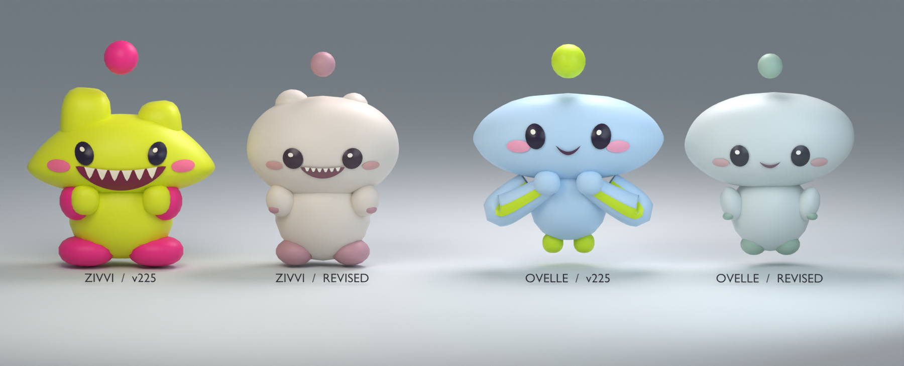

# Zivvi and Ovelle

These revised Blender rigs give Zivvi a warm porcelain body, two low crown bumps and six small milk teeth. Ovelle has a cool stone body, an asymmetric pebble head, two attached mittens and a gentle hover. Each source rig contains a neutral basis plus curious, startled, pleased, sleepy and affectionate expression morphs. The Studio renderer poses the semantic MeshParts directly.

| Revised FBX | Template meshes | Triangles | Body bounds, width × height × depth | Feet above origin |
|---|---:|---:|---|---:|
| Zivvi | 16 | 6,308 | 1.320 × 1.523 × 0.946 studs | 0.000 studs |
| Ovelle | 15 | 5,612 | 1.473 × 1.422 × 0.886 studs | 0.088 studs |

The two FBXs include their own separated, single-material mitten tip meshes. Each family’s mesh manifest gives the exact object name, animation channel, color role, paw-relative center and size. Each native recipe provides the fallback primitives, palette and pivots. Both formats use Roblox +Y up and authored +Z front. The Studio FBX import faces −Z and the adapter applies the existing half-turn. Ovelle’s cuff and hand pivots coincide so its accent moves with the mitten. The floating dot is optional and contributes only to visible camera clearance. [Validated import hashes and bounds](softening-import.json) · [Studio workflow](IMPORT.md)

The front, 35° three-quarter, 80° profile and expression sheet are genuine Blender renders of the revised geometry. [Front](garden-babies-front.png) · [Three-quarter](garden-babies-three-quarter.png) · [Profile](garden-babies-profile.png) · [Expressions](garden-babies-expressions.png)
